<div align="center">

# ⚔️ Guerra Ezuberante

### Política, poderes absurdos e batalhas caóticas dentro do Minecraft.

**Seis facções · Personagens com IA · Exércitos invocáveis · Multiplayer**


**Ezuberante é com z. Esse é o nome do mod.**

</div>

Guerra Ezuberante é um projeto de mod de Minecraft Java Edition em que personagens caricatos inspirados em figuras públicas entram em combate com habilidades absurdas, invocações, transformações, músicas e exércitos próprios. Vamos começar com uma entidade simples funcionando e evoluir até guerras entre facções em um servidor com amigos.

Este README reúne o design do jogo, as tecnologias propostas, a arquitetura pretendida e o caminho de desenvolvimento. Os ataques, nomes de poderes e eventos pertencem a uma sátira fictícia de videogame.

> **Estado atual — documentação e planejamento.** Ainda não existe projeto Java/Gradle, personagem implementado, sistema de facções ou JAR jogável. Os diagramas descrevem o funcionamento planejado. A versão do Minecraft e as dependências serão definidas antes da implementação. Arte, sprites e modelos serão trabalhados depois, com o autor.

## Navegação

- [Visão do jogo, facções e personagens](#visao)
- [Tecnologias: o que usaremos e por quê](#tecnologias)
- [Facção, classe e personagem](#conceitos)
- [Experiência do jogador](#experiencia)
- [Arquitetura do mod](#arquitetura)
- [Combate, habilidades e invocações](#combate)
- [Arte, modelos, animações e áudio](#arte)
- [Como vamos construir e testar](#desenvolvimento)
- [Roadmap e critérios de aceite](#roadmap)
- [Organização dos arquivos](#arquivos)
- [Decisões pendentes](#pendencias)
- [Documentos e referências](#referencias)

<a id="visao"></a>

## Conceito e direção

Transformar o Minecraft em um campo de batalha político caótico, multiplayer e completamente satírico. Personagens inspirados em figuras públicas terão poderes absurdos, exércitos próprios, invocações, alianças, músicas, transformações e habilidades especiais.

Os ataques, falas e relações descritos são caricaturas fictícias de videogame. As diferenças de poderes entre facções são escolhas de gameplay e balanceamento.

A estratégia de desenvolvimento é construir primeiro uma base que funcione, depois os personagens e, por fim, as batalhas gigantes. Cada marco deve funcionar antes da expansão seguinte.

Indicadores da visão original: seis facções iniciais, mais de onze personagens nomeados e primeiro marco de implementação chamado v0.001.

## Facção, classe e personagem

Três conceitos devem permanecer separados:

| Conceito | Significado | Exemplo |
| --- | --- | --- |
| Facção | Equipe, identidade e relações de aliados/inimigos | Direita Missão |
| Classe de combate | Arquétipo e função do jogador na batalha | Invocador |
| Personagem | Entidade independente com IA e conjunto de habilidades | Renan Santos |

Um jogador pode escolher Direita Missão, jogar de Invocador e utilizar poderes ligados ao Renan. Paralelamente, Renan pode existir como mob independente, invocado por spawn egg. Isso evita misturar a IA dos personagens com o controle das habilidades dos jogadores.

## As seis facções

| Facção | Identidade de gameplay | Conteúdo associado |
| --- | --- | --- |
| Esquerda Lulista | Invocações, comida e mortos-vivos | Lula, Janones, Boulos, artistas mainstream, burros zumbificados, feijão e meteoritos de picanha |
| Direita Bolsonarista | Aliados internacionais, bombas e ataques de dinheiro | Jair, Flávio e Eduardo Bolsonaro, Nikolas Ferreira, Donald Trump e Benjamin Netanyahu |
| Direita Missão | Invocação, transformação e cavalaria | Renan Santos, Arthur do Val, Glenda, nerds montados em onças e loiras ucranianas |
| Esquerda Independente | Defesa, suporte e poderes genéricos | Resistência em grupo, recuperação gradual de vida e controle de multidões |
| Direita Independente | Combate direto, precisão e poderes genéricos | Dano individual, velocidade e precisão |
| Centro | Versatilidade, negociação e poderes genéricos | Alternância adaptativa entre defesa, mobilidade e suporte |

As três primeiras são facções especiais, com líderes, habilidades próprias e tropas exclusivas. As três restantes são escolhas independentes com conjuntos básicos de habilidades.

### Seleção e persistência planejadas

- No primeiro ingresso no mundo, o jogador verá uma interface de escolha de facção.
- Jogadores da mesma facção serão aliados por padrão.
- Cada facção terá identificação visual, itens e efeitos próprios.
- A escolha será salva no mundo e continuará válida após desconectar e voltar ao servidor.
- O administrador poderá permitir mudanças de facção.

As regras completas de diplomacia, fogo amigo, troca de facção e progressão ainda precisam de detalhamento.

### Mapa de relações

O diagrama representa vínculos e conteúdo associado. Nem toda ligação representa uma invocação direta; as habilidades do catálogo esclarecem essas relações.

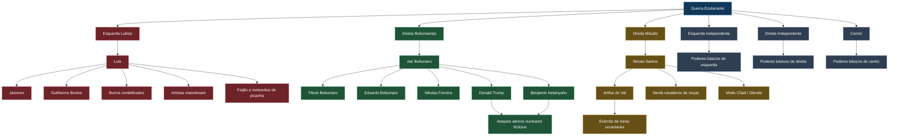

## Catálogo de personagens e habilidades

Todos os itens deste catálogo estão planejados. Dano, vida, alcance, duração, recarga, probabilidade de uso e limites de tropas ainda não receberam valores.

### Renan Santos

Facção: Direita Missão. Papel: boss, invocador e DPS (dano).

| Habilidade | Comportamento previsto |
| --- | --- |
| Me Respeita | Gira disparando projéteis em todas as direções, acompanhado de funk |
| Arthur do Val | Invoca Arthur; este poderá convocar seu próprio exército |
| Modo Chad | Ao negar a Glenda, recebe aumento de dano, velocidade e resistência, com aura visual |
| Cavalaria da Missão | Invoca nerds com lanças medievais montados em onças |
| Ultimate — Moggador Supremo | Combina rotação, disparos e cavalaria em uma sequência especial |

Renan é o personagem piloto sugerido no documento original. O autor ainda pretende definir e criar conosco o personagem inicial de teste e seus recursos visuais.

### Arthur do Val

Facção: Direita Missão. Papel: invocador e suporte ofensivo.

| Habilidade | Comportamento previsto |
| --- | --- |
| Exército Ucraniano | Invoca unidades de loiras ucranianas que atacam inimigos |
| São Fáceis Porque São Pobres | Nome de habilidade satírica no conceito; fala e bônus temporário de ataque para suas unidades |
| Reforços | Repõe parcialmente as tropas perdidas |
| Ultimate — Legião Ucraniana | Invoca uma formação maior de combatentes |

As unidades do exército terão modelo, comportamento e atributos próprios.

### Lula

Facção: Esquerda Lulista. Papel: boss, necromante e dano em área.

| Habilidade | Comportamento previsto |
| --- | --- |
| Dedos de Feijão | Dispara rajadas de feijões nos inimigos |
| Picanha Meteorítica | Faz chover meteoritos de picanha |
| Exército dos Mortos | Invoca burros zumbificados que perseguem inimigos |
| Convocação Política | Invoca Janones, Boulos e tropas caricatas de artistas mainstream |
| Ultimate — Chuva de Picanha | Bombardeio de área com diversos meteoritos |

### Jair Bolsonaro

Facção: Direita Bolsonarista. Papel: boss, comandante e controle.

| Habilidade | Comportamento previsto |
| --- | --- |
| Clã Bolsonaro | Invoca Flávio e Eduardo Bolsonaro |
| Reforço Conservador | Invoca Nikolas Ferreira |
| Aliança Internacional | Invoca Trump e Netanyahu |
| Funk Temporal | Coreografia com distorção visual do tempo e redução da velocidade dos inimigos |
| Ultimate — Caos Internacional | Combina dança, reforços e ataques explosivos dos aliados |

### Flávio Bolsonaro

Facção: Direita Bolsonarista. Papel: DPS e ataque à distância.

| Habilidade | Comportamento previsto |
| --- | --- |
| Rachadinha | Projéteis de dinheiro se dividem em duas partes durante o voo |
| Lula é Pobre | Provoca inimigos próximos e aumenta temporariamente o próprio dano |
| Chuva de Notas | Dispara múltiplos projéteis de dinheiro |

### Demais personagens, tropas e eventos

| Personagem ou unidade | Vínculo / papel | Mecânica prevista |
| --- | --- | --- |
| Janones | Suporte lulista | Provocação e fortalecimento de aliados |
| Guilherme Boulos | Tanque lulista | Defesa e combate corpo a corpo |
| Eduardo Bolsonaro | Reforço bolsonarista | Ataques e bônus de equipe |
| Nikolas Ferreira | Suporte bolsonarista | Buffs e provocações |
| Donald Trump | Boss invocável, aliado bolsonarista | Bombardeios aéreos fictícios |
| Benjamin Netanyahu | Boss invocável, aliado bolsonarista | Bombardeios fictícios em área |
| Nerds montados em onças | Cavalaria da Missão | Investida com lanças |
| Loiras ucranianas | Exército de Arthur | Formação e combate em grupo |
| Burros zumbificados | Exército de Lula | Ataques em massa |
| Artistas mainstream | Tropas lulistas | Suporte e efeitos sonoros |
| Glenda | NPC de evento ligado ao Renan | Evento que ativa a transformação Chad |

## Classes jogáveis

| Classe | Função | Características |
| --- | --- | --- |
| Combatente | Dano direto | Ataques rápidos e combos |
| Tanque | Resistência | Vida alta, escudos e provocação |
| Invocador | Controle de tropas | Criação de aliados temporários |
| Especialista | Poderes especiais | Projéteis, efeitos e manipulação de área |
| Suporte | Fortalecimento | Cura, buffs e proteção |

Qualquer facção poderá utilizar os arquétipos; as habilidades disponíveis dependerão da combinação entre facção e classe. Um Invocador da Missão terá tropas diferentes das de um Invocador Lulista. Um Combatente da Direita Independente usará poderes genéricos, sem receber automaticamente os especiais de Bolsonaro.

Ainda não há uma matriz completa de habilidades para cada combinação.

## Modos de jogo e expansão

### Laboratório político — criativo

Modo prioritário para desenvolver e testar. Os spawn eggs ficarão disponíveis em uma aba exclusiva chamada **Guerra Ezuberante**, permitindo invocar personagens, montar batalhas e testar habilidades. A disponibilidade será ampliada conforme cada entidade for implementada.

### Guerra de facções — multiplayer

Jogadores escolhem uma facção, recebem poderes e enfrentam outras equipes. O modo prevê regras de aliados e inimigos, progressão e habilidades especiais.

### Ideias futuras

Batalhas de chefes, arenas eleitorais, guerras entre facções e campanhas com missões. Essas ideias ainda não têm especificação detalhada nem marco reservado.

<a id="tecnologias"></a>

## Tecnologias: o que usaremos e por quê

As tecnologias abaixo compõem a base proposta. Escolheremos as versões em conjunto, verificando a compatibilidade com a versão alvo do Minecraft. Os badges identificam ferramentas e formatos; não significam que já estejam instalados ou configurados.

### Base do mod

| Tecnologia | Para que serve | Por que usar neste projeto | Situação |
| --- | --- | --- | --- |
|  | Plataforma em que existirão as entidades, os itens e as batalhas | Integrar os personagens ao mundo, ao inventário criativo e ao multiplayer | Versão pendente |
|  | Programar entidades, IA, poderes e regras | Organizar comportamentos compartilhados e a lógica do mod na plataforma escolhida | Versão do JDK pendente |
|  | API e infraestrutura para integrar o mod ao Minecraft | Base proposta para registros, entidades, itens e eventos | Proposto; versão pendente |
|  | Organizar compilação, dependências e empacotamento | Reproduzir o build e gerar o JAR a partir do projeto versionado | Configuração futura |

NeoForge é a API de modding escolhida na proposta original; sua documentação será a referência da integração com o jogo. [Documentação oficial do NeoForge](https://docs.neoforged.net/).

A proposta de build inclui versionar o Gradle Wrapper para o próprio projeto definir a versão da ferramenta. Essa versão será escolhida conforme o conjunto compatível de dependências. [Conceitos do Gradle](https://docs.gradle.org/current/userguide/gradle_basics.html), [Gradle Wrapper](https://docs.gradle.org/current/userguide/gradle_wrapper.html).

### Conteúdo, arte e animação

| Tecnologia | Para que serve | Por que usar neste projeto | Situação |
| --- | --- | --- | --- |
|  | Criar modelos, texturas e animações | Ferramentas de modelagem com poucos polígonos, pintura e animação para desenvolver a identidade dos personagens | Etapa posterior |
|  | Executar animações mais elaboradas | Poderá atender giros, danças, transformações e sequências de ataque por keyframes | Opcional |
|  | Descrever dados e recursos nos formatos definidos | Ajustar parâmetros suportados sem espalhar valores fixos por várias classes | Esquema futuro |

Blockbench possui ferramentas de modelos, texturas e animação. GeckoLib é uma biblioteca de animação para mods; a necessidade de usá-la dependerá dos modelos e dos movimentos desejados. [Blockbench](https://www.blockbench.net/), [GeckoLib](https://github.com/bernie-g/geckolib).

Os dados personalizados em JSON precisarão de leitores e validação implementados pelo mod. JSON poderá configurar os comportamentos suportados; comportamentos novos continuarão exigindo programação. Os recursos do Minecraft seguirão os formatos da versão alvo.

### Versionamento e documentação

| Tecnologia | Para que serve | Por que usar neste projeto | Situação |
| --- | --- | --- | --- |
|  | Registrar alterações e histórico | Comparar mudanças e recuperar uma base funcional | Em uso |
|  | Hospedar projeto e documentação | Centralizar o trabalho e acompanhar a evolução | Em uso |
|  | Escrever README, design e contexto | Manter o planejamento legível e versionado com o código | Em uso |
|  | Descrever fluxos e arquitetura em texto | Atualizar os diagramas junto das decisões do projeto | Em uso |

Os diagramas usam blocos Mermaid, formato renderizado pelo GitHub em arquivos Markdown. [Diagramas no GitHub](https://docs.github.com/en/get-started/writing-on-github/working-with-advanced-formatting/creating-diagrams).

O editor ficará a critério do autor. IntelliJ foi sugerido no documento inicial; a construção do mod não depende dessa escolha. Um quadro de tarefas poderá ser criado depois para acompanhar as entregas.

### Como as ferramentas se encaixam

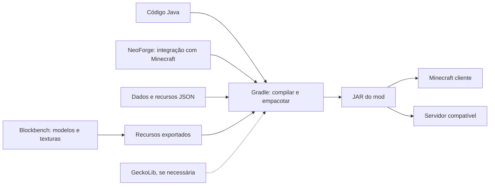

Esse é o caminho pretendido de compilação e distribuição. Os formatos de exportação e as dependências serão escolhidos antes de conectar arte e código.

<a id="conceitos"></a>

## Como facção, classe e personagem se conectam

A facção define o grupo e o repertório temático. A classe define a função de combate. O personagem é uma entidade independente com IA. A separação permite que jogadores e mobs utilizem habilidades compartilhadas, com formas diferentes de controle.

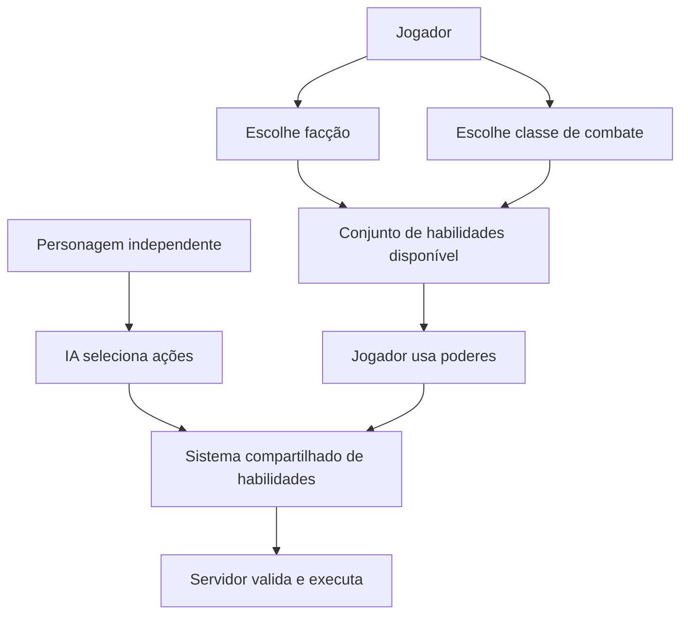

**Exemplo planejado:** um jogador da Missão e da classe Invocador poderá utilizar tropas ligadas à facção. Renan, quando invocado no mundo, será outro agente de combate com decisões próprias. A presença de Renan não transforma automaticamente o jogador nele.

Os papéis de boss, invocador e suporte do catálogo descrevem os personagens. A interface e as regras de seleção de classe dos jogadores ainda precisam ser detalhadas.

<a id="experiencia"></a>

## Experiência do jogador

### Entrada na guerra de facções

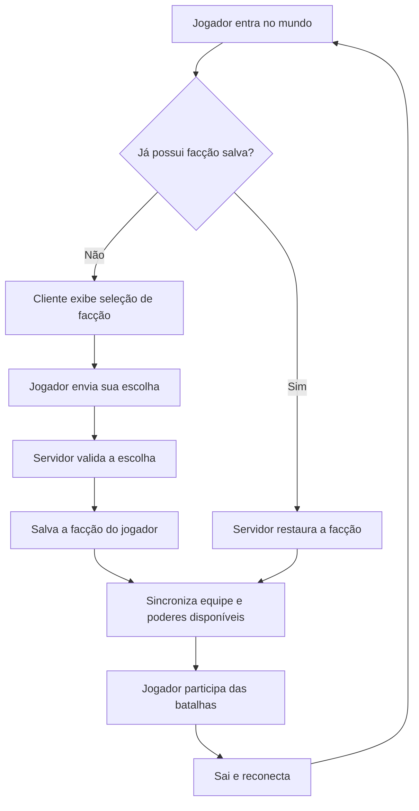

Esse é o fluxo pretendido do modo de facções. Escolhas inválidas, fechamento da seleção e permissões de troca precisarão de regras na implementação.

### Dois caminhos de uso

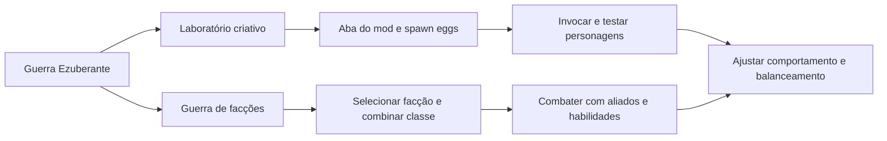

O laboratório será a primeira experiência funcional. A guerra multiplayer completa depende das entidades, dos poderes, das relações entre equipes e da persistência desenvolvidos nos marcos anteriores.

<a id="arquitetura"></a>

## Arquitetura do mod

Vamos separar registros de conteúdo, regras de jogo, habilidades, rede e apresentação. A estrutura deverá permitir acrescentar personagens sem reescrever o funcionamento de todos os outros.

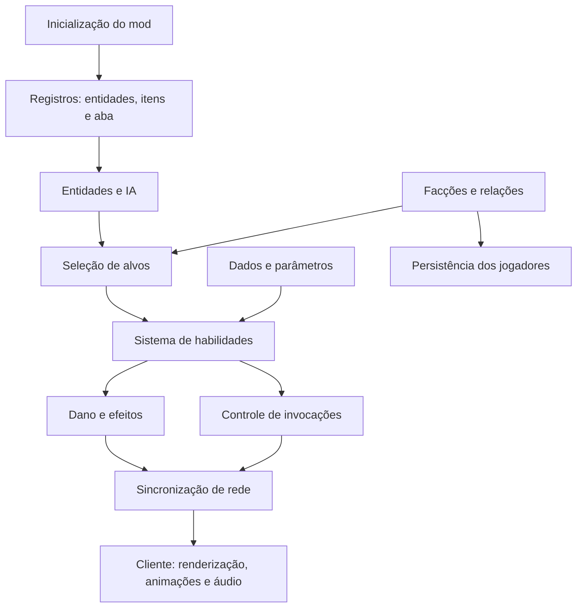

### Responsabilidade dos módulos

| Módulo proposto | Responsabilidade | Exemplo |
| --- | --- | --- |
| `registry` | Registrar conteúdo reconhecido pelo jogo | Renan, spawn egg e aba criativa |
| `entity` | Vida, movimento, IA e comportamento | Perseguir e atacar um alvo |
| `faction` | Identidade, equipes e dados de facção | Identificar aliados e inimigos |
| `ability` | Contrato e execução de poderes reutilizáveis | Me Respeita com condições e recarga |
| `combat` | Alvos, dano e gerenciamento de tropas | Aplicar dano e limitar invocações |
| `client` | Renderizadores, modelos, animações e interfaces | Exibir aura e seleção de facção |
| `network` | Comunicar intenções e estados necessários | Solicitar um poder e sincronizar seu resultado |
| Recursos e dados | Texturas, modelos, áudio, traduções e parâmetros | Aparência e dados dos personagens |

A primeira versão conterá apenas as partes necessárias ao piloto. A arquitetura será ampliada quando o comportamento exigir.

### Cliente e servidor

| Servidor: decide e mantém o estado | Cliente: apresenta e envia intenções |
| --- | --- |
| Valida facção, alvo, alcance, condições e recarga | Exibe interfaces e captura entradas do jogador |
| Calcula e aplica dano e efeitos | Renderiza personagens, projéteis e partículas |
| Cria, controla e remove tropas | Executa animações e áudio conforme os estados recebidos |
| Mantém dados persistentes | Apresenta facção e indicadores necessários |

Para personagens controlados pela IA, a decisão nasce no servidor. Para jogadores, o cliente envia uma intenção e o servidor valida antes de executar.

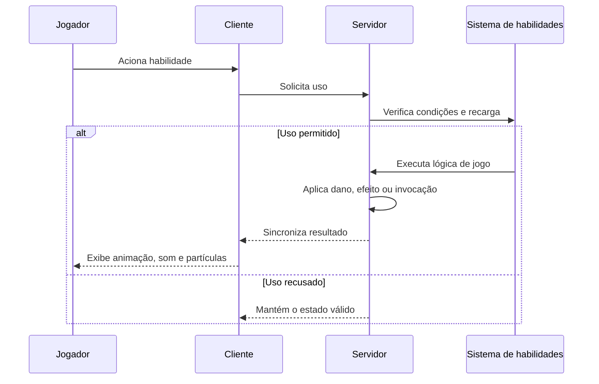

<a id="combate"></a>

## Combate, habilidades e invocações

### Habilidades e autoridade do servidor

Cada habilidade poderá configurar dano, alcance, recarga, duração e quantidade máxima de invocações.

O servidor será responsável por validar ataques, calcular dano e criar invocações. Os clientes apresentarão animações, sons, partículas e interfaces, com sincronização dos efeitos relevantes.

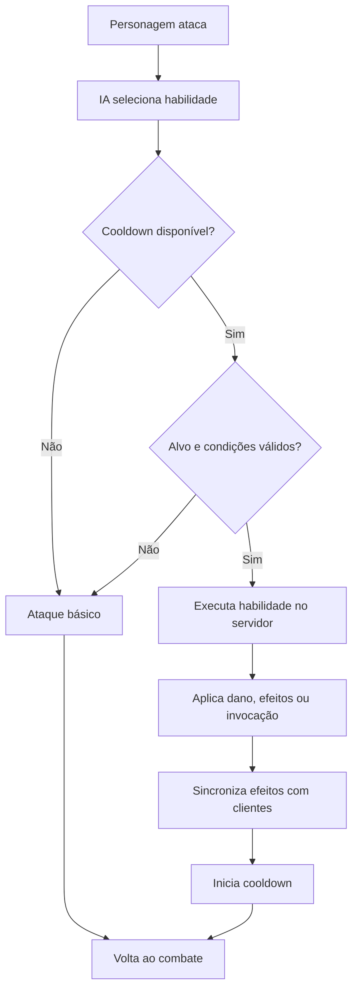

### Limites técnicos previstos

- Invocações com duração e quantidade máxima configuráveis.
- Ataques nucleares tratados como efeitos fictícios de videogame, sem destruição permanente de blocos por padrão.
- Distorção temporal aplicada a entidades e efeitos visuais, preservando o relógio global do servidor.
- IA evitando buscar todos os mobs desnecessariamente a cada tick.
- Gerenciador de áudio para músicas e falas.
- Sons originais ou com permissão para distribuição do mod, conforme previsto no material.

Limites concretos de entidades, intervalos de busca e metas de desempenho serão definidos com testes.

### Parâmetros de uma habilidade

| Parâmetro planejado | O que controla | Exemplo conceitual |
| --- | --- | --- |
| Identificador | Comportamento acionado | Giro do Renan |
| Dano | Impacto sobre o alvo | Dano de um projétil |
| Alcance / área | Onde o poder pode atingir | Distância de disparo ou raio de impacto |
| Cooldown | Intervalo mínimo entre usos | Tempo até o próximo giro |
| Duração | Tempo de um efeito | Duração do Modo Chad |
| Condições | Requisitos de uso | Ter inimigo válido no alcance |
| Limite de tropas | Quantidade máxima de invocações | Teto de unidades de Arthur |
| Apresentação | Efeitos e recursos associados | Animação, aura e som |

Isso orienta o design; ainda não há esquema JSON implementado. Os valores serão definidos com testes de combate.

### Ciclo de combate de uma entidade

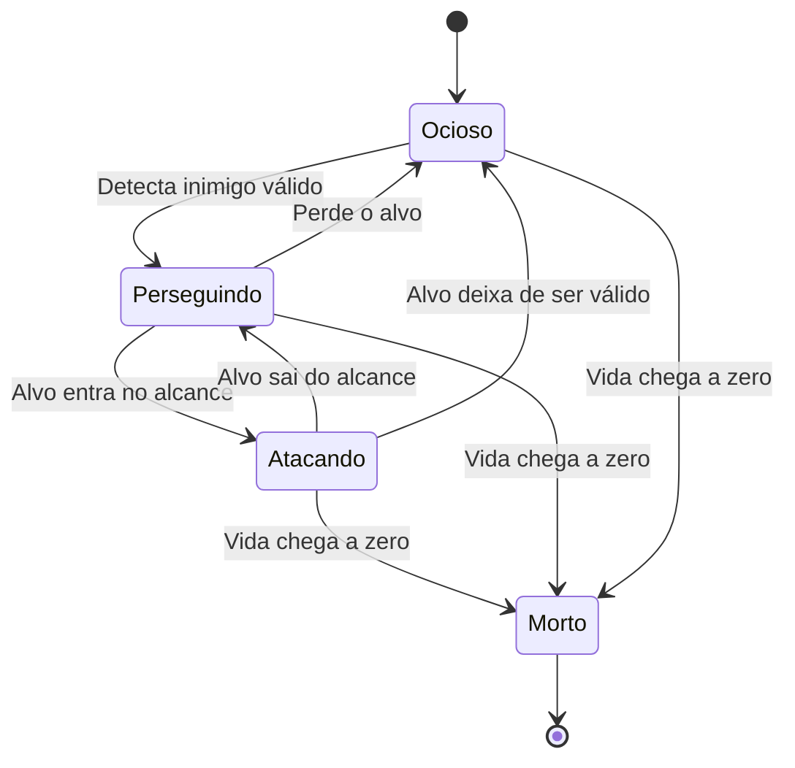

Esse modelo simplifica o comportamento para orientar os testes. Durante o ataque, o sistema escolhe entre habilidade disponível e ataque básico.

### Ciclo de uma invocação

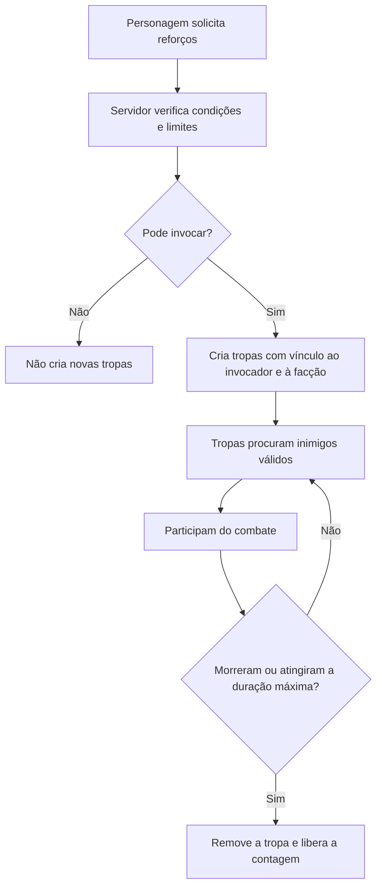

O sistema deverá rastrear invocador, facção, duração e quantidade de tropas. O comportamento após morte ou desconexão do invocador ainda será definido. Invocações encadeadas, como Renan → Arthur → exército, também precisarão respeitar limites.

### Desempenho e limites

| Situação | Abordagem planejada | Como verificar depois |
| --- | --- | --- |
| Muitas tropas | Limitar duração e quantidade | Aumentar grupos gradualmente no servidor |
| Busca de inimigos | Buscar em área local e em intervalos adequados | Observar custo da IA em batalhas |
| Projéteis e partículas | Controlar tempo de vida e apresentação | Testar poderes isolados e combinados |
| Bombardeios | Separar dano de destruição de blocos | Conferir dano e preservação da arena |
| Dança temporal | Afetar entidades e efeitos visuais | Verificar estabilidade da simulação global |
| Músicas sobrepostas | Gerenciar início, fim e sobreposição | Ativar vários personagens simultaneamente |

Metas numéricas de desempenho e limites serão definidos quando houver um protótipo mensurável.

<a id="arte"></a>

## Arte, sprites, modelos e áudio

O autor quer criar os recursos dos personagens em uma etapa posterior, começando por um personagem inicial de teste.

O formato visual ainda está em aberto: skins/texturas podem ser aproveitadas com um modelo compatível; uma imagem 2D pode exigir adaptação de modelo ou renderização como sprite plano. A escolha entre essas opções será feita quando houver referências e requisitos de animação.

As imagens anexadas nesta etapa são diagramas de conceito e uma captura de indicadores, não sprites, texturas ou modelos prontos para o Minecraft.

Nenhuma música, fala, textura ou animação foi produzida ou importada como recurso do mod nesta etapa.

### Caminho da arte até o jogo

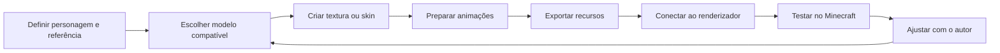

O primeiro teste poderá utilizar uma aparência provisória combinada com o autor. Recursos definitivos serão desenvolvidos junto do personagem. A ficha visual reunirá modelo, textura, animações, efeitos e sons; cada recurso será validado quando aparecer corretamente no jogo.

<a id="desenvolvimento"></a>

## Como vamos construir e testar

Cada etapa deverá produzir um resultado observável. Primeiro, um personagem aparece no mundo; depois ele enfrenta um alvo, usa um poder e participa de uma batalha contra outro personagem.

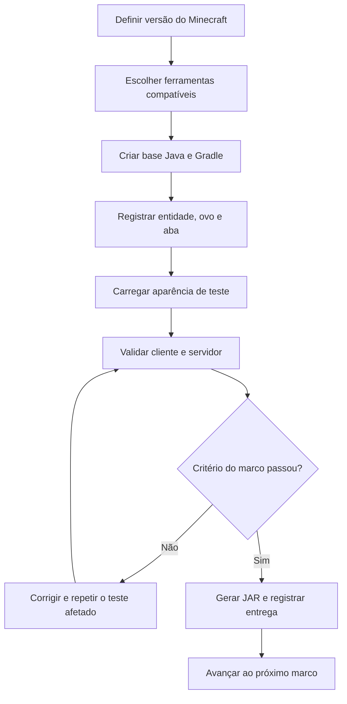

### Etapas práticas

1. **Definir a plataforma:** escolher Minecraft, Java, NeoForge e Gradle compatíveis.
2. **Criar a base mínima:** projeto compila e carrega no ambiente de desenvolvimento.
3. **Adicionar o piloto:** entidade, atributos, spawn egg e aba Guerra Ezuberante.
4. **Validar a apresentação:** renderizador e aparência provisória ou modelo preparado com o autor.
5. **Construir o combate:** detectar, perseguir, atacar, receber dano e morrer.
6. **Adicionar um poder completo:** condições, recarga, execução no servidor e efeitos no cliente.
7. **Adicionar um adversário:** primeira batalha automática entre facções diferentes.
8. **Expandir os sistemas:** seleção, persistência, tropas e personagens.
9. **Integrar e polir:** limites, balanceamento e alpha para os amigos.

### Plano de validação

| Área | Verificação planejada | Evidência esperada |
| --- | --- | --- |
| Build | Compilar e empacotar com o Wrapper | JAR gerado a partir do código versionado |
| Inicialização | Abrir cliente e iniciar servidor dedicado compatível | Sem falha de registro ou dependência de renderização no servidor |
| Invocação | Usar ovo e comando | Entidade aparece com atributos e aparência esperados |
| IA | Navegar até um alvo válido | Personagem se move e reage |
| Combate | Aplicar e receber dano, concluir morte | Resultado consistente no servidor |
| Poderes | Verificar alvo, alcance e cooldown | Sem dano duplicado ou repetição indevida |
| Multiplayer | Observar ações em clientes conectados | Estados e efeitos relevantes sincronizados |
| Persistência | Sair e reconectar após escolher facção | Escolha recuperada |
| Desempenho | Aumentar tropas e poderes | Limites funcionam e gargalos são identificáveis |

Essas verificações serão aplicadas conforme as funcionalidades existirem. Ainda não há resultados de testes de gameplay.

### Definição de uma entrega concluída

Cada marco deverá apresentar o comportamento previsto, passar pela validação adequada e ter a documentação atualizada. Compilar faz parte do processo; o funcionamento das entidades e dos poderes também precisará ser observado no jogo.

As instruções executáveis de instalação e build serão acrescentadas quando houver projeto Gradle e versões definidas.

<a id="roadmap"></a>

## Roadmap proposto

As versões abaixo são rótulos do planejamento original, ainda sem releases. A numeração poderá ser padronizada antes da configuração do projeto. Não há prazos de calendário: a duração depende de IA, recursos visuais e testes.

| Sprint / versão | Escopo | Critério de aceite previsto |
| --- | --- | --- |
| 01 — v0.001 | Base Java/NeoForge/Gradle, entidade piloto Renan, modelo/textura, spawn egg, aba criativa, movimentação, comando e primeiro JAR | Abrir o Minecraft, pegar o ovo na aba do mod, invocar o personagem com aparência correta e vê-lo mover-se sem erros; validar cliente e servidor |
| 02 — v0.002 | IA e combate básico: detectar, perseguir, atacar, receber dano e morrer | Renan enfrenta um zumbi ou alvo de teste sem travar |
| 03 — v0.003 | Ataque giratório, projéteis, cooldown, efeitos simples e primeira animação de combate | Habilidade automática respeita a recarga e causa dano no servidor |
| 04 — v0.004 | Lula, spawn egg, feijões e identificação básica de facções inimigas | Renan e Lula se reconhecem como inimigos e lutam automaticamente |
| 05 — v0.005 | Tela de seleção, seis facções, poderes genéricos, persistência e alianças | Escolha do jogador permanece ao reconectar |
| 06 — v0.006 | Arthur, loiras ucranianas, cavalaria de onças e evento da Glenda | Renan convoca reforços que identificam e atacam inimigos corretamente |
| 07 — v0.007 | Janones, Boulos, burros zumbificados, artistas e meteoritos de picanha | Lula enfrenta um grupo de invocações da Missão |
| 08 — v0.008 | Bolsonaro, Flávio, Eduardo, Nikolas, dinheiro dividido e dança temporal | Reforços e efeitos bolsonaristas funcionam e são sincronizados |
| 09 — v0.009 | Trump, Netanyahu, bombardeios, explosões visuais e habilidades combinadas | Ataques de área funcionam preservando o desempenho do servidor |
| 10 — v0.010 | Integração de poderes, sons, interfaces, limites de invocação e balanceamento | Três facções lutam numa arena multiplayer sem erros críticos |
| 11 — v0.1.0 | Alpha: polimento, otimização, instalação, documentação e correções | Amigos conseguem reproduzir o mod no cliente e servidor com a mesma versão |

### Checklist futuro da v0.001

- [ ] Criar o projeto Java com NeoForge e Gradle, após definir as versões.
- [ ] Registrar a entidade piloto, proposta como Renan Santos.
- [ ] Carregar modelo e textura definidos com o autor.
- [ ] Criar o spawn egg exclusivo da entidade.
- [ ] Criar a aba Guerra Ezuberante no inventário criativo.
- [ ] Implementar movimentação e animação básica.
- [ ] Permitir invocação por ovo e comando.
- [ ] Executar testes no cliente e no servidor.
- [ ] Gerar o primeiro arquivo `.jar`.

O primeiro marco comprova a infraestrutura. Funk, exércitos, meteoritos e poderes especiais ficam nos marcos posteriores.

O documento original pressupõe recursos visuais fornecidos. Como o pedido atual adia sua criação, será preciso combinar uma aparência provisória ou preparar a arte antes de considerar o critério visual desse marco concluído.

### Dependência entre os marcos

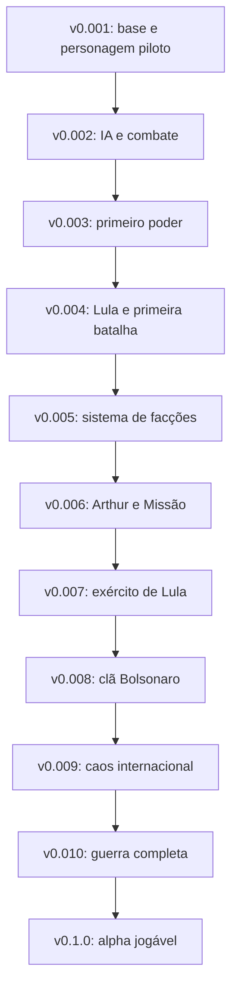

<a id="arquivos"></a>

## Organização dos arquivos

### Estrutura atual

```text
GUERRA/
├── README.md                     # Documentação principal no GitHub
├── CONTEXTO.md                   # Resumo para retomar o trabalho
└── docs/
    ├── IDEIA_GERAL.md            # Consolidação inicial do design
    └── referencias/
        ├── ideia-original.txt
        ├── faccoes-e-personagens.png
        ├── fluxo-de-habilidades.png
        └── visao-inicial.png
```

### Estrutura futura da implementação


Adaptação da árvore original ao nome atual. `guerra_ezuberante`, `br.com.guerraezuberante` e os nomes das classes abaixo são propostas; nenhum desses arquivos foi criado nesta etapa. Criar apenas os módulos necessários a cada marco.

```text
src/main/java/br/com/guerraezuberante/
├── GuerraEzuberanteMod.java
├── registry/
│   ├── ModEntities.java
│   ├── ModItems.java
│   └── ModCreativeTabs.java
├── entity/
│   ├── PoliticalMobEntity.java
│   ├── RenanEntity.java
│   ├── LulaEntity.java
│   ├── BolsonaroEntity.java
│   └── summons/
├── faction/
│   ├── Faction.java
│   ├── FactionManager.java
│   └── PlayerFactionData.java
├── ability/
│   ├── Ability.java
│   ├── AbilityManager.java
│   ├── AbilityContext.java
│   └── implementations/
├── combat/
│   ├── CombatManager.java
│   ├── TargetingService.java
│   └── SummonManager.java
├── client/
│   ├── renderer/
│   ├── model/
│   ├── animation/
│   └── gui/
└── network/
    └── packets/

src/main/resources/
├── assets/guerra_ezuberante/
│   ├── textures/
│   ├── models/
│   ├── animations/
│   ├── sounds/
│   └── lang/
└── data/guerra_ezuberante/
    └── characters/

gradle/
build.gradle
README.md
```

Uma entidade-base compartilhada poderá reunir comportamentos comuns. Subclasses específicas só serão necessárias para diferenças reais de comportamento. O sistema de habilidades deverá permitir ampliar personagens sem duplicar todo o código.

### Manutenção da documentação

| Arquivo | Papel |
| --- | --- |
| `README.md` | Documentação principal da ideia, tecnologias, funcionamento e construção do mod |
| `CONTEXTO.md` | Decisões, pendências e estado recente para retomar o trabalho |
| `docs/IDEIA_GERAL.md` | Consolidação inicial que serviu de base ao planejamento |
| `docs/referencias/` | Fontes originais e imagens recebidas |

O README deverá acompanhar as funcionalidades implementadas. Mudanças de design serão registradas para distinguir a proposta inicial das decisões novas.

<a id="pendencias"></a>

## Decisões pendentes e próximos passos

| Decisão | Estado atual | Quando resolver |
| --- | --- | --- |
| Nome público | **Guerra Ezuberante**, com z | Definido |
| Versão do Minecraft | Em aberto | Antes do projeto Java |
| Java, NeoForge e Gradle | Sem versões fixadas | Junto da plataforma alvo |
| Personagem piloto | Renan Santos é a proposta original | Antes da primeira entidade |
| Identificador técnico | `guerra_ezuberante` é uma proposta | Na criação do projeto |
| Pacote Java | `br.com.guerraezuberante` é uma proposta | Na criação do projeto |
| Aparência inicial | A combinar com o autor | Antes da validação visual |
| GeckoLib | Opcional | Ao definir animações |
| Atributos e recargas | Sem valores definidos | Nos testes de combate |
| Fogo amigo e alianças | Aliados da mesma facção por padrão; detalhes pendentes | Ao implementar facções |
| Troca de facção | Permissão administrativa prevista; regras pendentes | Ao criar seleção e persistência |
| Progressão | Prevista, sem especificação | Antes de expandir a guerra |
| Limites de tropas | Configuráveis, sem números fixados | Ao implementar invocações |
| Distribuição e instalação | Sem release disponível | Após um JAR validado |

O próximo passo de implementação será definir a versão do Minecraft e preparar a base para um personagem de teste. Sprites e demais recursos visuais serão construídos em conjunto nas etapas seguintes.

<a id="referencias"></a>

## Documentos e referências

- [Contexto resumido](CONTEXTO.md).
- [Documento inicial de ideia e design](docs/IDEIA_GERAL.md).
- [Texto original recebido](docs/referencias/ideia-original.txt).
- [Diagrama original de facções e personagens](docs/referencias/faccoes-e-personagens.png).
- [Diagrama original de habilidades](docs/referencias/fluxo-de-habilidades.png).
- [Captura dos indicadores iniciais](docs/referencias/visao-inicial.png).

As fontes históricas usam “Guerra Política”. O nome atual da interface, documentação e conteúdo público é **Guerra Ezuberante**. Propostas de implementação nas fontes são referências de planejamento; a etapa atual é de documentação.

<details>
<summary>Ver os diagramas originais recebidos</summary>

### Facções e personagens

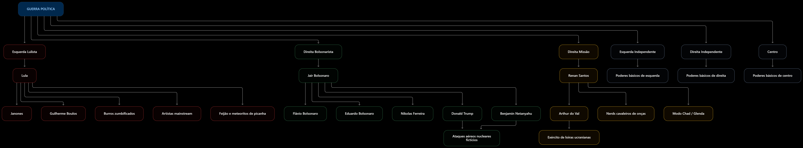

### Fluxo de habilidades

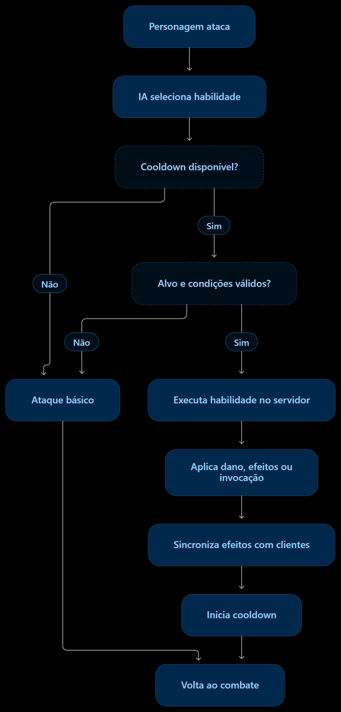

### Indicadores do conceito inicial

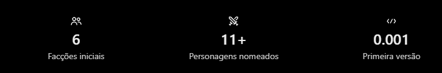

</details>

---

Planejamento documentado em **24/10/2026**. O roadmap descreve objetivos futuros e evoluirá conforme os primeiros testes no Minecraft.
