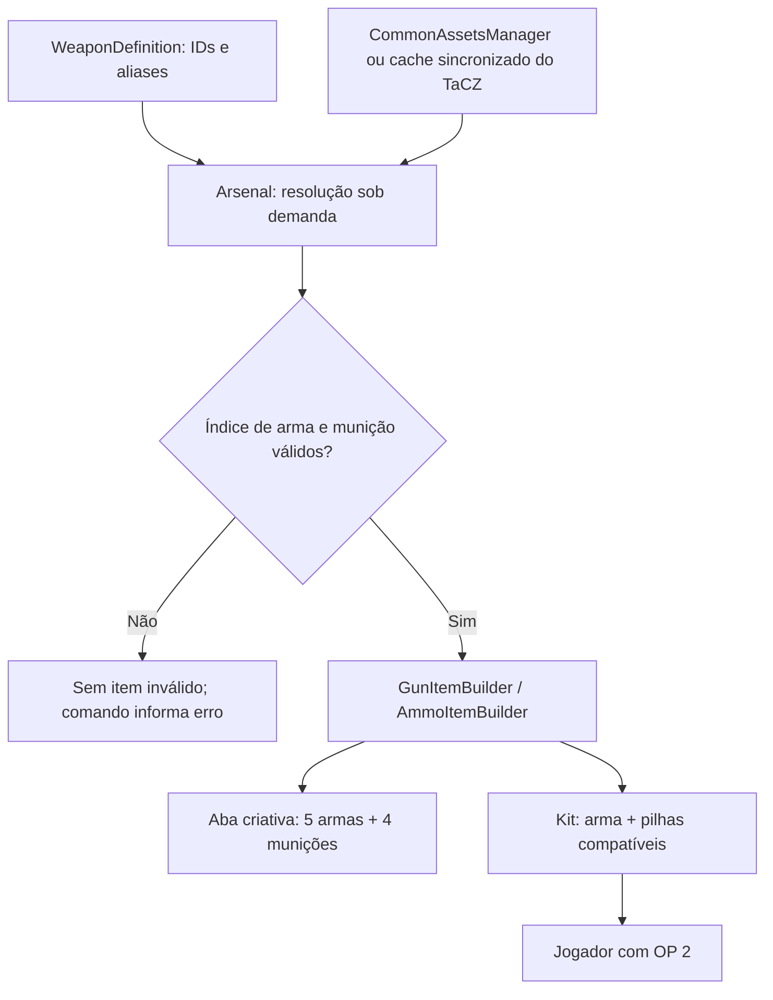
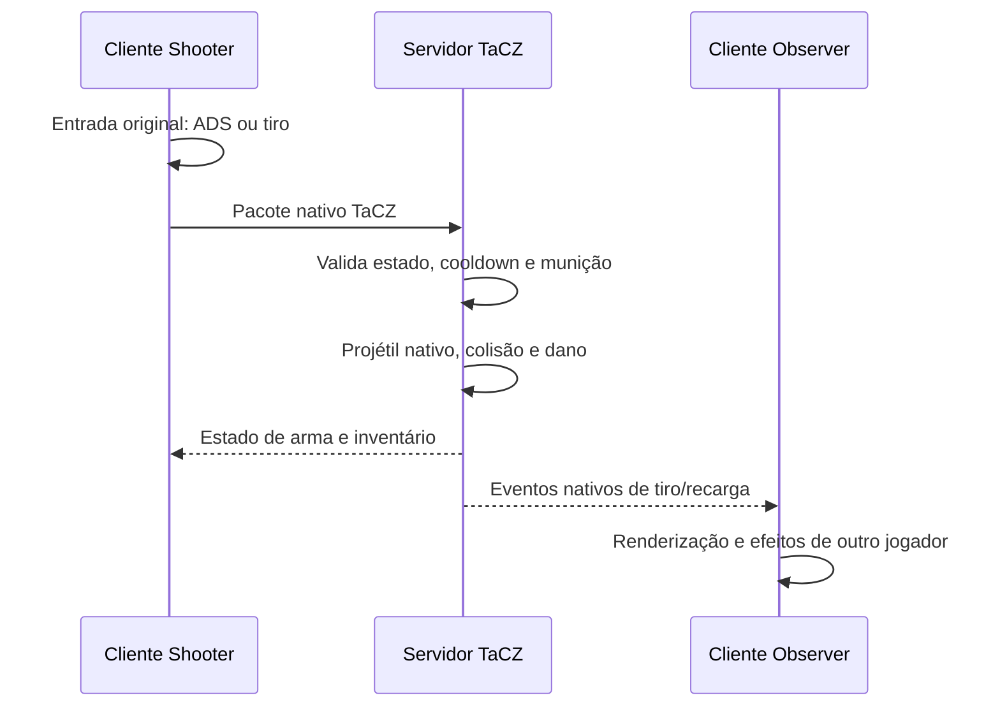

# Arsenal TaCZ — 0.005.0

## Escopo implementado

Integração original com o mod externo **Timeless and Classics Zero**, sem criar outro sistema de armas, projéteis, recarga ou animações FPS. Renan, os dois Arthurs, as combatentes, a Espada Ucraniana, skins, sons, alianças e controladores GeckoLib permanecem com seu código anterior. Nenhum NPC recebe arma de fogo automaticamente.

Antes da implementação foram conferidos o estado limpo após `f890071`, README/CONTEXTO, registros, itens, aba criativa, código existente, Gradle e integração GeckoLib. A primeira implementação expôs só a AKM. As outras quatro entraram depois de a AKM completar o cenário gráfico com ADS, disparo, dano, som, recoil, munição e recarga.

## Versões verificadas

| Componente | Versão |
| --- | --- |
| Minecraft / Forge | 1.20.1 / 47.4.28 |
| Java | 17; ambiente local 17.0.20.1 |
| Gradle / ForgeGradle | 8.8 / 6.0.54 |
| Guerra Ezuberante | 0.005.0 |
| GeckoLib Forge 1.20.1 | 4.8.4, dependência existente mantida |
| TaCZ Forge 1.20.1 | **1.1.8-hotfix2**, CurseForge **9037989** |

A página atual de arquivos foi consultada em 24/10/2026. O hotfix2, publicado em 02/10/2026, é posterior ao 1.1.8-hotfix usado como referência no pedido. O manifesto dentro do JAR instalado declara `Implementation-Version: 1.1.8-hotfix2`. O SHA-256 é `2cbb89f44333d2eb4e825d86d789ff119b272ff75184390b55bafd4f0e7f10c2`.

Gradle resolve `curse.maven:timeless-and-classics-zero-1028108:9037989` pelo CurseMaven e usa `fg.deobf` para compilar/executar em userdev. `mods.toml` exige a versão exata no cliente e servidor. O conjunto local para instalação normal contém o JAR **original**, sem remapeamento, separado do JAR do nosso mod. TaCZ não foi incorporado por Jar-in-Jar.

O TaCZ inclui o gunpack padrão em sua distribuição e carrega seus recursos. A validação não exigiu gunpack separado, Player Animator ou outro mod de armas. O Jar-in-Jar **do próprio TaCZ** fornece Simple Bedrock Model 2.2.2, LuaJ, Commons Math, BCEL e MixinExtras; isso não foi alterado.

## Armas, munição e kits

Os cinco IDs e os quatro calibres foram conferidos nos arquivos do gunpack **dentro do JAR efetivamente instalado**, não apenas no código de outra versão.

| Nome | ID da arma | ID de munição | Nome no comando | Carregador padrão | Reserva do kit |
| --- | --- | --- | --- | --- | --- |
| AKM | `tacz:ak47` | `tacz:762x39` | `ak47` ou `akm` | 30 | 120 |
| M4A1 | `tacz:m4a1` | `tacz:556x45` | `m4a1` | 30 | 120 |
| Glock 17 | `tacz:glock_17` | `tacz:9mm` | `glock17` ou `glock_17` | 17 | 68 |
| Desert Eagle | `tacz:deagle` | `tacz:50ae` | `deagle` | 7 | 64 |
| MP5A5 | `tacz:hk_mp5a5` | `tacz:9mm` | `mp5`, `mp5a5` ou `hk_mp5a5` | 30 | 120 |

A arma começa carregada, incluindo a câmara quando seu tipo de ferrolho permite. Nos testes, AKM/M4/MP5 têm 31 cartuchos disponíveis, Glock 18 e Desert Eagle 8. A reserva é calculada como quatro carregadores, com mínimo de 64, e dividida pelo limite real das pilhas de munição. Não se usa munição virtual/dummy nem reserva infinita. As regras normais de Creative e Survival continuam pertencendo ao TaCZ.

```mcfunction
/ge armamento ak47
/ge armamento m4a1
/ge armamento glock17
/ge armamento deagle
/ge armamento mp5
```

O comando exige **OP nível 2** e um jogador como executor. Console sem jogador não recebe inventário. O nome desconhecido e a ausência de índice/calibre produzem mensagens traduzidas. A árvore `/ge` recebe apenas o subcomando novo, sem remover outros comandos. Tab sugere os cinco nomes principais. A entrega usa o auxiliar de inventário do Forge, que trata inventário cheio sem criar pilhas acima do limite.

Não há itens fictícios com registros `guerra_ezuberante:ak47` ou equivalentes. Esses IDs do TaCZ são índices de gunpack; a arma real é construída pela API com seus dados e NBT originais.

## Código de integração

Java de produção, relativo a `src/main/java/io/github/omarflk/guerraezuberante/`:

| Arquivo | Responsabilidade |
| --- | --- |
| `arsenal/WeaponDefinition.java` | Define nome do comando, aliases e IDs oficiais de arma/munição |
| `arsenal/Arsenal.java` | Catálogo único, valida índices, constrói armas e munições, prepara kits e conteúdo criativo |
| `arsenal/ArsenalCommands.java` | Comando administrativo, permissão, sugestões, erros e entrega dos kits |
| `registry/ModCreativeTabs.java` | Acrescenta os ItemStacks reais depois dos quatro itens existentes |
| `client/gui/ModPanelScreen.java` | Informa a disponibilidade do arsenal na página inicial, preservando as cinco páginas |

Também mudaram Gradle, propriedades, metadados e traduções pt_br/en_us. Nenhum arquivo de entidade, invocação, renderer de personagem ou controller de combate precisou ser alterado.



`Arsenal.availableIndex` confere o índice de arma, o calibre declarado pelo GunData, a existência de munição e um modo de tiro válido. A resolução ocorre ao montar a aba ou executar o comando, depois que os dados foram carregados ou sincronizados. Nenhum ItemStack é criado no registro estático nem por `forceBuild`.

`GunItemBuilder.create()` recebe o ID real, modo nativo inicial, carregador padrão, câmara compatível e flag de calor prevista pelo dado original. `AmmoItemBuilder.create()` recebe o calibre real. O código confere os resultados via IGun/IAmmo antes da entrega e monta o kit completo antes de mudar o inventário. A aba deduplica a munição 9 mm e conserva seus quatro itens anteriores, totalizando 13 entradas.

## ADS, tiros, recarga e acessórios

O código de produção não adiciona handlers de clique, nova câmera/FOV, teclas de tiro, cálculo de dano ou pacotes próprios de disparo. Tudo isso usa o TaCZ. Seu código e suas assinaturas foram estudados e confrontados com o bytecode instalado: TimelessAPI, GunItemBuilder, AmmoItemBuilder, IGun, AbstractGunItem, IGunOperator e IClientPlayerGunOperator.

Os controles padrão conferidos no fonte oficial são: botão esquerdo para tiro, direito para ADS, **R** para recarga, **G** para modo de tiro, **H** para inspeção e **Z** para acessórios. O **K** do nosso painel permanece independente. Configurações/remapeamentos do TaCZ continuam valendo.

As armas usam as animações originais de equipar, segurar, mirar, disparar, recuar, recarregar e inspecionar, quando disponíveis no gunpack. A integração não bloqueia slots de acessórios nem exige óptica. Um GameTest instala a óptica nativa `tacz:scope_acog_ta31` numa M4A1 pela API original e confere o resultado. Os testes gráficos das cinco armas usam suas miras sem acessórios.

GeckoLib continua renderizando os personagens; o TaCZ mantém seu próprio sistema de modelos FPS. A coexistência foi executada em cliente, servidor GameTest e servidor dedicado, com personagens presentes no cenário. Player Animator é opcional e não entrou como requisito novo.

## Autoridade e eventos



Os eventos GunShootEvent, GunFireEvent, GunReloadEvent, GunFinishReloadEvent e EntityHurtByGunEvent foram inspecionados. GunShoot representa a ação de gatilho; GunFire, a emissão do tiro, inclusive quando um modo dispara mais de uma vez. GunReload contém entidade, ItemStack e lado lógico; EntityHurtByGunEvent possui Pre/Post, atirador, alvo e IDs.

**GunFinishReloadEvent existe, mas o caminho nativo de recarga dessa versão não o emite nos testes**; a busca no fonte também não encontrou o construtor sendo usado na lógica de recarga. Por isso a auditoria comprova a conclusão pelo estado autoritativo e pelo carregador restaurado, em vez de inventar um evento ou tratá-lo como obrigatório.

Os listeners de auditoria ficam apenas em `src/gameTest`. Não há observadores de dano de arma adicionados ao JAR principal nem aplicação duplicada de dano pelo nosso mod.

## Automação e testes executados

### Servidor GameTest

**37 testes obrigatórios passaram**: os 31 anteriores, mais seis de arsenal:

1. AKM real, munição compatível e kit com 120 de reserva.
2. Entrada de gunpack ausente ou calibre incorreto falha sem item falso.
3. Comando inacessível sem permissão e kit completo com nível 2.
4. Conteúdo criativo nativo com munição deduplicada.
5. Cinco armas e rejeição de calibres errados.
6. Instalação de acessório nativo.

### Cliente real em Survival

A automação abriu o Minecraft em perfil isolado, acionou a API cliente original do TaCZ e seus pacotes e capturou o framebuffer. A mira foi mantida com a tecla nativa simulada, respeitando a configuração de segurar para mirar. O alvo recebeu dano real de projétil; não se chamou hurt diretamente para simular um tiro.

| Arma | FOV normal → ADS aproximado | Recoil de câmera observado | Dano corporal observado a 12 blocos |
| --- | --- | --- | --- |
| AKM | 70° → 55,53° | 0,80° | 9 |
| M4A1 | 70° → 55,53° | 1,24° | 6,5 |
| Glock 17 | 70° → 60,53° | 1,20° | 7 |
| Desert Eagle | 70° → 60,53° | 2,73° | 16 |
| MP5A5 | 70° → 60,53° | 1,07° | 6 |

Essas medidas são observações de uma execução, não valores fixados pelo Guerra Ezuberante. O recoil é variável e o dano depende das regras nativas, distância, alvo e local de impacto. Cada arma gerou um evento cliente de tiro e um som de disparo; a recarga terminou e a tentativa sem munição foi rejeitada. A instrumentação de som observa a chamada real ao sistema de áudio, sem presumir audição/aprovação humana.

### Servidor dedicado e dois clientes reais

O autor aceitou explicitamente a EULA para o teste local. Foi criado um servidor dedicado normal Forge em `.tools/run-arsenal-server`, vinculado apenas a **127.0.0.1:25581**, com whitelist de Shooter/Observer e sem RCON. Os perfis offline pertencem exclusivamente a esse teste local; a integração não altera autenticação de servidores de jogadores.

Shooter jogou em Survival e executou as cinco armas. Observer conectou por TCP como um segundo Minecraft, em modo espectador. Os resultados da execução completa registram **maxPlayers=2**, um gatilho/tiro/acerto no servidor e um evento remoto de tiro/recarga para cada arma.

| Arma | Total antes do tiro | Total após tiro e recarga | Acertos no servidor | Tiros / recargas recebidos pelo Observer |
| --- | --- | --- | --- | --- |
| AKM | 151 | 150 | 1 | 1 / 1 |
| M4A1 | 151 | 150 | 1 | 1 / 1 |
| Glock 17 | 86 | 85 | 1 | 1 / 1 |
| Desert Eagle | 72 | 71 | 1 | 1 / 1 |
| MP5A5 | 151 | 150 | 1 | 1 / 1 |

O total inclui arma/câmara/reserva. Depois, a fixture de teste esvaziou carregador e reserva, e o cliente tentou as operações nativas novamente. Não houve novo tiro aceito, recarga iniciada nem criação de munição. Essa manipulação só existe no cenário de teste; o código de produção não muda a contagem durante gameplay.

Repetições adicionais para capturas tiveram timeout de login, durante inicialização simultânea e também ao tentar iniciar em sequência. O executor agora espera o observador terminar o login antes de abrir Shooter, mas **a repetibilidade do login ainda não está aprovada**. O resultado completo anterior permanece registrado; não se usa um simples retorno zero do Gradle como comprovação de gameplay. A causa dos timeouts não foi atribuída por inferência ao TaCZ ou à nossa integração.

Na execução gráfica final separada, a tela criativa real foi aberta e sua aba selecionada: confirmou cinco armas, quatro munições e os itens anteriores. [Captura da aba](preview/arsenal-0.005/aba-criativa.png), [relatório cliente final](validacao/arsenal-0.005/singleplayer-final-cliente.json), [relatório servidor integrado final](validacao/arsenal-0.005/singleplayer-final-servidor.json). Essa execução completou com sucesso após as tentativas de captura em rede.

### Ferramentas versionadas

- `tools/validate_tacz.ps1`: SHA-256, manifesto, gunpack incluído, IDs/calibres e ausência de fontes/assets copiados.
- `tools/arsenal_visual_test.ps1`: copia um mundo GameTest fechado, usa perfil gráfico isolado e exige relatórios cliente/servidor aprovados.
- `tools/arsenal_network_test.ps1`: prepara servidor local/whitelist e abre dois clientes; exige relatórios dos três processos. Aceite da EULA é explícito; o script não o presume em outra instalação.
- `tools/arsenal_run.ps1`: launcher dos três papéis, sem o problema de argumentos `-P...=...` atravessando o parser de `powershell -File`.
- `ArsenalGameTests`, `ArsenalTestScenario`, `ArsenalClientChecks`: fixtures e auditorias fora do JAR distribuído.

## Build e instalação

```powershell
powershell -NoProfile -ExecutionPolicy Bypass -File tools/gradle.ps1 runGameTestServer build
```

Artefato próprio: `build/libs/guerra_ezuberante-0.005.0.jar`. Conjunto local pronto: `build/distributions/guerra-ezuberante-0.005.0/mods/`, com Guerra Ezuberante, GeckoLib 4.8.4 e TaCZ 1.1.8-hotfix2 separados. Cliente e servidor Forge 1.20.1 devem usar esse conjunto compatível. Não usar o JAR mapped do cache de desenvolvimento numa instalação normal.

No IntelliJ, o projeto Gradle já contém as dependências e os runs; executar `runClient` abre o perfil normal. `tools/gradle.ps1` escolhe o JDK portátil neste workspace. Ao finalizar, o agente deixa o cliente atualizado aberto para o autor testar. Não houve push ou merge nesta sprint.

## Limites e pendências

- O TaCZ emite avisos de recursos de áudio em alguns keyframes de animação (`minecraft:...raise`, `...drop` e outros) e no arquivo agregado de recarga tática da MP5. O JAR contém arquivos segmentados de recarga, mas não aquela referência agregada. São referências da distribuição externa. Os sons principais de tiro foram encontrados e registrados pela auditoria; nenhum asset substituto foi inventado ou copiado. Nem todos os sons de animação/recarga foram declarados aprovados.
- O evento GunFinishReloadEvent não foi tomado como prova de conclusão; estado e munição efetivos foram verificados.
- Os testes de rede são locais. Latência real de internet, servidores com muitos jogadores, outros gunpacks, shaders e bibliotecas opcionais ainda não foram exercitados.
- Acessórios nativos continuam suportados; a instalação de uma óptica foi verificada por API, mas não toda a matriz de acessórios nem cada configuração de zoom.
- Aprovação estética/auditiva e gameplay pelo autor continuam sendo feedback humano. Não foram adicionadas armas ao Renan/Arthur; a futura mecânica de tiro dos personagens depende de outro pedido.

## Licenças, créditos e referências

TaCZ: **Serene Wave Studio | Timeless Squad**, código GPL 3.0 e assets CC BY-NC-ND 4.0 conforme declaração do projeto. Os arquivos permanecem na distribuição original externa. Nossa integração usa chamadas de API e identificadores, sem fork ou cópia de implementação/assets. [Créditos e dependências](DEPENDENCIAS_TERCEROS.md).

- [Arquivo oficial TaCZ 1.1.8-hotfix2](https://www.curseforge.com/minecraft/mc-mods/timeless-and-classics-zero/files/9037989).
- [Código oficial 1.20.1](https://github.com/MCModderAnchor/TACZ/tree/1.20.1).
- [GunItemBuilder](https://github.com/MCModderAnchor/TACZ/blob/1.20.1/src/main/java/com/tacz/guns/api/item/builder/GunItemBuilder.java).
- [AmmoItemBuilder](https://github.com/MCModderAnchor/TACZ/blob/1.20.1/src/main/java/com/tacz/guns/api/item/builder/AmmoItemBuilder.java).
- [TimelessAPI](https://github.com/MCModderAnchor/TACZ/blob/1.20.1/src/main/java/com/tacz/guns/api/TimelessAPI.java).
- [CommonAssetsManager e ciclo de carregamento](https://github.com/MCModderAnchor/TACZ/blob/1.20.1/src/main/java/com/tacz/guns/resource/CommonAssetsManager.java).
- [IClientPlayerGunOperator](https://github.com/MCModderAnchor/TACZ/blob/1.20.1/src/main/java/com/tacz/guns/api/client/gameplay/IClientPlayerGunOperator.java).

Resultados completos e capturas: [VALIDACAO.md](VALIDACAO.md).
