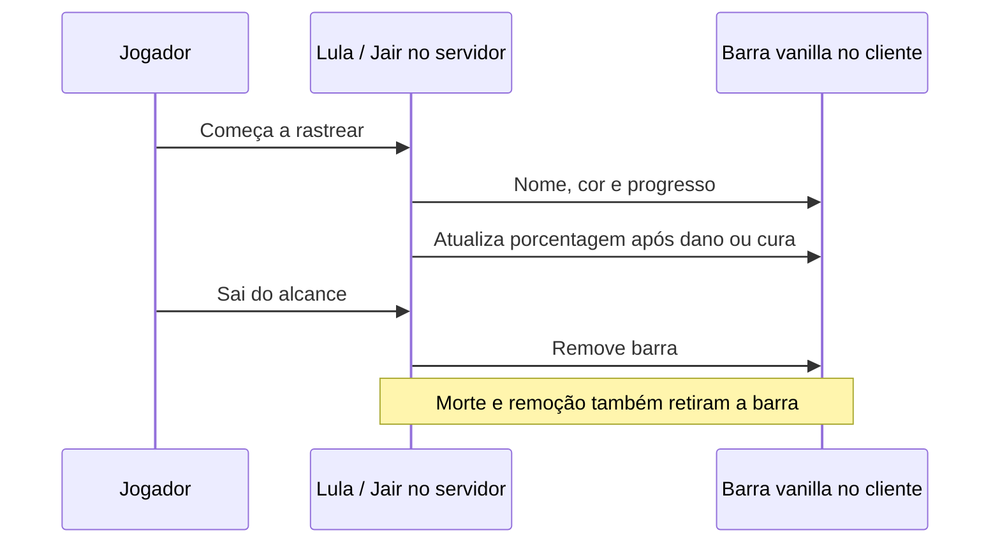
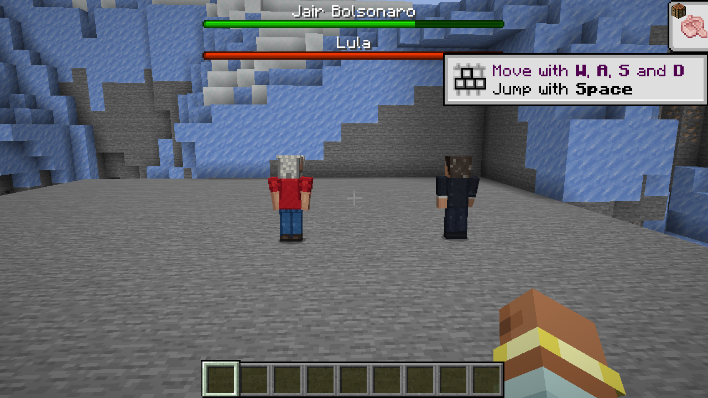
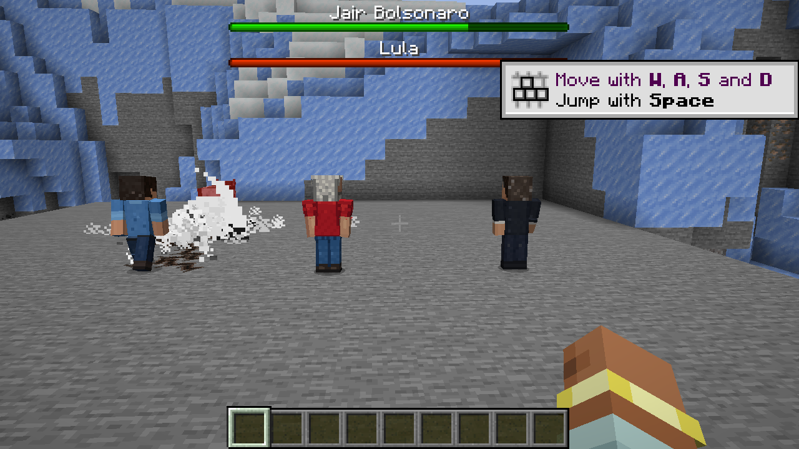

# Guerra Ezuberante 0.011.0 — bosses e Rachadinha

Lula e Jair Bolsonaro passam de 30 para **300 HP**, o valor de `WitherBoss.createAttributes()` no Minecraft Java 1.20.1 usado neste projeto. A referência foi conferida no bytecode local do jogo; 300 HP equivalem a 150 corações.

## Barras nativas de boss

`SpecialDeathEntity` mantém um `ServerBossEvent` por personagem, com nome traduzível fixado no tipo da entidade. Lula usa `RED`; Jair usa `GREEN`; ambos usam a barra contínua `PROGRESS`. Nomes personalizados da entidade não substituem os rótulos pedidos.

`startSeenByPlayer` inscreve o jogador e `stopSeenByPlayer` o remove. A cada tick do servidor, o progresso acompanha `vida atual / vida máxima`, limitado entre 0 e 1. Entrar na morte especial remove imediatamente os espectadores; remoção da entidade também limpa a lista. Não escurece a tela nem muda a música ambiente com o sinalizador do boss.



## Rachadinha mais forte e recorrente

| Parâmetro | Antes | Agora |
| --- | --- | --- |
| Dano base por inimigo/ativação | 6 | **10** |
| Recarga | 240 ticks / 12 s | **120 ticks / 6 s** |
| Knockback adicional | 0,35 | **0,65** |
| Raio do último impacto | Mesmo raio estreito dos segmentos | **2,25 blocos** |
| Prioridade da IA | Igual ao corpo a corpo | Superior ao corpo a corpo |

O objetivo de corpo a corpo em execução impedia a habilidade de voltar a assumir movimento/olhar quando as prioridades eram iguais. A habilidade agora pode interrompê-lo ao ficar disponível. Um alvo visível e ao alcance mantém o combate ativo durante a espera; não precisa receber outro golpe para lembrar do inimigo.

O caso de alvo praticamente no mesmo X/Z agora produz um impacto no chão em vez de um caminho vazio. A escavação preserva o bloco imediatamente abaixo do conjurador no momento do impacto. Ele ainda pode andar pelos sulcos criados na luta.

O último segmento tem emissor de explosão, nuvem, mais partículas de terreno e som de explosão mais forte/grave. A área final verifica distância horizontal real até a hitbox, linha de visão e hostilidade. O conjunto de UUIDs continua impedindo dano duplicado pelos segmentos e pelo final da mesma ativação. A ampliação da área de combate não cria uma cratera circular adicional: destruição segue a faixa estreita já existente, com permissões e `mobGriefing`.

## Mundos e configurações existentes

Config SERVER em `serverconfig/guerra_ezuberante-server.toml` de cada mundo:

```toml
balance_revision = 1

[lula]
max_health = 300.0

[jair]
max_health = 300.0

[flavio]
rachadinha_damage = 10.0
rachadinha_cooldown_ticks = 120
rachadinha_knockback = 0.65
rachadinha_final_radius = 2.25
```

`ConfigMigrations` atualiza uma vez os valores que ainda correspondem exatamente aos padrões antigos de vida/dano/recarga/knockback. Valores personalizados diferentes são mantidos. O marcador evita repetir a atualização em recargas futuras.

NBT sem `BossHealthRevision`, com atributo base máximo 30, é migrado na leitura para o máximo configurado, preservando a porcentagem: 15/30 vira 150/300. O marcador é salvo na próxima gravação. Personagens mortos continuam com vida zero e a sequência especial não reinicia. Não editar os mundos do autor com cenários de teste.

## Validação

76 GameTests obrigatórios passaram em `.tools/boss-rift-final-tests.log`: as 71 regressões e cinco novos testes. Cobrem quatro ativações naturais da IA com escavação (intervalos 121/120/120 ticks), impacto à queima-roupa, dano final ampliado sem atingir espectadores, vida/cor/nome/progresso das barras, inscrição/remoção de espectadores, morte, migração NBT e preservação de configurações personalizadas.

As regressões incluem combate, armas, invocações, morte especial, proteção de terreno, animações e comportamento sem agressão. **O teste gráfico final passou** usando somente `.tools/run-boss-rift-client`, volume mestre zero antes do lançamento, mundo copiado e fixtures fora do JAR. Conferiu dois rótulos/cores, 300 HP, pacotes de progresso de 70%/80%, quatro ativações naturais (121/120/120 ticks), remoção na morte e ao sair do alcance. [Relatório](validacao/boss-0.011/cliente.json).





Na montagem inicial, chunks da arena distante eram descarregados e a fixture mantinha referências antigas de personagens. O cenário foi corrigido para manter somente a arena isolada carregada e resolver referências atuais pelo UUID. A aprovação acima corresponde à execução final `.tools/boss-rift-visual-loaded.log`; as tentativas anteriores não foram consideradas aprovadas. Isto não valida internet pública ou latência multiplayer.

Artefato: `build/libs/guerra_ezuberante-0.011.0.jar`. Dependências, áudios e skins corrigidas da 0.010.1 preservados. Entrega local, sem commit/push automático.
