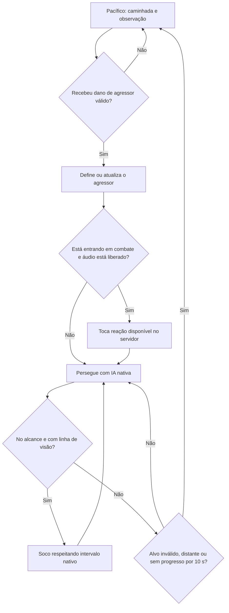

# Combate básico — 0.002.0

Esta sprint adiciona Arthur do Val e retaliação compartilhada para Renan e Arthur. A stack permanece Minecraft 1.20.1, Forge 47.4.28 e Java 17. Sem armas, poderes, tropas ou facções jogáveis.

## Comportamento

`RetaliatingCharacterEntity` concentra os objetivos nativos de movimentação, o `MeleeAttackGoal`, o controle do agressor, a recarga das falas e a persistência. Não há busca de alvos por proximidade nem alerta de aliados.

O alvo só é definido após um dano aceito que reduza a vida e possua agressor vivo identificável. Dano ambiental, autoagressão, jogadores em Creative/Spectator e jogadores invulneráveis não iniciam retaliação. Um novo agressor que cause dano substitui o alvo atual. Survival e Adventure são aceitos.

O combate utiliza alcance e intervalo de socos da IA nativa, com verificação explícita de linha de visão. A perseguição termina se o alvo morrer, for removido, mudar de mundo, ficar a mais de 20 blocos ou se não houver aproximação/ataque bem-sucedido por 200 ticks, aproximadamente 10 segundos em um servidor a 20 TPS.

O estado de perseguição não é restaurado ao carregar uma entidade: referências antigas de agressores são descartadas. Vida, persistência e recargas de áudio continuam salvas.



## Atributos e escala

| Parâmetro | Renan | Arthur |
| --- | --- | --- |
| Vida máxima | 30 | 32 |
| Dano base | 4 | 5 |
| Velocidade | 0,25 | 0,24 |
| Alcance de perseguição | 20 blocos | 20 blocos |
| Escala visual | 1,0 | 0,88 |
| Hitbox largura × altura | 0,6 × 1,8 | 0,528 × 1,584 |
| Altura dos olhos | 1,62 | 1,4256 |

Arthur utiliza a skin 64×64 fornecida, preservada sem edição. A escala é aplicada no renderer, nas dimensões registradas da entidade e na altura dos olhos. Não há dependência de GeckoLib.

## Conteúdo preservado e adicionado

O ovo do Renan, sua skin, as duas falas por interação e o painel K foram preservados. Arthur tem ovo próprio, aparece na mesma aba e possui seleção e prévia na página Personagens. A página Habilidades distingue retaliação e socos implementados dos poderes especiais ainda planejados.

Os sons são disparados somente pelo servidor. A reação de combate usa o protocolo nativo de som vinculado à entidade. Cooldowns impedem reinício da mesma música a cada golpe. O botão direito aguarda o término da recarga de combate para não acrescentar falas durante a reação.

Inventário completo, durações, duplicatas e reação selecionada do Arthur: [AUDIOS.md](AUDIOS.md).

## Arquivos desta sprint

| Área | Criados | Modificados |
| --- | --- | --- |
| Entidades | `entity/RetaliatingCharacterEntity.java`, `entity/ArthurDoValEntity.java` | `entity/RenanSantosEntity.java` |
| Renderização | `client/renderer/ArthurRenderer.java` | `client/ClientModEvents.java` |
| Registros | — | `registry/ModEntities.java`, `ModItems.java`, `ModCreativeTabs.java`, `ModSounds.java`, classe principal do mod |
| Painel | — | `client/gui/ModPanelScreen.java` e traduções pt/en |
| Recursos | Skin do Arthur, modelo JSON do ovo, phonk e sete OGGs do Arthur | `sounds.json`, metadados; falas do Renan reconvertidas sem cortes |
| Testes | `src/gameTest/.../CombatGameTests.java` | `RenanGameTests.java`, template de testes ampliado |
| Ferramentas | — | `tools/convert_audio.ps1`, `tools/validate_assets.ps1` |
| Build | — | `gradle.properties` para 0.002.0, opções de cliente isolado em `build.gradle` |
| Documentação | Este relatório e `AUDIOS.md` | README, CONTEXTO, validação, design e instruções da pasta de entrada |

Os arquivos Java usam o pacote `io.github.omarflk.guerraezuberante`. As mudanças da primeira versão foram preservadas. Após os testes da sprint, o autor autorizou publicar a implementação atual na main do GitHub.

## Testar manualmente

1. Feche a instância antiga do jogo antes de iniciar a nova versão pelo comando `powershell -ExecutionPolicy Bypass -File tools/gradle.ps1 runClient`.
2. Em mundo de teste com comandos habilitados, use os dois ovos da aba Guerra Ezuberante. Eles devem conviver pacificamente.
3. Use `/gamemode survival` ou `/gamemode adventure`, ataque Renan e observe perseguição, socos e início do phonk.
4. Faça o mesmo com Arthur: ele inicia a gravação inteira “É vagabundo sim” e revida. A recarga de 11 s e o estado de combate impedem reinício a cada golpe. Suas sete gravações continuam disponíveis por botão direito.
5. Afaste-se mais de 20 blocos ou separe o alvo por uma barreira. Não deve haver dano através dela; a perseguição sem progresso termina.
6. Abra K → Personagens e alterne entre Renan e Arthur. Compare atributos e prévias.

```mcfunction
/give @p guerra_ezuberante:renan_spawn_egg
/give @p guerra_ezuberante:arthur_do_val_spawn_egg
/summon guerra_ezuberante:renan_santos ~ ~ ~
/summon guerra_ezuberante:arthur_do_val ~2 ~ ~
```

JAR: `build/libs/guerra_ezuberante-0.002.0.jar`. Use apenas um JAR do Guerra Ezuberante por instalação; o arquivo 0.001.0 é o protótipo anterior, não um complemento.

Para validar regressões: `tools/gradle.ps1 runGameTestServer` e `tools/validate_assets.ps1`, executados com PowerShell conforme o README. Resultados observados e limitações de multiplayer: [VALIDACAO.md](VALIDACAO.md).
