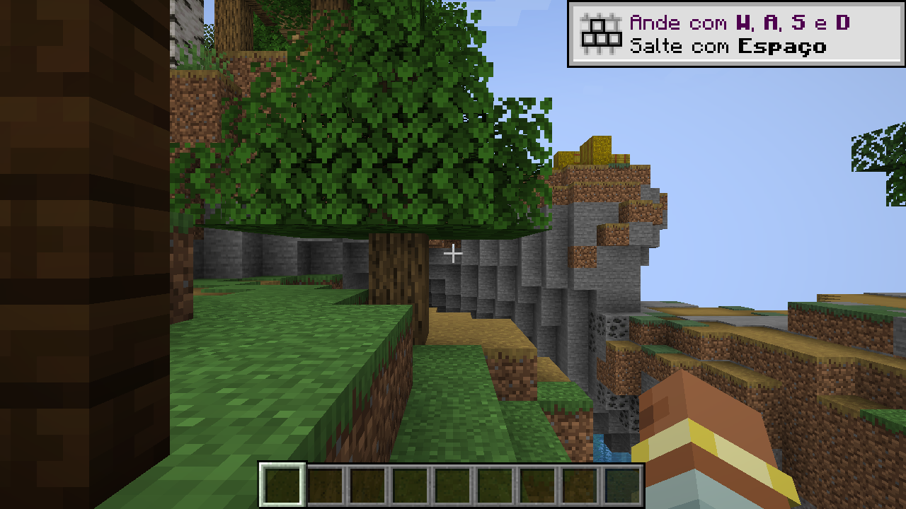

# Guerra Ezuberante 0.014.2 — áudio e acesso às vilas

Correções solicitadas pelo autor em 29/10/2026 após testar a integração de Gabriel. Todos os recursos da 0.014.1 continuam disponíveis.

## Gravações

- Um clique inicia uma gravação; outro clique pula para outra, respeitando apenas o debounce de10 ticks (0,5 s). A gravação anterior é encerrada antes de iniciar a próxima.
- Ao terminar, fica em silêncio até outro acionamento. Um alvo de combate persistente não renova uma playlist indefinidamente; cada encontro inicia no máximo uma gravação automática.
- Renan, Arthur e Lula mantêm suas bibliotecas completas, sem repetição imediata no embaralhamento quando houver alternativas.
- Jair agora usa a mesma sessão sincronizada por entidade: **Eu não te** e **Popcorn** no botão direito; **Canalha** apenas na reação a dano (40% de chance), sem interromper automaticamente outra fala. O clique do jogador pode pular inclusive Canalha.
- Morte, início da morte especial, remoção e saída do mundo encerram o som da entidade. Encerrar Jair não silencia outros personagens.
- Metadados dos OGGs do Jair medidos com FFprobe:6,540998 s / 53,292993 s / 42,372993 s; 131/1066/848 ticks. Gravações inteiras, sem reedição dos recursos.
- `interaction_session_ticks` e `combat_grace_ticks` ficam na configuração por compatibilidade, mas não geram mais reprodução automática contínua.

O defeito do Jair vinha de um caminho antigo de áudio: a interação usava um som avulso com cooldown longo, enquanto os demais personagens já tinham uma instância rastreada. Por isso o clique não pulava e a sessão de morte não conseguia interromper esse som.

## Coordenadas e teleporte

O chat copiava apenas `X Z`. Digitar `/tp 176 480` faz o Minecraft tentar resolver nomes de entidades. O comando vanilla completo seria `/tp 176 200 480`, com três valores, mas a altura200 ainda exige cuidado ao aterrissar.

Agora, clicar numa vila prepara um comando completo no chat; confirme com Enter:

```mcfunction
/ge vilas tp missao 1
/ge vilas tp bolsonarista 2
/ge vilas tp lulista 3
```

Requer comandos ativados ou operador. Aceita `lulista`, `bolsonarista`, `missao`, `esquerda`, `direita`, `centro` e índices 1–3. O número identifica a mesma posição mesmo que a ordem por distância no chat mude. `/ge vilas` e `/ge vilas <faccao>` continuam listando as posições.

O servidor carrega o destino no mundo principal, procura chão sólido com espaço para o jogador, rejeita líquidos/alguns pisos perigosos/borda e limpa a velocidade e a queda. Se não achar uma posição segura num raio de 8 blocos, recusa em vez de teleportar no ar. A lista não passa a gerar chunks apenas por ser consultada.

## Testes ampliados de geração

A semente **-42** revelou duas posições em biomas oceânicos após esgotar a busca no setor da facção. Acrescentada uma busca pelo restante do anel, mantendo separação e escolhas já válidas. Nas 16 sementes verificadas, as 18 posições ficam em terra; o par mais próximo tem 176 blocos de distância.

Também foi criado um **mundo normal novo com semente -42**. As 18 vilas foram geradas pelo gerador de terreno real, não por `/place`: todas apresentaram início de estrutura válido, um castelo e 12 estandartes no castelo. Depois, um cliente real percorreu as 18 posições pelos comandos enviados pela rede e confirmou a chegada ao chão. [Relatório da geração](validacao/audio-vilas-0.014.2/geracao-mundo.json) · [Relatório do cliente](validacao/audio-vilas-0.014.2/cliente.json).



## Validação da entrega

| Verificação | Resultado |
| --- | --- |
| GameTests com TaCZ | 126 obrigatórios aprovados |
| GameTests sem TaCZ | 62 obrigatórios aprovados |
| Posições de vilas | 16 sementes, 18/18 em terra em cada uma |
| Geração natural | 18 vilas no mundo normal de semente -42 |
| Teleporte real | 18 destinos, seis facções, comando enviado pelo cliente |
| Áudio no cliente |Pular fala longa/Canalha, morte, remoção, fim sem autoplay, independência entre entidades e limpeza ao sair do mundo |
| Build |Validadores, reobf e pacotes com/sem TaCZ aprovados |

Logs locais: `.tools/audio-village-0142-tests-final.log`, `.tools/audio-village-0142-no-tacz.log`, `.tools/village-world-0142.log`, `.tools/audio-village-0142-client-final.log`, `.tools/audio-village-0142-package.log`.

A primeira fixture gráfica deixou a explosão posterior do Jair matar o Renan usado para testar fim natural. Corrigida a fixture: depois de observar a parada do som na morte, remove o cadáver antes da explosão. A explosão de produção não foi desativada. O GameTest de teleporte captura o destino porque a conexão do FakePlayer ignora teleporte por definição; o cliente real verifica movimento e sincronização.

## Reproduzir os cenários

```powershell
.\tools\gradle.ps1 runGameTestServer
.\tools\gradle.ps1 runGameTestServer -PwithoutTacz
# Após aceitar a EULA do Minecraft para o servidor local:
.\tools\village_world_test.ps1 -Seed -42 -AcceptEula
$world = Get-Content .tools/village-world-last-world.txt -Raw
.\tools\character_audio_test.ps1 -WorldPath $world
```

Os perfis ficam em `.tools/`; o cliente automatizado grava master 0 antes de abrir. O servidor fica restrito a 127.0.0.1:25589 e encerra após o relatório. Nenhum cenário modifica mundos normais do autor.

Para deixar o perfil normal aberto sem som, preservando seu volume salvo:

```powershell
.\tools\gradle.ps1 runClient -PsilentClient
```

Esse parâmetro cancela a reprodução apenas na JVM iniciada; não silencia o Windows ou outros aplicativos, não altera o volume salvo e não encerra o jogo automaticamente.

## Limites

Use mundo novo para ver as vilas completas: não há retrogeneração em chunks explorados. A busca adicional pode mudar posições onde a rotina antiga falhava. Os testes não cobrem todas as sementes, geradores/datapacks ou todos os mods de proteção. A geração natural conferiu estruturas e bandeiras; os GameTests de construção cobrem personagens e estandartes das seis facções, sem prometer sobrevivência de todos os aldeões em todo terreno vanilla. Áudio testado com master 0: ciclo de reprodução e recursos verificados, sem audição.

JAR: `build/libs/guerra_ezuberante-0.014.2.jar`. SHA256: `39671cf9bf9c850142fa248efb42d13a2470d935cc48e099ecc46319f1471f1d`.
