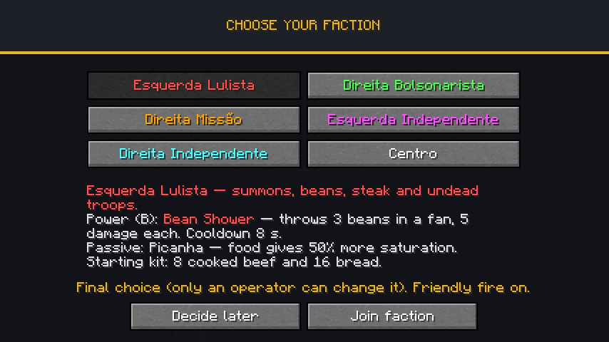
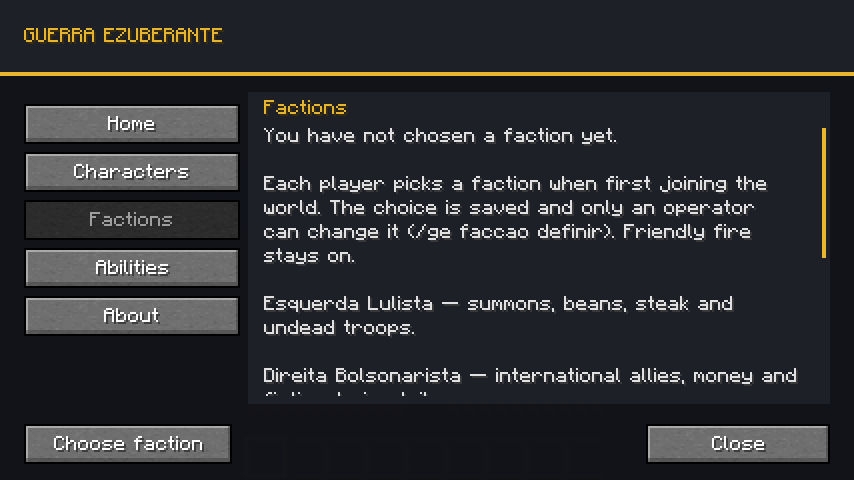
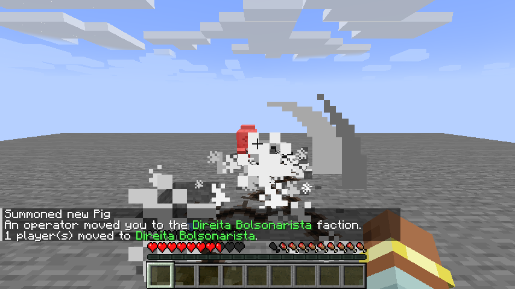
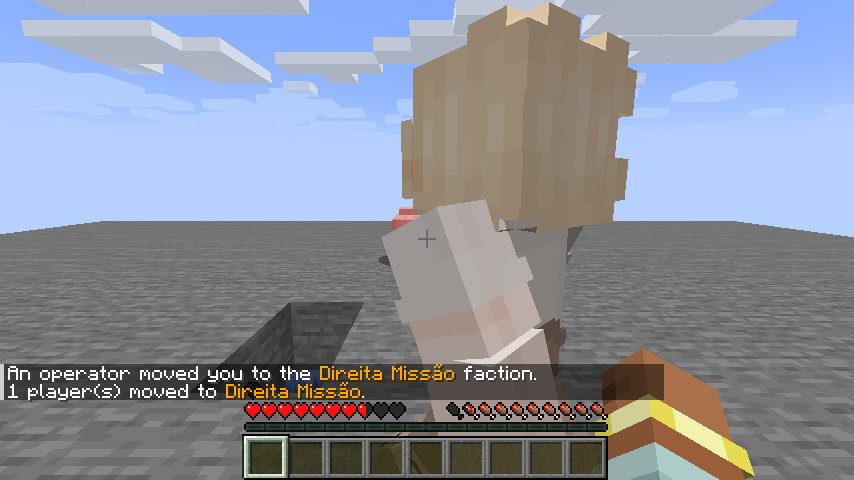
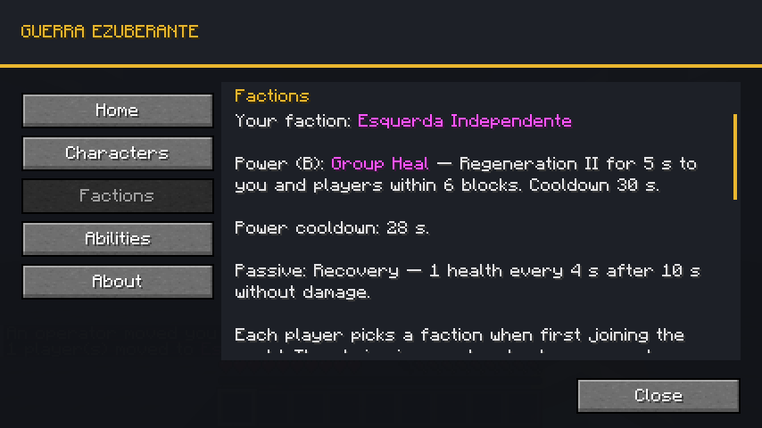

# Guerra Ezuberante 0.012.0 — facções, poderes e kits

Primeira versão do sistema de facções descrito no README. Cada jogador escolhe uma das seis facções ao entrar no mundo pela primeira vez; a escolha fica salva no mundo e aparece no nome do jogador. Só um operador pode trocá-la depois. Cada facção tem **um poder ativo (tecla B)**, **um passivo** e **um kit inicial** entregue uma única vez.



## O que muda para o jogador

| Momento | Comportamento |
| --- | --- |
| Primeiro login no mundo | Abre a tela **Escolha sua facção** com as seis opções coloridas. Clicar mostra descrição, poder, passivo e kit; **Entrar na facção** confirma. |
| Não quer decidir agora | **Decidir depois** fecha a tela. Painel K → Facções mostra **Escolher facção**; a tela volta a abrir no próximo login enquanto não houver escolha. |
| Depois de escolher | A escolha é definitiva para o jogador. O servidor anuncia no chat: *"Fulano entrou na facção Esquerda Lulista."* |
| Nome | Prefixo colorido `[Lulista]`, `[Bolsonarista]`, `[Missão]`, `[Esquerda]`, `[Direita]` ou `[Centro]` no chat, nas mensagens de morte, na lista do TAB e no nome acima da cabeça. |
| Desconectar, morrer, trocar de dimensão | A facção continua. Fica salva em `data/guerra_ezuberante_factions.dat` do mundo (overworld), por UUID. |

| Facção | Cor |
| --- | --- |
| Esquerda Lulista | vermelho |
| Direita Bolsonarista | verde |
| Direita Missão | dourado |
| Esquerda Independente | rosa |
| Direita Independente | ciano |
| Centro | branco |

## Poderes (tecla B)

A tecla padrão é **B**: a V que foi proposta já é usada pelo TaCZ (corpo a corpo e zoom). Dá para trocar em Opções → Controles → Guerra Ezuberante. O servidor decide tudo: o cliente só pede para usar o poder.

| Facção | Poder | Efeito padrão | Recarga |
| --- | --- | --- | --- |
| Esquerda Lulista | Chuva de Feijão | 3 feijões em leque (±10°), 5 de dano cada, mesmo projétil do Lula | 8 s |
| Direita Bolsonarista | Rachadinha | Fenda até 8 blocos em direção à mira, 8 de dano uma vez por alvo, **sem escavar** | 15 s |
| Direita Missão | Exército Ucraniano | 2 Combatentes Ucranianas que emergem do chão, seguem e defendem o jogador por 30 s; no máximo 2 ativas | 45 s |
| Esquerda Independente | Cura em Grupo | Regeneração II por 5 s para quem usou e jogadores a até 6 blocos | 30 s |
| Direita Independente | Investida | Dash de ~6 blocos para frente e Força I por 5 s | 12 s |
| Centro | Adaptação | Alterna Defesa (Resistência I) ↔ Mobilidade (Velocidade I); começa em Defesa | 5 s |

- A barra de ação mostra a recarga restante ao tentar usar cedo e avisa quando o poder volta.
- **Recusas não gastam a recarga**: Rachadinha sem chão na direção, exército já completo ou sem espaço seguro para invocar.
- A recarga é **do jogador**, não da facção: continua ao morrer, desconectar ou ser movido de facção pelo operador. Fica nos dados persistentes do jogador (`PlayerPersisted`).
- A Rachadinha do jogador atinge qualquer criatura ou jogador no caminho, exceto quem usou e as próprias tropas, e respeita o PvP do servidor. A do Flávio mantém o filtro de combate original.
- As Ucranianas do jogador defendem de quem o atacou e entram na luta contra quem ele atacou nos últimos 5 s. Somem ao fim dos 30 s, se o dono morrer ou trocar de dimensão. Usam a mesma contagem por dono do Arthur (`SummonLedger`).

## Passivos

| Facção | Passivo |
| --- | --- |
| Esquerda Lulista | **Picanha:** comida dá 50% a mais de saturação (limitado ao nível de fome, como no vanilla) |
| Direita Bolsonarista | **Colete:** +2 de armadura |
| Direita Missão | **Disciplina:** +2 de vida máxima |
| Esquerda Independente | **Recuperação:** 1 de vida a cada 4 s depois de 10 s sem levar dano |
| Direita Independente | **Agilidade:** +10% de velocidade de movimento |
| Centro | A postura escolhida fica sempre ativa (efeito ambiente renovado a cada segundo) |

Os bônus de atributo são modificadores transitórios ressincronizados a cada segundo com a facção atual: não acumulam e somem ao trocar de facção. A postura do Centro nunca substitui uma poção ou beacon mais forte ou mais longo.

## Kit inicial

| Facção | Itens |
| --- | --- |
| Esquerda Lulista | 8 bifes cozidos e 16 pães |
| Direita Bolsonarista | GE-P12 carregada e 24 cartuchos |
| Direita Missão | Espada Ucraniana e escudo |
| Esquerda Independente | Escudo, peitoral de ferro e 2 poções de cura arremessáveis |
| Direita Independente | Arco com Poder I e 32 flechas |
| Centro | Espada de ferro, escudo e 8 bifes cozidos |

Entregue **uma vez por jogador por mundo**, só na escolha feita pelo próprio jogador. Operador definindo ou limpando a facção não gera kit novo. O registro fica em `guerra_ezuberante_factions.dat` (lista `Kits`).

## Configuração

Seção `[faction_powers]` em `serverconfig/guerra_ezuberante-server.toml` do mundo: `starting_kit_enabled`, recarga de cada poder (`*_cooldown_ticks`), dano e quantidade do feijão, dano e alcance da Rachadinha, número e duração das tropas, raio e duração da cura, força do dash e duração da Força, e os valores de cada passivo. Os textos dos poderes mostram os valores padrão.

## Fogo amigo continua ativo

Pedido do autor nesta versão: **membros da mesma facção podem se ferir**. A facção é só identidade. Ela não cria time de scoreboard, não altera `isAlliedTo` nem bloqueia dano. A regra de PvP do servidor (`pvp` no `server.properties`) e os times criados por `/team` continuam valendo como antes.

Os personagens com IA (Renan, Arthur, Lula, Jair, Flávio, Ucranianas) **não mudam**: continuam neutros até serem provocados e com as mesmas alianças fixas entre si. Ser Lulista não faz o Lula proteger o jogador.

## Comandos

| Comando | Permissão | Efeito |
| --- | --- | --- |
| `/ge faccao` | todos | Mostra a sua facção. |
| `/ge faccao definir <jogadores> <faccao>` | operador (nível 2) | Coloca os jogadores na facção. IDs: `lulista`, `bolsonarista`, `missao`, `esquerda`, `direita`, `centro` (Tab completa). |
| `/ge faccao limpar <jogadores>` | operador (nível 2) | Remove a facção; a tela de escolha abre de novo para esses jogadores. |

## Como funciona por dentro

```mermaid
sequenceDiagram
    participant C as Cliente
    participant S as Servidor
    C->>S: Entra no mundo
    S->>C: Facções dos jogadores online
    S-->>C: Pedido de escolha (se não tiver facção)
    C->>C: Abre a tela quando não há outra tela aberta
    C->>S: Escolhe facção (só o índice)
    S->>S: Recusa se já tiver facção; senão salva
    S->>C: Sincroniza para todos e anuncia no chat
```

- Pacote `faction/`: `Faction` (enum com IDs estáveis e cores), `FactionData` (SavedData no overworld), `Factions` (regras de escolha/atribuição/limpeza), `FactionPowers` (poderes, recarga e passivos), `FactionKit`, `FactionNetwork` (canal `guerra_ezuberante:faction`, versão 1) e `FactionEvents` (login, prefixo de nome/TAB e comandos).
- Cliente: `client/FactionClient` guarda o pedido de escolha até o mundo terminar de carregar e limpa a cópia local ao desconectar; `client/screen/FactionSelectionScreen` é a tela, na mesma paleta do painel K.
- O cliente nunca define a facção sozinho: envia só o índice escolhido e o servidor decide. IDs desconhecidos num arquivo salvo são descartados ao carregar, sem quebrar o mundo.
- Reaproveitamento sem duplicar: `BeanProjectile` ganhou dano por instância (Lula continua 6); `RachadinhaEntity` e `Rachadinha.trace` aceitam qualquer `LivingEntity` como lançador; `UkrainianFighterEntity` aceita um jogador como dono; `ArthurSummoning.spawnFighters` é compartilhado entre Arthur e o poder da Missão.
- Prefixo via `PlayerEvent.NameFormat` e `PlayerEvent.TabListNameFormat` do Forge, preservando a formatação de times vanilla.

## Validação

| Etapa | Resultado |
| --- | --- |
| Build com validadores | aprovado |
| GameTests com TaCZ | **90/90** (76 anteriores + 14 novos) |
| GameTests sem TaCZ | **26/26** (12 anteriores + 14 novos) |
| Cliente gráfico isolado, singleplayer | aprovado; ver abaixo |

Os 14 testes novos rodam com e sem TaCZ. `FactionGameTests` (5): persistência e descarte de ID desconhecido; primeira escolha definitiva até ação do operador; prefixo no nome e no TAB; fogo amigo igual ao de jogadores sem facção (o servidor de GameTest desliga PvP, então o teste compara com um par de controle); permissões e execução de `definir`/`limpar`/consulta. `FactionPowerGameTests` (9): kit único e só na escolha própria; passivos de atributo seguem a facção e não acumulam; recarga bloqueia reuso e recusa não gasta recarga; 3 feijões de 5 de dano; troca de postura do Centro; Picanha (+6,4 de saturação no bife); Recuperação só após período sem dano; Rachadinha do jogador causa 8 uma vez e não escava; 2 Ucranianas presas ao jogador com limite respeitado. O jogador simulado do GameTest (`makeMockServerPlayerInLevel`) quebra no Forge 1.20.1 por não ter canal de rede; os testes que precisam do dono no mundo usam um FakePlayer adicionado ao nível.

Cliente real em perfil isolado `.tools/run-faction-client` com volume master 0, numa cópia do mundo de GameTest (sem tocar `run/`):

- A tela abriu sozinha no primeiro login; selecionar mostrou a descrição e ativou a confirmação.
- Confirmar chegou ao servidor: chat e log com *"Dev joined the Esquerda Lulista faction."* (cliente em inglês).
- Mensagem de morte com prefixo `[Lulista] Dev drowned`; após renascer, painel K mostrou a facção.
- Salvar, sair e relançar: log *"[Lulista] Dev joined the game"* e a tela **não** reabriu.
- Sem facção: **Decidir depois** fechou a tela, painel K mostrou **Escolher facção**, e escolher por ali funcionou.



Poderes no mesmo perfil isolado, numa plataforma criada por comando na cópia do mundo de teste (comandos habilitados só nessa cópia):

- A tela de escolha mostra poder, passivo e kit sem cortar texto a 854×480. O kit chegou ao confirmar ("Faction kit received: 8 cooked beef and 16 bread") e o chat mostrou `<[Lulista] Dev>`.
- B como Lulista: os feijões atingiram o porco; B de novo mostrou "Bean Shower on cooldown: 6 s".
- `/ge faccao definir` para Bolsonarista e B: fenda até o porco, dano aplicado, pedra intacta.
- Missão: duas Combatentes emergiram ao lado do jogador; reuso mostrou recarga de 41 s.
- Direita: dash medido de z −7,5 para 1,1 (8,6 blocos com força 1,8); padrão ajustado para 1,3 (~6 blocos), valor final não remedido no cliente.
- Centro: "Stance: Mobility (Speed I)". Esquerda: ícone de Regeneração e partícula de coração. Painel K mostrou poder, recarga (28 s) e passivo.







**Não validado ainda:** lista do TAB e nome acima da cabeça com dois jogadores reais (no singleplayer com um jogador só o vanilla esconde o TAB; o prefixo do TAB está coberto pelo GameTest); Cura em Grupo e Rachadinha atingindo outro jogador real; Ucranianas do jogador entrando em combate no cliente; distância final do dash com força 1,3. Multiplayer com dois clientes não foi executado nesta versão.

## Próximos passos possíveis

Regras de diplomacia; troca de facção pelo próprio jogador com custo; relação entre a facção do jogador e os personagens com IA; poderes por classe. Nada disso foi implementado sem pedido.
