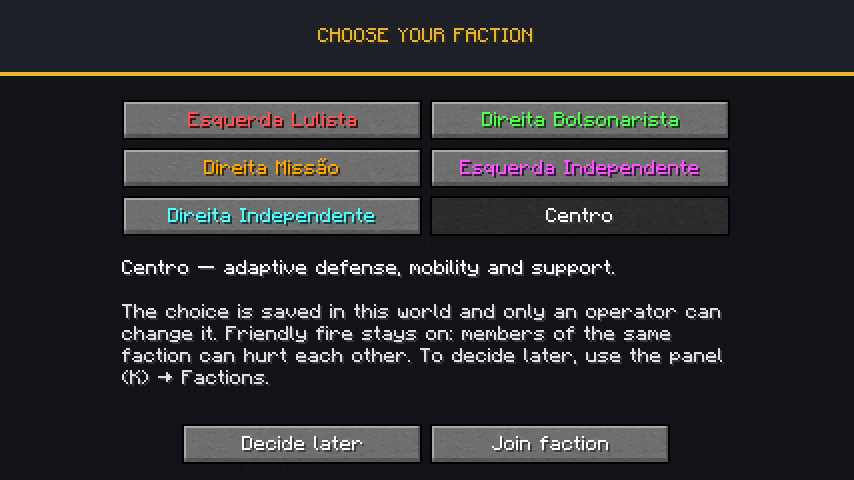

# Guerra Ezuberante 0.012.0 — escolha de facção

Primeira versão do sistema de facções descrito no README. Cada jogador escolhe uma das seis facções ao entrar no mundo pela primeira vez; a escolha fica salva no mundo e aparece no nome do jogador. Só um operador pode trocá-la depois.



## O que muda para o jogador

| Momento | Comportamento |
| --- | --- |
| Primeiro login no mundo | Abre a tela **Escolha sua facção** com as seis opções coloridas. Clicar mostra a descrição; **Entrar na facção** confirma. |
| Não quer decidir agora | **Decidir depois** fecha a tela. Painel K → Facções mostra **Escolher facção**; a tela volta a abrir no próximo login enquanto não houver escolha. |
| Depois de escolher | A escolha é definitiva para o jogador. O servidor anuncia no chat: *"Fulano entrou na facção Esquerda Lulista."* |
| Nome | Prefixo colorido `[Lulista]`, `[Bolsonarista]`, `[Missão]`, `[Esquerda]`, `[Direita]` ou `[Centro]` no chat, nas mensagens de morte, na lista do TAB e no nome acima da cabeça. |
| Desconectar, morrer, trocar de dimensão | A facção continua. Fica salva em `data/guerra_ezuberante_factions.dat` do mundo (overworld), por UUID. |

| Facção | Cor |
| --- | --- |
| Esquerda Lulista | vermelho |
| Direita Bolsonarista | verde |
| Direita Missão | dourado |
| Esquerda Independente | rosa |
| Direita Independente | ciano |
| Centro | branco |

## Fogo amigo continua ativo

Pedido do autor nesta versão: **membros da mesma facção podem se ferir**. A facção é só identidade. Ela não cria time de scoreboard, não altera `isAlliedTo` nem bloqueia dano. A regra de PvP do servidor (`pvp` no `server.properties`) e os times criados por `/team` continuam valendo como antes.

Os personagens com IA (Renan, Arthur, Lula, Jair, Flávio, Ucranianas) **não mudam**: continuam neutros até serem provocados e com as mesmas alianças fixas entre si. Ser Lulista não faz o Lula proteger o jogador.

## Comandos

| Comando | Permissão | Efeito |
| --- | --- | --- |
| `/ge faccao` | todos | Mostra a sua facção. |
| `/ge faccao definir <jogadores> <faccao>` | operador (nível 2) | Coloca os jogadores na facção. IDs: `lulista`, `bolsonarista`, `missao`, `esquerda`, `direita`, `centro` (Tab completa). |
| `/ge faccao limpar <jogadores>` | operador (nível 2) | Remove a facção; a tela de escolha abre de novo para esses jogadores. |

## Como funciona por dentro

```mermaid
sequenceDiagram
    participant C as Cliente
    participant S as Servidor
    C->>S: Entra no mundo
    S->>C: Facções dos jogadores online
    S-->>C: Pedido de escolha (se não tiver facção)
    C->>C: Abre a tela quando não há outra tela aberta
    C->>S: Escolhe facção (só o índice)
    S->>S: Recusa se já tiver facção; senão salva
    S->>C: Sincroniza para todos e anuncia no chat
```

- Pacote `faction/`: `Faction` (enum com IDs estáveis e cores), `FactionData` (SavedData no overworld), `Factions` (regras de escolha/atribuição/limpeza), `FactionNetwork` (canal `guerra_ezuberante:faction`, versão 1) e `FactionEvents` (login, prefixo de nome/TAB e comandos).
- Cliente: `client/FactionClient` guarda o pedido de escolha até o mundo terminar de carregar e limpa a cópia local ao desconectar; `client/screen/FactionSelectionScreen` é a tela, na mesma paleta do painel K.
- O cliente nunca define a facção sozinho: envia só o índice escolhido e o servidor decide. IDs desconhecidos num arquivo salvo são descartados ao carregar, sem quebrar o mundo.
- Prefixo via `PlayerEvent.NameFormat` e `PlayerEvent.TabListNameFormat` do Forge, preservando a formatação de times vanilla.

## Validação

| Etapa | Resultado |
| --- | --- |
| Build com validadores | aprovado |
| GameTests com TaCZ | **81/81** (76 anteriores + 5 novos) |
| GameTests sem TaCZ | **17/17** (12 anteriores + 5 novos) |
| Cliente gráfico isolado, singleplayer | aprovado; ver abaixo |

Os cinco testes novos (`src/pistolTest/.../FactionGameTests.java`, rodam com e sem TaCZ): persistência e descarte de ID desconhecido; primeira escolha definitiva até ação do operador; prefixo no nome e no TAB; fogo amigo igual ao de jogadores sem facção (o servidor de GameTest desliga PvP, então o teste compara com um par de controle); permissões e execução de `definir`/`limpar`/consulta.

Cliente real em perfil isolado `.tools/run-faction-client` com volume master 0, numa cópia do mundo de GameTest (sem tocar `run/`):

- A tela abriu sozinha no primeiro login; selecionar mostrou a descrição e ativou a confirmação.
- Confirmar chegou ao servidor: chat e log com *"Dev joined the Esquerda Lulista faction."* (cliente em inglês).
- Mensagem de morte com prefixo `[Lulista] Dev drowned`; após renascer, painel K mostrou a facção.
- Salvar, sair e relançar: log *"[Lulista] Dev joined the game"* e a tela **não** reabriu.
- Sem facção: **Decidir depois** fechou a tela, painel K mostrou **Escolher facção**, e escolher por ali funcionou.


**Não validado ainda:** lista do TAB e nome acima da cabeça com dois jogadores reais (no singleplayer com um jogador só o vanilla esconde o TAB; o prefixo do TAB está coberto pelo GameTest). Multiplayer com dois clientes não foi executado nesta versão.

## Próximos passos possíveis

Poderes, itens e efeitos por facção; regras de diplomacia; troca de facção pelo próprio jogador com custo; relação entre a facção do jogador e os personagens com IA. Nada disso foi implementado sem pedido.
