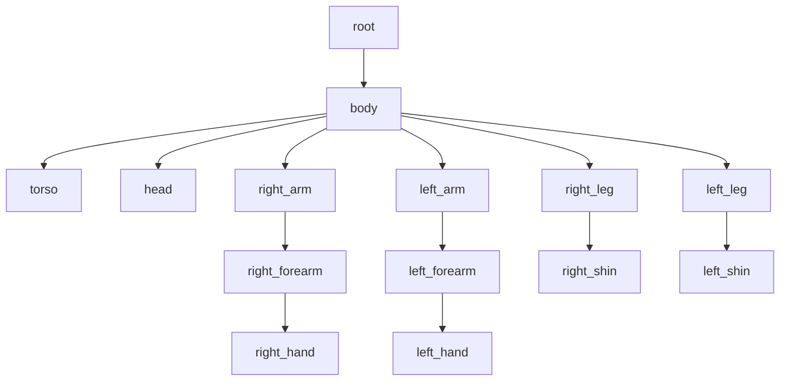

# GeckoLib, animações articuladas e variantes — 0.004.0

Esta sprint substitui a renderização PlayerModel da 0.003.0 por GeckoLib 4. A documentação anterior em INVOCACAO_0.003.md e COMBATE_0.002.md é histórica; as decisões e os números atuais estão neste arquivo e no README.

## Dependências exatas

| Componente | Versão | Uso |
| --- | --- | --- |
| Minecraft Java | 1.20.1 | Plataforma mantida |
| Forge | 47.4.28 | Registros, entidades, configurações e networking |
| Java | 17 | Código, toolchain e gerador de recursos |
| Gradle / ForgeGradle | 8.8 / 6.0.54 | Build e remapeamento |
| GeckoLib Forge 1.20.1 | **4.8.4** | GeoEntity, cache por entidade, controller, GeoModel e GeoEntityRenderer |
| FFmpeg | Ferramenta local | MP3 completo → Ogg Vorbis mono 44.100 Hz |

Coordenada: `software.bernie.geckolib:geckolib-forge-1.20.1:4.8.4`. O Maven oficial foi consultado em 24/10/2026: o metadata lista 4.8.4 como release para esse artefato específico. Gradle usa `implementation fg.deobf(...)`; `mods.toml` exige a versão exata no cliente e no servidor. Não foram importadas APIs GeckoLib 3 ou 5.

O fonte oficial 4.8.4 foi baixado e inspecionado para confirmar pacotes `core.animation`, `GeoEntity`, UVs de BakedModelFactory, formato de FaceUV e BlockAndItemGeoLayer. O Mixin já é fornecido pelo Forge. Como este mod não declara mixins próprios, os runs configuram diretamente `mixin.env.remapRefMap` e `mixin.env.refMapRemappingFile`, com dependência da tarefa `createSrgToMcp`. Isso corrige o erro real `TextureManagerMixin / m_118506_` encontrado na primeira abertura em userdev, mantendo o remapeamento necessário ao GeckoLib.

O build também gera um diretório `build/distributions/guerra-ezuberante-0.004.0/mods/` com o JAR reobfuscado do mod e o **JAR original** do GeckoLib, resolvido sem `fg.deobf`. O GeckoLib não é incorporado ao JAR do mod. Não instalar a variante mapped de desenvolvimento em uma instalação normal.

## Arquivos de implementação

Caminhos Java relativos a `src/main/java/io/github/omarflk/guerraezuberante/`:

| Arquivo | Mudança |
| --- | --- |
| `entity/RetaliatingCharacterEntity.java` | GeoEntity, cache, controller, alcance entre caixas, revalidação no impacto e knockback |
| `entity/ArthurDoValEntity.java` | Variante por construtor, arma, conjuração exclusiva, Speed I persistente, dano final 5 |
| `entity/UkrainianFighterEntity.java` | Relógio de emergência, atraso individual e salvamento sem reiniciar a fase |
| `animation/CharacterAnimationController.java` | Seleção de oito clipes, cache de RawAnimation e busca temporal sincronizada |
| `client/model/CharacterGeoModel.java` | Modelo compartilhado, textura por personagem e orientação da cabeça |
| `client/renderer/CharacterGeoRenderer.java` | GeoEntityRenderer compartilhado e espada no osso da mão |
| `client/renderer/RenanRenderer.java` | Textura original de Renan, escala 1 |
| `client/renderer/ArthurRenderer.java` | Textura original de Arthur, escala 0,88 nas duas variantes e legado |
| `client/renderer/UkrainianFighterRenderer.java` | Textura original da combatente, sem translação de elevador no renderer |
| `client/ClientModEvents.java` | Registra os dois Arthurs adicionais |
| `client/gui/ModPanelScreen.java` | Quatro seleções em duas linhas, cinco páginas preservadas |
| `registry/ModEntities.java` | IDs novos e ID antigo mantido |
| `registry/ModItems.java`, `registry/ModCreativeTabs.java` | Ovos separados e espada de ferro preservada |
| `registry/ModSounds.java` | Recarga do novo efeito: 120 ticks |
| `GuerraEzuberanteMod.java` | Atributos para os novos registros |
| `config/ModConfig.java` | Emergência padrão e mínima de 44 ticks; migração de valores antigos menores |
| `summon/ArthurSummoning.java` | Bloqueia Combatente também na API de spawn; escalona cada unidade em dois ticks |

O antigo `CombatHumanoidModel.java` foi removido. `RenanSantosEntity.java` não precisou mudar: herda a nova base e mantém seus atributos e suas listas de áudio.

## Modelo e UV

Recursos gerados em `src/main/resources/assets/guerra_ezuberante/`:

- `geo/humanoid.geo.json` — formato 1.12.0, atlas 64×64, 14 ossos e 20 cubos com base + overlays.
- `animations/humanoid.animation.json` — formato 1.8.0 e oito clipes.



Cada braço/perna original de 4×12×4 é dividido em dois cubos de 4×6×4. As faces laterais usam as primeiras e as últimas seis linhas da área original; não se reutiliza o box UV de um cubo 4×6 como se o atlas tivesse sido redesenhado. Cabeça e tronco conservam suas regiões clássicas. Topos e bases usam as regiões correspondentes do atlas; tampas internas só ficam expostas ao dobrar articulações. Camadas externas mantêm seus offsets e inflação (cabeça 0,5; roupas 0,25 pixel). As duas mãos são pivôs sem cubos adicionais.

Hashes dos PNGs empacotados são comparados às fontes pelo validador. Nenhum rosto, cabelo, terno, faixa, roupa ou espada foi repintado. A escala de Arthur pertence ao renderer e à entidade, preservando a textura 64×64.

## Geradores e validação automática

O agente executa a geração; não é uma tarefa de edição manual do autor:

```powershell
powershell -NoProfile -ExecutionPolicy Bypass -File tools/generate_gecko.ps1
powershell -NoProfile -ExecutionPolicy Bypass -File tools/gradle.ps1 runGameTestServer build
```

`GenerateGeckoAssets.java` só usa JDK 17 e produz saída determinística. Faz interpolação smoothstep das poses e amostra a 20 Hz; o Gecko interpola entre as amostras durante a renderização. Cada clipe redefine rotações e translações de todos os ossos para evitar resíduos de uma pose em outra entidade.

`validate_assets.ps1`: JSONs, idiomas, legendas, OGGs, dimensões dos PNGs e hashes de origem. `validate_gecko.ps1`: pais e nomes únicos, regiões UV dentro de 64×64, continuidade dos segmentos, ossos existentes em cada clipe, vetores finitos, timestamps dentro da duração, clipes exigidos, frame de impacto em 0,25 s, texturas e dependência obrigatória. Ambos rodam em `check`/`build`; `compileJava` resolve e verifica as APIs da dependência real. `generate_gecko.ps1` gera e chama ambos.

## Emergência e sincronização

1. Mãos aparecem separadamente até 400 ms; a segunda tem atraso de 120 ms dentro do clipe.
2. De 400 a 800 ms, os cotovelos dobram e a cabeça começa a aparecer.
3. De 800 a 1400 ms, braços e antebraços puxam o tronco inclinado.
4. De 1400 a 1900 ms, coxas e canelas dobram e completam a saída.
5. De 1900 a 2200 ms, a espada passa a ser renderizada e a postura volta ao combate.

As cinco unidades usam atrasos de 0/2/4/6/8 ticks. A configuração mínima é 44 ticks; se o servidor escolher um valor maior, o clipe é desacelerado proporcionalmente. O renderer não move o corpo inteiro para cima com uma função de elevador: quem move o esqueleto é o clipe articulado. A posição física segue sobre chão sólido e seguro, sem alterar blocos ou aumentar caixas de colisão.

Servidor controla o bloqueio de ações. SynchedEntityData carrega início/duração da emergência, início da conjuração e início/lado do golpe. O controller Gecko usa o mesmo relógio do mundo para procurar o frame, preservando a fase se uma entidade começa a ser rastreada no meio da ação. A fase é persistida em NBT, incluindo atraso ainda não cumprido. Dano, spawn, cooldown, ownership e Speed são exclusivamente do servidor; clientes renderizam.

## Alcance, dano e arma

A distância mínima entre AABBs considera os três eixos. A folga máxima é 1,9 bloco entre superfícies, equivalente a 2,5 blocos entre centros para duas entidades de largura 0,6. Os testes usam alvo de tamanho real e também verificam distância vertical, paredes e hitboxes originais. A IA usa um limite de busca compatível; início e impacto consultam a mesma função exata.

Preparação ocorre no início do ataque; dano único no tick 5. Soco direito, esquerdo e corte têm keyframe explícito em 0,25 s. Se o alvo escapar ou ficar atrás de uma parede antes do impacto, o golpe não causa dano. O knockback adicional é 0,2, respeitando resistência vanilla. Nenhum dano adicional foi associado a efeitos visuais no cliente.

Renan mantém dano 4. Ambos os Arthurs mantêm dano final 5. Para o Combatente, o ataque retira temporariamente apenas o modificador ATTACK_DAMAGE da arma da instância de atributo, executa o ataque de base e o restaura em `finally`. Isso conserva o atributo básico 5 e evita dobrar o dano ao equipar uma espada. A espada mantém todas as propriedades de ferro e perde uma unidade de durabilidade por acerto aceito. Nas tropas, base 1 + modificador vanilla 5 = dano 6.

## Variantes e persistência

As três entradas de Arthur utilizam a mesma classe com uma propriedade de variante definida pelo registro. `arthur_do_val_combatente`: arma e nenhum caminho de invocação. `arthur_do_val_invocador`: sem arma, conjura e recebe Speed. `arthur_do_val`: legado compatível como Invocador. Cada novo tipo tem ovo próprio; entidades salvas com ID antigo continuam carregando.

Após um cast criar pelo menos uma unidade, `HasSummoned=true` é salvo. O Invocador recebe `MOVEMENT_SPEED`, duração infinita -1 e amplificador 0. O efeito usa o modificador vanilla, não soma níveis em cada leva e é restaurado se removido. O valor básico continua 0,24; Speed I resulta em aproximadamente 0,288. Cast sem espaço/terreno válido não concede Speed. O Combatente nunca concede esse bônus.

Capacidade 30, quantidade 5, intervalo 700 ticks, HP 15, vida 6000 ticks carregados e tolerância de dono ausente 200 continuam configuráveis. Ledger por dimensão conta também unidades descarregadas. As tropas continuam seguindo/defendendo seu dono, compartilhando alvos legítimos, protegendo Renan e irmãs do mesmo dono, sem atacar jogadores aleatórios.

## Áudio substituído

Fonte atual: `audios/ucraniana/efeito sonoro spawn ucrania.MP3`.

- SHA-256 da fonte: `5162b84a34516322de7dd0307c20fb26cf328d3eb23413c9ff01a2ce3e47f354`.
- Duração medida com FFprobe: **5,903667 s**.
- A fonte antiga normalizada tinha outro hash (`8b06fd5370363ff5984e7a58dec7272186cb07c1983763667a725cb34d69f860`); portanto a troca não foi inferida apenas pelo nome.
- Cópia de entrada atualizada: `assets-entrada/audio/arthur/invocacao.mp3`; original em audios preservado.
- OGG completo, Vorbis mono 44.100 Hz, em `sounds/arthur/invocacao.ogg`; sem corte/aceleração.
- Mesmo evento `arthur.invocacao` em ModSounds/sounds.json, streaming e legenda mantidos; recarga reduzida a 120 ticks, superior à duração de 5,90 s.
- Um disparo no início da conjuração do dono, nenhum disparo individual das cinco tropas. As sete falas de Arthur e os três sons de Renan não foram reconvertidos.

## Testes e limites

O conjunto agora tem **31 GameTests**: 22 existentes adaptados e nove novos. Verifica atributos, ovos, variantes, legado, dano, durabilidade, alcance, visão, knockback, Speed após sucesso e save/load, ausência de Speed no Combatente, falha de cast, escalonamento e persistência da fase. Também cobre comportamento pacífico, agressor válido, cooldown de 700 ticks, limite por dono, segurança de terreno, aliados, perseguição e áudio disponível.

`ClientVisualChecks` e `ObserverVisualChecks` só entram no source set de testes, nunca no JAR final. `visual_test.ps1` copia o mundo fechado do GameTest para uma nova pasta `.tools/run-summon-client/saves/Gecko4-...`; captura o framebuffer real do Minecraft em 1280×720 e fecha a instância de teste. O mundo do jogador em run/ não é usado. O cenário exibe as skins, variantes, conjuração, mãos, apoio, joelhos, combate e painel.

Há uma tentativa opcional de dois clientes reais: host com `visual_test.ps1 -Multiplayer`, depois `multiplayer_test.ps1`. Listener limitado a IPv4 127.0.0.1:25579, sem anúncio LAN. O teste usa perfis offline só nessa instância isolada e não altera a autenticação do mod ou de servidores normais. Ambos os scripts exigem marcadores de conclusão, além de retorno zero do processo. **As tentativas desta sprint chegaram ao handshake Forge, mas não completaram o login do observador. A renderização multiplayer com dois clientes continua pendente.**

O servidor GameTest Forge foi inicializado e executou o conjunto sem GUI. A tentativa de servidor dedicado convencional e seus limites estão em [VALIDACAO.md](VALIDACAO.md). Capturas estáticas comprovam poses e recursos; não substituem avaliação de fluidez pelo autor nem teste de rede com latência real. Nenhuma aprovação humana de animação ou audição manual do novo efeito foi presumida.

## Fontes oficiais

- [Maven específico de Forge 1.20.1](https://dl.cloudsmith.io/public/geckolib3/geckolib/maven/software/bernie/geckolib/geckolib-forge-1.20.1/maven-metadata.xml).
- [Instalação GeckoLib 4](https://github.com/bernie-g/geckolib/wiki/Installation-(Geckolib4)).
- [Controllers e animações em código](https://github.com/bernie-g/geckolib/wiki/Defining-Animations-in-Code-(Geckolib4)).
- [Código oficial GeckoLib 1.20.1](https://github.com/bernie-g/geckolib/tree/1.20.1); a API utilizada foi conferida no source JAR exato 4.8.4 do Maven.
- [Remapeamento de referências Mixin](https://github.com/SpongePowered/Mixin/blob/master/src/main/java/org/spongepowered/asm/mixin/MixinEnvironment.java).

Após a entrega e o teste pelo autor, ele autorizou commit e push das alterações atuais com a mensagem: "efeitos sonoros arrumados, mais vozes, animacoes tbm agora e melhorei a mecanica de combate". Nenhum merge foi solicitado; consultar o histórico Git para o commit publicado.
