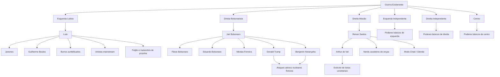
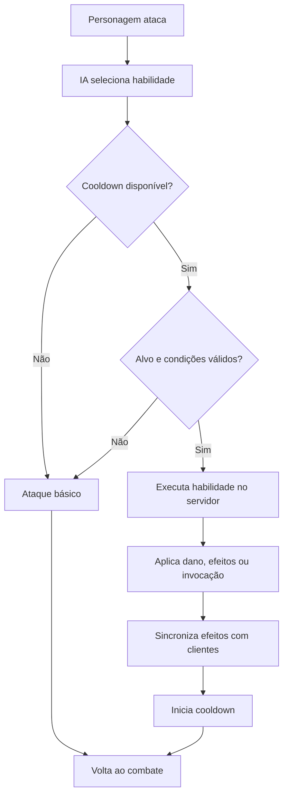

# Guerra Ezuberante — documento de ideia e design

Consolidação de contexto em 24/10/2026, a partir do GDD conceitual versão 0.1 e dos três anexos fornecidos pelo autor.

A documentação principal está no [README](../README.md), com a implementação atual e o plano completo. **Atualização técnica: Minecraft 1.20.1, Forge 47.4.28, Java 17, Gradle 8.8, ForgeGradle 6.0.54, pacote io.github.omarflk.guerraezuberante e versão 0.001.0.** A primeira implementação do Renan usa a skin e as duas falas fornecidas pelo autor. Consulte [VALIDACAO.md](VALIDACAO.md). As descrições de estado de planejamento abaixo preservam a etapa original, anterior ao código; não representam o estado atual.

**Nome atual: Guerra Ezuberante, com z.** O título “Guerra Política” nas fontes é histórico. A versão 0.1 do documento de design não significa que exista uma versão 0.1 do mod.

Atualização de implementação: **0.002.0** adiciona Arthur do Val e retaliação compartilhada. A lore abaixo permanece preservada; estado da sprint em [COMBATE_0.002.md](COMBATE_0.002.md), [AUDIOS.md](AUDIOS.md) e [VALIDACAO.md](VALIDACAO.md).

Atualização da sprint **0.004.0**: GeckoLib 4.8.4 obrigatório, humanoide articulado, emergência corporal em 44 ticks, alcance corrigido e dois Arthurs estão implementados. O Exército Ucraniano e a Espada Ucraniana da sprint anterior foram preservados. Estado real e arquivos em [GECKOLIB_0.004.md](GECKOLIB_0.004.md); as seções abaixo preservam o planejamento original.

## 1. Escopo inicial e estado atual

Este documento começou como registro da ideia. Em seguida, o autor autorizou a implementação do Renan e forneceu a skin e duas falas. A implementação atual está documentada no README, preservando aqui a lore e o roadmap original.

O projeto Gradle está configurado e o protótipo possui Renan, skin, ovo, falas por interação e painel informativo. O build e dois GameTests de servidor passaram; o autor confirmou skin e áudios no cliente. Facções jogáveis, poderes de combate e tropas continuam futuros. Veja os limites de testes em VALIDACAO.md.

O conteúdo abaixo preserva o planejamento enviado. A stack atual é Forge 47.4.28 no Minecraft 1.20.1 com Java 17. Os critérios futuros e os sistemas avançados descritos não representam funcionalidades implementadas.

## 2. Conceito e direção

Transformar o Minecraft em um campo de batalha político caótico, multiplayer e completamente satírico. Personagens inspirados em figuras públicas terão poderes absurdos, exércitos próprios, invocações, alianças, músicas, transformações e habilidades especiais.

Os ataques, falas e relações descritos são caricaturas fictícias de videogame. As diferenças de poderes entre facções são escolhas de gameplay e balanceamento.

A estratégia de desenvolvimento é construir primeiro uma base que funcione, depois os personagens e, por fim, as batalhas gigantes. Cada marco deve funcionar antes da expansão seguinte.

Indicadores da visão original: seis facções iniciais, mais de onze personagens nomeados e primeiro marco de implementação chamado v0.001.

## 3. Facção, classe e personagem

Três conceitos devem permanecer separados:

| Conceito | Significado | Exemplo |
| --- | --- | --- |
| Facção | Equipe, identidade e relações de aliados/inimigos | Direita Missão |
| Classe de combate | Arquétipo e função do jogador na batalha | Invocador |
| Personagem | Entidade independente com IA e conjunto de habilidades | Renan Santos |

Um jogador pode escolher Direita Missão, jogar de Invocador e utilizar poderes ligados ao Renan. Paralelamente, Renan pode existir como mob independente, invocado por spawn egg. Isso evita misturar a IA dos personagens com o controle das habilidades dos jogadores.

## 4. As seis facções

| Facção | Identidade de gameplay | Conteúdo associado |
| --- | --- | --- |
| Esquerda Lulista | Invocações, comida e mortos-vivos | Lula, Janones, Boulos, artistas mainstream, burros zumbificados, feijão e meteoritos de picanha |
| Direita Bolsonarista | Aliados internacionais, bombas e ataques de dinheiro | Jair, Flávio e Eduardo Bolsonaro, Nikolas Ferreira, Donald Trump e Benjamin Netanyahu |
| Direita Missão | Invocação, transformação e cavalaria | Renan Santos, Arthur do Val, Glenda, nerds montados em onças e loiras ucranianas |
| Esquerda Independente | Defesa, suporte e poderes genéricos | Resistência em grupo, recuperação gradual de vida e controle de multidões |
| Direita Independente | Combate direto, precisão e poderes genéricos | Dano individual, velocidade e precisão |
| Centro | Versatilidade, negociação e poderes genéricos | Alternância adaptativa entre defesa, mobilidade e suporte |

As três primeiras são facções especiais, com líderes, habilidades próprias e tropas exclusivas. As três restantes são escolhas independentes com conjuntos básicos de habilidades.

### Seleção e persistência planejadas

- No primeiro ingresso no mundo, o jogador verá uma interface de escolha de facção.
- Jogadores da mesma facção serão aliados por padrão.
- Cada facção terá identificação visual, itens e efeitos próprios.
- A escolha será salva no mundo e continuará válida após desconectar e voltar ao servidor.
- O administrador poderá permitir mudanças de facção.

As regras completas de diplomacia, fogo amigo, troca de facção e progressão ainda precisam de detalhamento.

### Mapa de relações

O diagrama representa vínculos e conteúdo associado. Nem toda ligação representa uma invocação direta; as habilidades do catálogo esclarecem essas relações.



## 5. Catálogo de personagens e habilidades

Todos os itens deste catálogo estão planejados. Dano, vida, alcance, duração, recarga, probabilidade de uso e limites de tropas ainda não receberam valores.

### Renan Santos

Facção: Direita Missão. Papel: boss, invocador e DPS (dano).

| Habilidade | Comportamento previsto |
| --- | --- |
| Me Respeita | Gira disparando projéteis em todas as direções, acompanhado de funk |
| Arthur do Val | Invoca Arthur; este poderá convocar seu próprio exército |
| Modo Chad | Ao negar a Glenda, recebe aumento de dano, velocidade e resistência, com aura visual |
| Cavalaria da Missão | Invoca nerds com lanças medievais montados em onças |
| Ultimate — Moggador Supremo | Combina rotação, disparos e cavalaria em uma sequência especial |

Renan é o personagem piloto sugerido no documento original. O autor ainda pretende definir e criar conosco o personagem inicial de teste e seus recursos visuais.

### Arthur do Val

Facção: Direita Missão. Papel: invocador e suporte ofensivo.

| Habilidade | Comportamento previsto |
| --- | --- |
| Exército Ucraniano | Invoca unidades de loiras ucranianas que atacam inimigos |
| São Fáceis Porque São Pobres | Nome de habilidade satírica no conceito; fala e bônus temporário de ataque para suas unidades |
| Reforços | Repõe parcialmente as tropas perdidas |
| Ultimate — Legião Ucraniana | Invoca uma formação maior de combatentes |

As unidades do exército terão modelo, comportamento e atributos próprios.

### Lula

Facção: Esquerda Lulista. Papel: boss, necromante e dano em área.

| Habilidade | Comportamento previsto |
| --- | --- |
| Dedos de Feijão | Dispara rajadas de feijões nos inimigos |
| Picanha Meteorítica | Faz chover meteoritos de picanha |
| Exército dos Mortos | Invoca burros zumbificados que perseguem inimigos |
| Convocação Política | Invoca Janones, Boulos e tropas caricatas de artistas mainstream |
| Ultimate — Chuva de Picanha | Bombardeio de área com diversos meteoritos |

### Jair Bolsonaro

Facção: Direita Bolsonarista. Papel: boss, comandante e controle.

| Habilidade | Comportamento previsto |
| --- | --- |
| Clã Bolsonaro | Invoca Flávio e Eduardo Bolsonaro |
| Reforço Conservador | Invoca Nikolas Ferreira |
| Aliança Internacional | Invoca Trump e Netanyahu |
| Funk Temporal | Coreografia com distorção visual do tempo e redução da velocidade dos inimigos |
| Ultimate — Caos Internacional | Combina dança, reforços e ataques explosivos dos aliados |

### Flávio Bolsonaro

Facção: Direita Bolsonarista. Papel: DPS e ataque à distância.

| Habilidade | Comportamento previsto |
| --- | --- |
| Rachadinha | Projéteis de dinheiro se dividem em duas partes durante o voo |
| Lula é Pobre | Provoca inimigos próximos e aumenta temporariamente o próprio dano |
| Chuva de Notas | Dispara múltiplos projéteis de dinheiro |

### Demais personagens, tropas e eventos

| Personagem ou unidade | Vínculo / papel | Mecânica prevista |
| --- | --- | --- |
| Janones | Suporte lulista | Provocação e fortalecimento de aliados |
| Guilherme Boulos | Tanque lulista | Defesa e combate corpo a corpo |
| Eduardo Bolsonaro | Reforço bolsonarista | Ataques e bônus de equipe |
| Nikolas Ferreira | Suporte bolsonarista | Buffs e provocações |
| Donald Trump | Boss invocável, aliado bolsonarista | Bombardeios aéreos fictícios |
| Benjamin Netanyahu | Boss invocável, aliado bolsonarista | Bombardeios fictícios em área |
| Nerds montados em onças | Cavalaria da Missão | Investida com lanças |
| Loiras ucranianas | Exército de Arthur | Formação e combate em grupo |
| Burros zumbificados | Exército de Lula | Ataques em massa |
| Artistas mainstream | Tropas lulistas | Suporte e efeitos sonoros |
| Glenda | NPC de evento ligado ao Renan | Evento que ativa a transformação Chad |

## 6. Classes jogáveis

| Classe | Função | Características |
| --- | --- | --- |
| Combatente | Dano direto | Ataques rápidos e combos |
| Tanque | Resistência | Vida alta, escudos e provocação |
| Invocador | Controle de tropas | Criação de aliados temporários |
| Especialista | Poderes especiais | Projéteis, efeitos e manipulação de área |
| Suporte | Fortalecimento | Cura, buffs e proteção |

Qualquer facção poderá utilizar os arquétipos; as habilidades disponíveis dependerão da combinação entre facção e classe. Um Invocador da Missão terá tropas diferentes das de um Invocador Lulista. Um Combatente da Direita Independente usará poderes genéricos, sem receber automaticamente os especiais de Bolsonaro.

Ainda não há uma matriz completa de habilidades para cada combinação.

## 7. Modos de jogo e expansão

### Laboratório político — criativo

Modo prioritário para desenvolver e testar. Os spawn eggs ficarão disponíveis em uma aba exclusiva chamada **Guerra Ezuberante**, permitindo invocar personagens, montar batalhas e testar habilidades. A disponibilidade será ampliada conforme cada entidade for implementada.

### Guerra de facções — multiplayer

Jogadores escolhem uma facção, recebem poderes e enfrentam outras equipes. O modo prevê regras de aliados e inimigos, progressão e habilidades especiais.

### Ideias futuras

Batalhas de chefes, arenas eleitorais, guerras entre facções e campanhas com missões. Essas ideias ainda não têm especificação detalhada nem marco reservado.

## 8. Roadmap proposto

As versões abaixo são rótulos do planejamento original, ainda sem releases. A numeração poderá ser padronizada antes da configuração do projeto. Não há prazos de calendário: a duração depende de IA, recursos visuais e testes.

| Sprint / versão | Escopo | Critério de aceite previsto |
| --- | --- | --- |
| 01 — v0.001 | Base Java/Forge/Gradle, entidade piloto Renan, modelo/textura, spawn egg, aba criativa, movimentação, comando e primeiro JAR | Abrir o Minecraft, pegar o ovo na aba do mod, invocar o personagem com aparência correta e vê-lo mover-se sem erros; validar cliente e servidor |
| 02 — v0.002 | IA e combate básico: detectar, perseguir, atacar, receber dano e morrer | Renan enfrenta um zumbi ou alvo de teste sem travar |
| 03 — v0.003 | Ataque giratório, projéteis, cooldown, efeitos simples e primeira animação de combate | Habilidade automática respeita a recarga e causa dano no servidor |
| 04 — v0.004 | Lula, spawn egg, feijões e identificação básica de facções inimigas | Renan e Lula se reconhecem como inimigos e lutam automaticamente |
| 05 — v0.005 | Tela de seleção, seis facções, poderes genéricos, persistência e alianças | Escolha do jogador permanece ao reconectar |
| 06 — v0.006 | Arthur, loiras ucranianas, cavalaria de onças e evento da Glenda | Renan convoca reforços que identificam e atacam inimigos corretamente |
| 07 — v0.007 | Janones, Boulos, burros zumbificados, artistas e meteoritos de picanha | Lula enfrenta um grupo de invocações da Missão |
| 08 — v0.008 | Bolsonaro, Flávio, Eduardo, Nikolas, dinheiro dividido e dança temporal | Reforços e efeitos bolsonaristas funcionam e são sincronizados |
| 09 — v0.009 | Trump, Netanyahu, bombardeios, explosões visuais e habilidades combinadas | Ataques de área funcionam preservando o desempenho do servidor |
| 10 — v0.010 | Integração de poderes, sons, interfaces, limites de invocação e balanceamento | Três facções lutam numa arena multiplayer sem erros críticos |
| 11 — v0.1.0 | Alpha: polimento, otimização, instalação, documentação e correções | Amigos conseguem reproduzir o mod no cliente e servidor com a mesma versão |

### Checklist futuro da v0.001

- [ ] Criar o projeto Java com Forge e Gradle, após definir as versões.
- [ ] Registrar a entidade piloto, proposta como Renan Santos.
- [ ] Carregar modelo e textura definidos com o autor.
- [ ] Criar o spawn egg exclusivo da entidade.
- [ ] Criar a aba Guerra Ezuberante no inventário criativo.
- [ ] Implementar movimentação e animação básica.
- [ ] Permitir invocação por ovo e comando.
- [ ] Executar testes no cliente e no servidor.
- [ ] Gerar o primeiro arquivo `.jar`.

O primeiro marco comprova a infraestrutura. Funk, exércitos, meteoritos e poderes especiais ficam nos marcos posteriores.

O documento original pressupõe recursos visuais fornecidos. Como o pedido atual adia sua criação, será preciso combinar uma aparência provisória ou preparar a arte antes de considerar o critério visual desse marco concluído.

## 9. Arquitetura técnica proposta

Esta seção registra a proposta recebida, sem fixar versões ou validar compatibilidade de ferramentas. A configuração técnica será feita na etapa de implementação.

| Tecnologia | Responsabilidade proposta | Situação |
| --- | --- | --- |
| Minecraft Java Edition | Plataforma do mod | 1.20.1 |
| Java | Programação | JDK 17 |
| Forge | Integração, registros, entidades, itens e eventos | 47.4.28 |
| Gradle | Compilação e dependências | Wrapper 8.8 e ForgeGradle 6.0.54 |
| Blockbench | Modelos e animações | Recursos visuais adiados |
| GeckoLib 4.8.4 | Animações articuladas | Obrigatório desde 0.004.0 |
| JSON | Dados configuráveis de personagens e poderes | Formato/esquema a definir |
| IntelliJ + Codex | Ambiente sugerido na fonte | Sugestão, sem impor troca de editor |
| Git/GitHub | Versionamento e colaboração | Repositório inicializado |

### Organização futura do código

Árvore-alvo de expansão, adaptada ao nome atual e ao pacote escolhido. `guerra_ezuberante` e `io.github.omarflk.guerraezuberante` estão configurados. A entidade atual chama-se `RenanSantosEntity`; vários módulos abaixo são futuros. A estrutura efetivamente criada está no README.

```text
src/main/java/io/github/omarflk/guerraezuberante/
├── GuerraEzuberanteMod.java
├── registry/
│   ├── ModEntities.java
│   ├── ModItems.java
│   └── ModCreativeTabs.java
├── entity/
│   ├── PoliticalMobEntity.java
│   ├── RenanEntity.java
│   ├── LulaEntity.java
│   ├── BolsonaroEntity.java
│   └── summons/
├── faction/
│   ├── Faction.java
│   ├── FactionManager.java
│   └── PlayerFactionData.java
├── ability/
│   ├── Ability.java
│   ├── AbilityManager.java
│   ├── AbilityContext.java
│   └── implementations/
├── combat/
│   ├── CombatManager.java
│   ├── TargetingService.java
│   └── SummonManager.java
├── client/
│   ├── renderer/
│   ├── model/
│   ├── animation/
│   └── gui/
└── network/
    └── packets/

src/main/resources/
├── assets/guerra_ezuberante/
│   ├── textures/
│   ├── models/
│   ├── animations/
│   ├── sounds/
│   └── lang/
└── data/guerra_ezuberante/
    └── characters/

gradle/
build.gradle
README.md
```

Uma entidade-base compartilhada poderá reunir comportamentos comuns. Subclasses específicas só serão necessárias para diferenças reais de comportamento. O sistema de habilidades deverá permitir ampliar personagens sem duplicar todo o código.

### Habilidades e autoridade do servidor

Cada habilidade poderá configurar dano, alcance, recarga, duração e quantidade máxima de invocações.

O servidor será responsável por validar ataques, calcular dano e criar invocações. Os clientes apresentarão animações, sons, partículas e interfaces, com sincronização dos efeitos relevantes.



### Limites técnicos previstos

- Invocações com duração e quantidade máxima configuráveis.
- Ataques nucleares tratados como efeitos fictícios de videogame, sem destruição permanente de blocos por padrão.
- Distorção temporal aplicada a entidades e efeitos visuais, preservando o relógio global do servidor.
- IA evitando buscar todos os mobs desnecessariamente a cada tick.
- Gerenciador de áudio para músicas e falas.
- Sons originais ou com permissão para distribuição do mod, conforme previsto no material.

Limites concretos de entidades, intervalos de busca e metas de desempenho serão definidos com testes.

## 10. Arte, sprites, modelos e áudio

O autor quer criar os recursos dos personagens em uma etapa posterior, começando por um personagem inicial de teste.

O formato visual ainda está em aberto: skins/texturas podem ser aproveitadas com um modelo compatível; uma imagem 2D pode exigir adaptação de modelo ou renderização como sprite plano. A escolha entre essas opções será feita quando houver referências e requisitos de animação.

As imagens anexadas nesta etapa são diagramas de conceito e uma captura de indicadores, não sprites, texturas ou modelos prontos para o Minecraft.

Nenhuma música, fala, textura ou animação foi produzida ou importada como recurso do mod nesta etapa.

## 11. Organização do trabalho

O material propõe quatro áreas de trabalho: núcleo do mod, poderes, arte/animação e testes de gameplay. A implementação poderá ser conduzida com o Codex; decisões visuais e testes de experiência serão feitos com o autor.

Um quadro Trello ou GitHub Projects foi sugerido na fonte, mas não foi criado nem configurado. Cada personagem poderá ter uma ficha com:

- Nome, facção, papel e status de implementação.
- Sprite/textura, modelo e animações.
- Habilidades e parâmetros de balanceamento.
- Sons, falas e efeitos.
- Testes e critério de aceite.

## 12. Decisões pendentes

| Decisão | Estado |
| --- | --- |
| Nome público do mod | Confirmado pelo autor: Guerra Ezuberante, com z |
| Escopo do trabalho atual | Primeiro protótipo do Renan implementado e em teste |
| Versão do Minecraft | 1.20.1 |
| Versões de Java, Forge e Gradle | JDK 17, Forge 47.4.28, Wrapper 8.8, ForgeGradle 6.0.54 |
| Personagem piloto | Renan Santos confirmado e implementado |
| Aparência do primeiro teste | Skin clássica 64×64 do autor integrada e confirmada no jogo |
| Identificador técnico e pacote Java | guerra_ezuberante e io.github.omarflk.guerraezuberante |
| GeckoLib e formato de animação | GeckoLib 4.8.4 obrigatório; modelos e clipes gerados por código |
| Atributos e balanceamento | Sem valores definidos |
| Regras detalhadas de alianças, progressão e troca de facção | Ainda não especificadas |
| Formato final dos recursos visuais e áudio | A definir com o autor |

As pendências restantes são de evolução do gameplay. As decisões da base Java já foram tomadas e aplicadas.

## 13. Fontes e preservação de contexto

- [Texto original recebido](referencias/ideia-original.txt): preservado sem reescrita; contém o nome antigo, resíduos de estilo da exportação e instruções propostas para uma etapa futura.
- [Diagrama original de facções e personagens](referencias/faccoes-e-personagens.png).
- [Diagrama original do fluxo de habilidades](referencias/fluxo-de-habilidades.png).
- [Captura dos indicadores iniciais](referencias/visao-inicial.png).
- [Contexto resumido do projeto](../CONTEXTO.md).

O texto recebido menciona um botão “Copiar prompt” para a v0.001, mas não traz o corpo do prompt. Esta consolidação preserva o checklist e os critérios descritos sem inventar o conteúdo ausente.

As correções e decisões explícitas do autor prevalecem sobre as propostas históricas das fontes. O nome atual é Guerra Ezuberante; o estado real do protótipo está no README, em CONTEXTO.md e em VALIDACAO.md.
