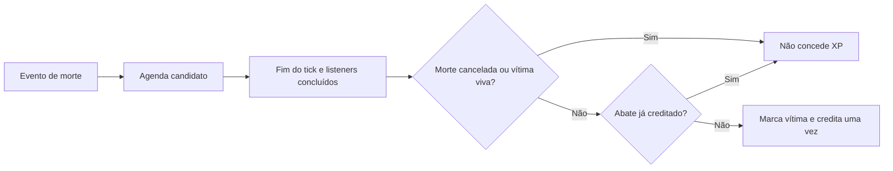
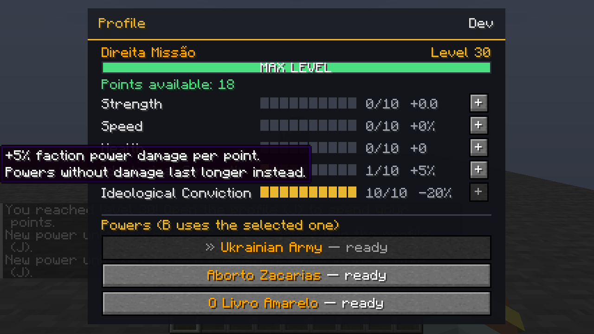
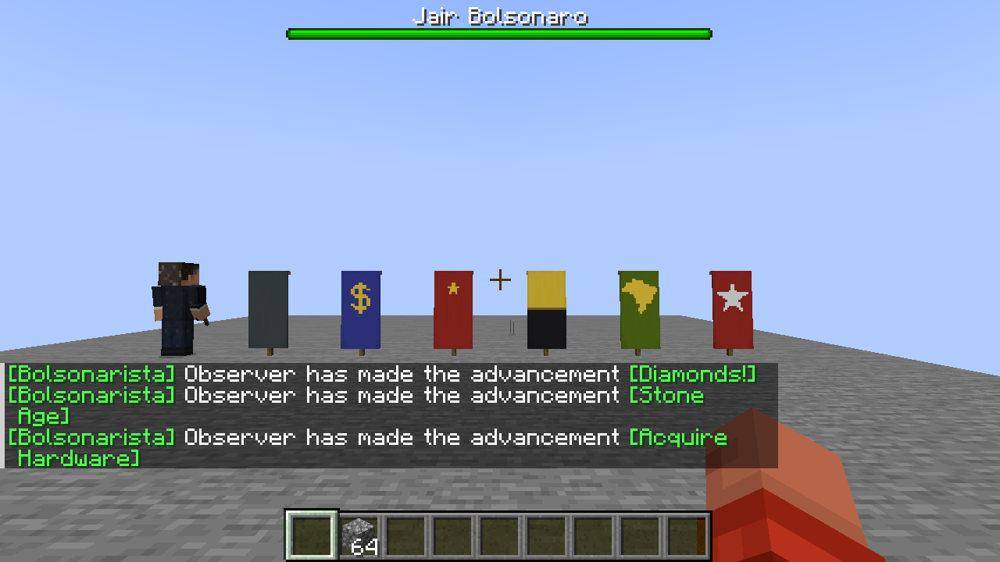

# Guerra Ezuberante 0.014.1 — progressão, vozes e vilas integradas

Integração autorizada por OmarFLK em **29/10/2026**, preservando a contribuição de **[GabrielKraemer2805](https://github.com/GabrielKraemer2805/A-Guerra-Ezuberante)** e as correções já publicadas na main0.012.1.

Os commits originais permanecem no histórico: `001db7c` (progressão e poderes), `e643e90` (vozes do Jair) e `b08a9b0` (vilas e castelos). Os conflitos em contexto, README, versão e `FactionPowers` foram resolvidos combinando os recursos novos com a segurança anterior, sem substituir a main inteira pelo fork.

## Recursos integrados

| Recurso | Funcionamento | Documento |
| --- | --- | --- |
| Níveis e atributos | Níveis1–30,29 pontos e cinco atributos; perfil na teclaJ | [Progressão](PROGRESSAO_0.013.md) |
| Convicção | Segundo/terceiro poder com5/10 pontos; B usa o selecionado emJ; recargas por slot | [Poderes](PROGRESSAO_0.013.md#poderes-novos) |
| Jair | Duas falas de interação e Canalha na reação a dano, com recargas para evitar sobreposição | [Áudios](AUDIOS.md) |
| Vilas e castelos |18 posições planejadas, três por facção, casas vanilla, bandeiras, castelo e personagens persistentes | [Vilas](VILAS_0.014.md) |
| Coordenadas | Chat, painelK e `/ge vilas`; dependem do gerador e dos conjuntos de estruturas | [Coordenadas](VILAS_0.014.md#coordenadas) |

Minecraft1.20.1, Forge47.4.28, JDK17, GeckoLib4.8.4 e TaCZ opcional1.1.8-hotfix2 continuam nas mesmas versões. O canal de facções passa a ser a **versão3**: use o mesmo conjunto atualizado no cliente e servidor.

## Correções

### Explosão do Faz o L

- O jogador precisa estar vivo, presente e na dimensão correta. Projétil sem dono válido não explode sozinho depois de logout.
- Destruição depende de `faz_o_l_break_blocks` e `mayBuild`: modo Aventura mantém o terreno. Efeitos/dano permitidos continuam separados dessa autorização.
- Cada bloco candidato respeita chunks carregados, borda, `mayInteract` e `BlockEvent.BreakEvent` com o próprio jogador. A explosão permitida em Survival continua destruindo terreno; a proteção não foi obtida desativando o poder inteiro.
- O início da explosão é observado sem conceder efeito antecipado. Depois que todos os listeners terminam, cancelar `ExplosionEvent.Start` também impede dano separado, empurrão e perda de itens.
- Se o dano for recusado ou não reduzir vida/absorção, não há empurrão adicional nem roubo de itens. Isso considera que `LivingEntity.hurt` pode retornar true mesmo quando um listener posterior cancela o dano efetivo.

### Manifestantes

`doHurtTarget` revalida a regra de alvo no impacto. Desligar PvP, mudar a facção do alvo ou a proteção de equipe durante um ataque não permite que o alvo antigo receba o golpe. A IA continua atacando quando a relação e o PvP permitem.

### XP confirmado

`LivingDeathEvent` apenas agenda um candidato. No fim do tick, após o processamento completo dos handlers, o sistema confirma que o evento não foi cancelado e a vítima não está viva. Só então concede XP. Isso também cobre listeners LOWEST que cancelam depois de outros listeners.

Uma marca persistente na vítima impede conceder o mesmo abate outra vez. A sequência especial de morte do Lula/Jair e seu salvamento não duplicam XP. A fila transitória é limpa ao encerrar o servidor. Respawn aplica os bônus de facção e atributos antes de restaurar a vida; retornar do End sem morrer não concede uma cura indevida.

### Proteções anteriores preservadas

A integração mantém os tokens/prazos das tropas de jogador, limpeza em morte/dimensão/logout, liberação de slots descarregados, bloqueio de unidades da vida anterior, PvP no impacto das Ucranianas e `LastHurtAt` persistente. A API de perfil substitui o snapshot antigo de cooldown sem apagar os dados anteriores do primeiro slot. Os cinco testes de segurança da0.012.1 continuam presentes.

## Validação

| Verificação | Resultado |
| --- | --- |
| GameTests com TaCZ | **120 aprovados** |
| GameTests sem TaCZ | **56 aprovados** |
| Casos novos de segurança | Seis, incluídos nos totais acima |
| Dois clientes reais | Host e observador aprovados em perfis isolados, master0 antes de abrir |
| Geração de vilas | Testes de posições em cinco sementes, registros e construção real de vilas/castelos de três facções representativas |
| Áudio | Recursos e timers validados; audição não executada nos testes silenciados |

Os casos novos exigem: preservação de terreno em Aventura, bloqueio por evento de bloco, destruição permitida em Survival, explosão cancelada sem dano/perda de itens/movimento, dano cancelado sem efeitos adicionais, PvP/facção/equipe no impacto, morte cancelada sem XP, abate normal único e morte especial salva sem crédito duplicado.

A arena antiga de escavação estava recebendo água externa: as cavidades viravam água e a verificação por ar falhava. A fixture foi elevada para uma plataforma seca; dano, flags e proteção continuam exigidos. Logs finais `.tools/integration-014-final-tests.log` e `.tools/integration-014-no-tacz.log`.

### Dois clientes e dados observados

| Fluxo | Evidência da execução final |
| --- | --- |
| Escolha, nome/TAB e cura | Duas facções escolhidas por C2S, prefixos recebidos pelos dois e cura10→14/15HP |
| Recarga e mudança de facção | Painel aberto30→27s e mudança administrativa sem reabrir |
| Tropas anteriores | PvP OFF sem dano/ON com dano; respawn limpa slots e rejeita NBT da sessão antiga |
| Reconexão | Retorno53ticks após dano; espera de recuperação preservada |
| PerfilJ | Nível30 concedido pela fixture, Convicção10, Força Ideológica1,18 pontos livres e três poderes; pontos gastos por pacotes C2S |
| Meteoro, livro e Manifestantes | Mesmos **20**, **6** e **10** IDs nos dois clientes |
| Manifestantes | Zero hits após desligar PvP com alvo já adquirido; um hit medido com PvP ON |
| Faz o L | Dano em jogador real e duas pilhas derrubadas; restou uma de três no inventário, refletida no cliente |
| Bandeiras e Jair | Seis bandeiras, materiais novos e Jair renderizados sem erro nos dois clientes |

O dano final depende de dificuldade, armadura e efeitos: na fixture do Faz o L, a vítima ficou com13,85HP. O teste não promete dano final idêntico ao dano base configurado em qualquer situação.

Relatórios [servidor](validacao/integracao-0.014.1/server.json), [host](validacao/integracao-0.014.1/host.json), [observador](validacao/integracao-0.014.1/observer.json). Logs `.tools/integration-014-{host,observer}.log`. As capturas são adiadas até o framebuffer renderizar a alteração; o conjunto de IDs também é comparado entre clientes.

O cenário reproduzível é `tools/faction_multiplayer_test.ps1` para o host e `-Observer` no segundo terminal, após concluir `runGameTestServer`. Usa uma cópia fechada de mundo, sessão própria e listener apenas127.0.0.1:25586. Os sinais em arquivos coordenam etapas; perfil/pontos/poderes/inventário passam pela rede real. Nenhum cenário usa mundos normais do autor.

## Instalação e limites

Build, validadores e reobf aprovados em `.tools/integration-014-package.log`. Artefato: `build/libs/guerra_ezuberante-0.014.1.jar`, SHA256 `c28c4b1a0e14a822e593098233bd172b1e9f7d7f3139da85cc43c95686011181`. Inspecionado sem classes de teste ou TaCZ embutido. Conjuntos com/sem TaCZ continuam em `build/distributions/`, com dependências em JARs separados. O [guia de requisitos](../guia-de-prompts/REQUISITOS.md) foi atualizado.

Para ver as vilas completas, use um mundo novo. Chunks antigos não recebem retrogeneração, as posições podem se deslocar na procura de biomas e a presença de coordenadas não garante estrutura completa em áreas exploradas anteriormente. A validação não cobre todas as sementes/geradores, internet pública, latência artificial ou todos os mods de proteção.
