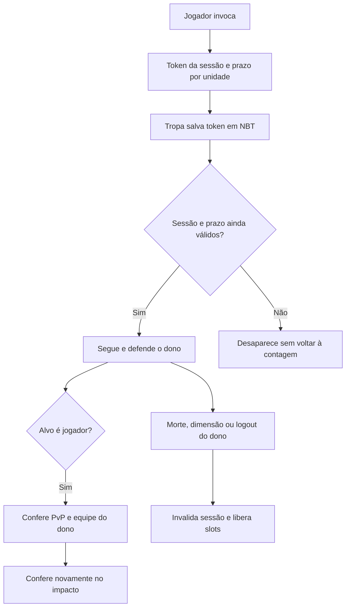
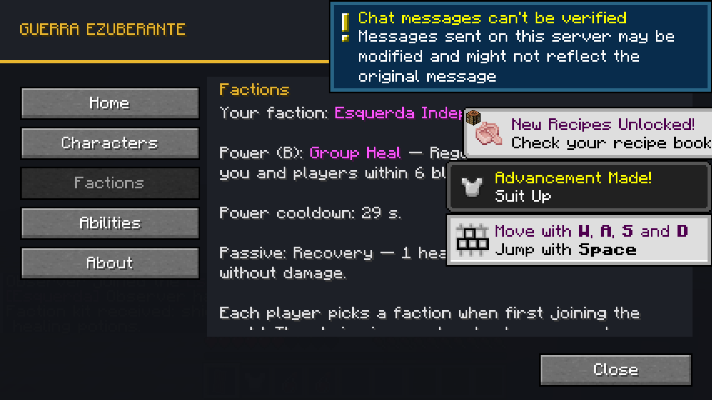

# Guerra Ezuberante 0.012.1 — integração da primeira contribuição

Em 28/10/2026, o autor autorizou integrar o fork de **[GabrielKraemer2805](https://github.com/GabrielKraemer2805/A-Guerra-Ezuberante)** e corrigir os pontos encontrados na revisão. Seus commits `144955e` e `0cc3a6e` são mantidos no histórico, com autoria original. A descrição da contribuição está em [FACCOES_0.012.md](FACCOES_0.012.md).

O sistema acrescenta as seis facções jogáveis, escolha persistente, prefixos, poderes na tecla B, passivos, kits e comandos administrativos. A aceitação inclui as propostas de escolha definitiva até ação de operador, fogo amigo sujeito às regras do servidor, kits únicos e Cura em Grupo sem filtro de facção. NPCs continuam com suas alianças próprias.

## Correções da revisão

| Problema da 0.012.0 | Comportamento da 0.012.1 |
| --- | --- |
| Tropas do jogador aplicavam dano de mob sem respeitar PvP do dono | Seleção de alvo e impacto consultam `canHarmPlayer` do dono; PvP OFF e equipes continuam protegidos. Tropas do Arthur preservam seu comportamento |
| Morte com unidades descarregadas deixava slots ocupados | Morte, mudança de dimensão e logout retiram unidades carregadas e invalidam a sessão de invocação em todas as dimensões |
| Unidades antigas podiam reencontrar o jogador renascido com o mesmo UUID | Cada sessão de invocação tem um token salvo; unidades antigas não entram na sessão seguinte |
| Duração das tropas dependia apenas de ticks carregados | Tropas do jogador têm prazo no relógio do overworld; unidades expiradas não prendem slots quando o chunk está descarregado |
| Logout apagava a espera da regeneração | Instante do último dano fica em `PlayerPersisted/GuerraEzuberanteFaction/LastHurtAt`, usando o mesmo relógio persistente da recarga |
| Texto da recarga ficava congelado no painel K aberto | Conteúdo atualiza quando muda o segundo exibido; respawn e mudança de dimensão recebem novo snapshot de recarga |

### Vínculo e contagem das tropas

O `SummonLedger` mantém a contagem existente para Arthur/Jair. Grupos de jogador têm adicionalmente `PlayerToken` e prazos por unidade. O token não é uma credencial de rede; identifica a sessão de invocação para impedir que uma entidade salva em um chunk antigo retorne depois da morte do dono.

A próxima invocação cria uma sessão nova, sem fechar permanentemente o UUID do jogador. A remoção de uma unidade antiga não libera o slot de uma unidade nova. O prazo expira mesmo sem executar ticks no chunk da unidade; a limpeza visual ocorre quando a unidade estiver carregada.

Grupos antigos de jogador da 0.012.0, sem token, são aposentados com segurança ao consultar a contagem/reencontrar o dono. Personagens de Arthur continuam usando os campos anteriores e sua contagem não é alterada por essa migração de jogadores.

### Regeneração e persistência

O evento de dano registra o instante no NBT persistente do jogador. Sair/entrar não remove esse dado. A recuperação só começa quando tiverem passado os 200 ticks configurados e respeita o intervalo de cura já existente. A recarga do poder continua compartilhada entre facções e permanece após morte/reconexão.

## Interface, documentação e ferramentas

- Painel K atualiza a recarga e mudanças de facção enquanto aberto, preservando a posição de rolagem.
- Badge, caminhos de distribuição e guia de requisitos apontam para 0.012.1; o comentário da configuração usa B.
- A documentação distingue a proposta do colaborador da aceitação posterior por OmarFLK.
- `CLAUDE.md` reconhece o fallback de `JAVA_HOME` no wrapper e orienta conferir estado/fetch antes de integrar mudanças remotas.
- Uma fixture antiga de terreno esperava 65 ticks fixos, mas o comprimento variável da Rachadinha podia exigir mais. Ela agora espera `células × SEGMENT_TICKS + FADE_TICKS + 3`, sem alterar física, dano nem duração do poder.

## Validação

Cinco novos GameTests verificam: PvP OFF/ON e mudança de política no impacto; proteção de equipes; morte com unidades descarregadas, novo token e rejeição de NBT antigo; limpeza na dimensão/logout; expiração e persistência do ledger; manutenção da contagem dos NPCs; regeneração/recarga após reconexão.

**95 GameTests com TaCZ e 31 sem TaCZ passaram**, em `.tools/faction-final-tests.log` e `.tools/faction-final-no-tacz.log`. Fixtures de teste não entram no JAR.

**Dois clientes reais passaram** na execução final `.tools/faction-host-release.log` / `.tools/faction-observer-release.log`:

| Caso | Resultado observado |
| --- | --- |
| Escolha pela tela e confirmação C2S | Host Lulista e observador Esquerda, salvos pelo servidor |
| Prefixos remotos de nome e TAB | Ambos receberam as duas associações corretas e os nomes prefixados |
| Feijões | Mesmos três IDs 283/284/285 nos dois clientes; alvo de 40 para 35 HP |
| Cura em Grupo | Os dois jogadores de 10 para 14/15 HP durante a janela medida |
| Painel K aberto | Recarga exibida de 30 para 27 s; troca de facção administrativa atualizada sem reabrir |
| Tropas com PvP OFF | Vítima ficou em 20 HP e zero eventos de dano de tropas |
| Tropas com PvP ON | IA real aplicou dano em jogador; um evento medido antes de encerrar a luta |
| Morte, respawn e unidade antiga | Slots liberados, facção/recarga preservadas, NBT antigo rejeitado e nova invocação permitida |
| Reconexão | 53 ticks entre dano e retorno; manteve 10 HP antes da espera, curou para 11 depois dos 200 ticks |
| Rachadinha contra jogador | PvP OFF manteve 20 HP; PvP ON reduziu para 12 HP |
| Investida | Impulso 1,3 deslocou 9,4833 blocos na plataforma desse cenário |

A Investida é impulso físico, não deslocamento fixo. O padrão 1,3 foi preservado; a descrição atual deixa de prometer aproximadamente seis blocos. Terreno, efeitos, movimento e condições de simulação podem mudar a distância.

Relatórios: [servidor](validacao/faccoes-0.012.1/servidor.json), [host](validacao/faccoes-0.012.1/host.json), [observador](validacao/faccoes-0.012.1/observer.json). Capturas em `docs/preview/faccoes-0.012.1/`; dados de nome/TAB são conferidos nos clientes, não inferidos só de uma captura. Cenário inicial de PvP descartado porque fome confundiu a comparação de vida: a execução final mantém comida e desliga apenas regeneração natural, sem enfraquecer as verificações de dano.

Validação local em loopback: não foi um teste de internet pública, latência artificial, outros mods de proteção ou todas as condições possíveis de terreno.

O cenário `tools/faction_multiplayer_test.ps1` usa host e observador em perfis `.tools/`, master 0 antes de abrir, cópia do mundo de teste e conexão apenas `127.0.0.1:25586`. Sinais em arquivos coordenam as etapas; escolha/poderes/prefixos/cura/dano/reconexão são conferidos através do servidor e de clientes reais.

Para executar: conclua `runGameTestServer`, inicie o script do host, aguarde o listener indicado em `.tools/faction-test-session.txt` e execute o mesmo script com `-Observer` em outro terminal. Cada script exige seu relatório de sucesso. Não use o perfil normal nem um mundo do autor como fixture.

Artefato: `build/libs/guerra_ezuberante-0.012.1.jar`. Bundles com/sem TaCZ continuam em `build/distributions/`. Minecraft 1.20.1, Forge 47.4.28, JDK 17, GeckoLib 4.8.4 e TaCZ opcional 1.1.8-hotfix2 permanecem nas mesmas versões.
