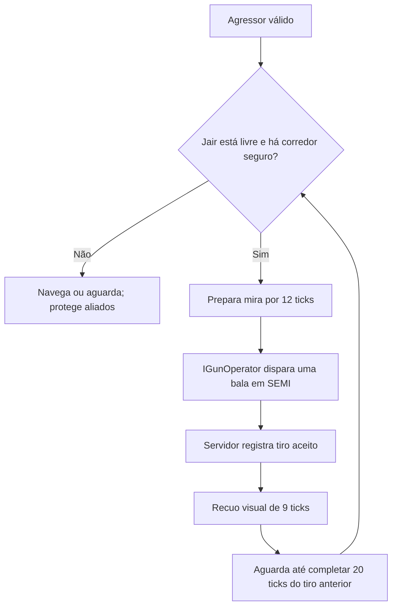
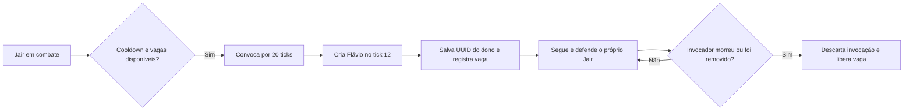
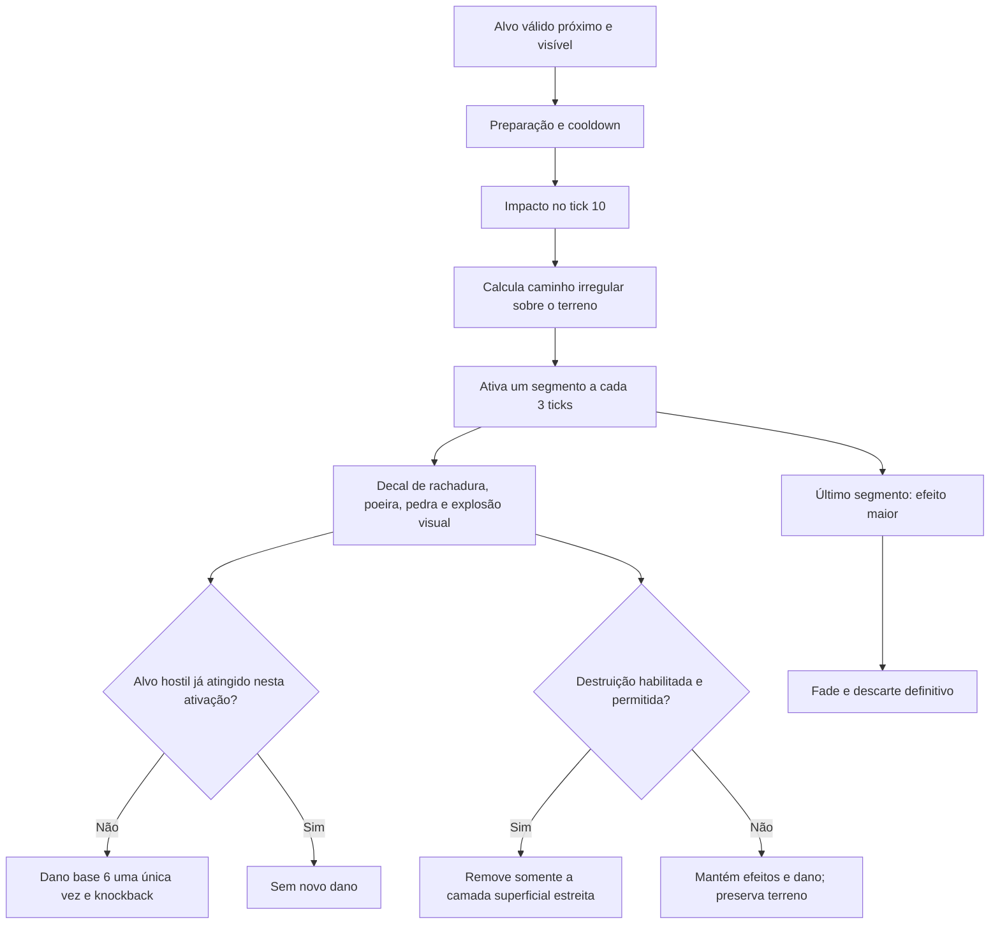
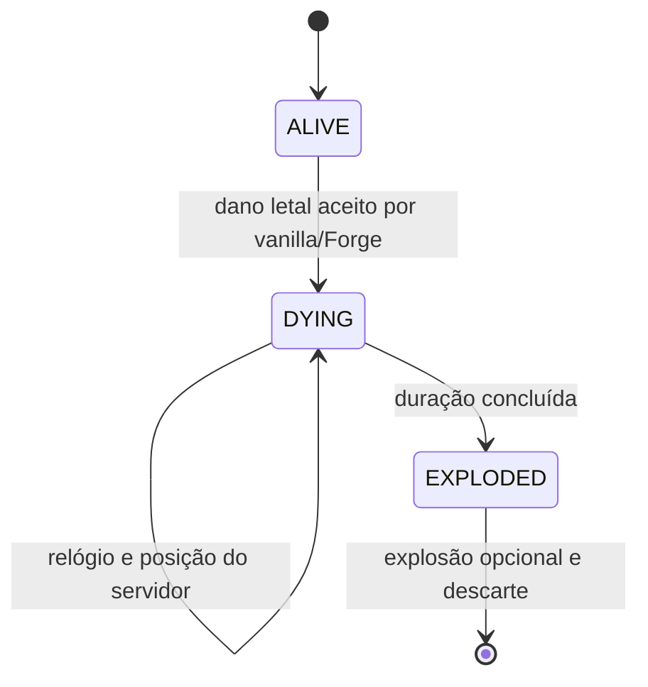

# Jair, Flávio e Rachadinha — 0.010.0

> Atualização visual0.010.1 autorizada pelo autor: [correção das laterais das cabeças](arte/correcao-cabecas-0.010.1.md). Os originais abaixo foram preservados como fonte; as texturas runtime agora usam as cópias corrigidas. O restante das skins e as mecânicas permanecem iguais.

Sprint implementada no projeto existente, mantendo Minecraft Java 1.20.1, Forge 47.4.28, Java 17, GeckoLib 4.8.4 e o TaCZ 1.1.8-hotfix2 opcional. Não foi instalado outro mod de armas. Os três prompts anexados pelo autor tinham conteúdo idêntico. Os poderes e nomes são sátira fictícia de videogame.

## Acesso rápido

```mcfunction
/give @s guerra_ezuberante:jair_bolsonaro_spawn_egg
/give @s guerra_ezuberante:flavio_bolsonaro_spawn_egg
/summon guerra_ezuberante:jair_bolsonaro ~ ~ ~5
/summon guerra_ezuberante:flavio_bolsonaro ~ ~ ~5
```

Os dois ovos estão na aba Guerra Ezuberante. O painel **K → Personagens → Jair / Flávio** inclui descrição, prévia 3D e mecânicas. Provoque em Survival para iniciar combate: nenhum dos dois procura jogadores para atacar espontaneamente. Teste fissuras e mortes em um mundo descartável, pois as opções padrão permitem dano ao terreno.

| Personagem | Entidade | Vida padrão | Movimento | Dano corpo a corpo |
| --- | --- | --- | --- | --- |
| Jair Bolsonaro | `guerra_ezuberante:jair_bolsonaro` | 30 HP | 0,24 | 4, fallback quando desarmado |
| Flávio Bolsonaro | `guerra_ezuberante:flavio_bolsonaro` | 30 HP | 0,25 | 4 |

Vida, movimento e dano corpo a corpo são configuráveis. Hitbox 0,6 × 1,8, olhos a1,62 e acompanhamento20 blocos. As entidades existentes preservam atributos salvos; as configurações são aplicadas na criação.

## Skins e modelos

As skins `jair_bolsonaro_skin_64x64.png` e `flavio_bolsonaro_skin_64x64.png` foram copiadas sem alterar pixels. Fontes em `assets-entrada/skins/`, recursos em `textures/entity/{jair_bolsonaro,flavio_bolsonaro}.png`. As grandes imagens de preview não são usadas como textura.

Cada personagem tem seu próprio modelo e arquivo de animações, com 14 ossos e UVs clássicos64×64. A faixa verde-amarela permanece no atlas do Jair e acompanha o torso; a camisa azul do Flávio usa exclusivamente a skin dele. O helper de geometria é compartilhado, mas os recursos, nomes dos clipes e caminhos são distintos.

Gerador determinístico: `tools/GenerateBolsonaroAssets.java`, executado por `tools/generate_bolsonaro.ps1`. Ele reutiliza o helper existente em modo que não escreve o humanoide antigo. Não foram regenerados os modelos/animações de Renan, Arthur ou Lula. `validateBolsonaroAssets` integra `check/build`, conferindo hashes, dimensões, ossos, UVs e todos os15 clipes novos.

## Jair e a Glock nativa

Arma escolhida: **Glock 17 do TaCZ**, ID **`tacz:glock_17`**, calibre nativo **`tacz:9mm`**. O item, modelo3D, som, projéteis, rede e dano pertencem ao TaCZ original. Nenhum desses assets foi copiado para o Guerra Ezuberante.



- Um tiro aceito por ciclo de **20 ticks de servidor**, sem rajada, catch-up ou tiro vindo de keyframe.
- A mesma lógica de posicionamento e linha de tiro do Renan foi extraída para `NpcRangedGoal`/`NpcGunUser`. Distância útil5–18 blocos; abaixo5 tenta recuar, fora18 se aproxima. Parede ou corpo aliado interrompe a mira/disparo.
- O adapter `TaczNpcWeapon` escolhe AK47 para Renan e Glock 17 para Jair. O modo SEMI é definido somente no ItemStack do NPC.
- `needCheckAmmo()` e `consumesAmmoOrNot()` retornamfalse exclusivamente nos operadores Renan/Jair. Nada de tags portáteis de munição infinita; jogadores continuam precisando de munição e recarga normais. A arma do NPC tem chance de drop0.
- O carregador nativo da Glock permaneceu em17 nos testes, mesmo após mais de17 disparos. As regras de munição do jogador foram verificadas separadamente.
- Sem TaCZ, Jair usa o fallback corpo a corpo e continua carregando como entidade válida. Não aparece uma pistola falsa substituta.

O relógio do TaCZ inclui timers de tempo real. GameTests acelerados verificam ausência de rajadas, impactos reais e conservação da munição; a cadência exata20/20 foi medida nos clientes em tempo normal. Interrupções por parede, aliado, invocação ou perda de alvo naturalmente suspendem a sequência.

## Dinastia Bolsonaro

Somente Jair invoca Flávio. Na primeira entrada em combate válido, inicia uma convocação de20 ticks. A criação ocorre no **tick12**, durante o gesto do braço esquerdo, com partículas verdes e amarelas.

Padrão: **1 Flávio**, cooldown **700 ticks / 35s**, limite **3 simultâneos por Jair**. A busca por um local seguro é limitada a uma região próxima, reutiliza as validações de terreno existentes e não força chunks. Limite cheio, falta de terreno ou fim do combate impedem criação.



`SummonLedger` já existente contabiliza UUIDs por dimensão, inclusive unidades descarregadas. O vínculo `JairSummoner` e os cooldowns são salvos em NBT. Uma convocação interrompida por reload não cria um aliado sem alvo válido. Recarregar não devolve o cooldown.

Ao iniciar a morte do Jair, o grupo é fechado. Flávios vinculados desaparecem; os descarregados são removidos quando voltam a carregar. Se o dono apenas estiver ausente/descarregado, há tolerância de200 ticks carregados antes de dissipar a unidade. Remoção definitiva ou mudança de dimensão do dono também fecha o grupo antigo. Flávios de ovo, sem UUID de dono, não participam dessa remoção.

Jair e Flávio pertencem à mesma aliança Bolsonarista e respeitam também alianças de scoreboard. Não foram redefinidas as relações de Renan, Lula, Arthur e tropas. A proteção de aliados vale para a linha de tiro, o impacto nativo da Glock, a Rachadinha e a explosão do Jair. A morte explosiva antiga do Lula mantém suas regras anteriores.

## Rachadinha

Flávio funciona com ou sem Jair. Quando vinculado, segue o próprio dono e compartilha seu agressor válido. Independente, usa a retaliação normal. Entre habilidades, pode usar golpes corpo a corpo; esses golpes são ataques separados do orçamento da fissura.

| Parâmetro padrão | Valor |
| --- | --- |
| Alcance horizontal | 8 blocos, limitado pela posição do alvo |
| Cooldown | 240 ticks / 12 s |
| Largura | aproximadamente1 bloco |
| Dano por alvo por ativação | até6 pontos base, antes de armadura/reduções |
| Knockback | 0,35, respeitando resistência vanilla |
| Propagação | 1 segmento a cada3 ticks |
| Desaparecimento visual | 24 ticks após a propagação |

### Animação e tempo

1. **Ticks0–8:** levanta os braços, inclina o corpo e ergue o joelho.
2. **Ticks8–12:** golpeia o chão; a soltura ocorre no **tick10**, no keyframe de impacto.
3. **Ticks12–24:** recuperação do corpo e braços.
4. A fissura continua avançando enquanto o Flávio recupera o movimento. Um mesmo Flávio não mantém ativações simultâneas ilimitadas.



### Caminho, visual e dano

`Rachadinha.trace` calcula uma linha com pequenos desvios laterais, procura superfícies carregadas até um degrau acima/abaixo e exige altura livre. Paredes altas, borda do mundo, terreno sem apoio e chunks ausentes truncam o percurso. Não escava montanhas nem força carregamento.

A entidade curta `guerra_ezuberante:rachadinha` guarda uma ativação, com no máximo 32 células. Células de cotovelo conectam as curvas por uma face, para que a escavação não vire buracos tocando apenas pelos cantos. O alcance continua sendo a distância horizontal até o alvo; o número de células pode ser maior que essa distância por causa das curvas. Não tem spawn egg nem `/summon`, não é persistida e desaparece se o caster morrer/descarregar. Reload cancela o efeito em andamento, mantendo o cooldown salvo do Flávio.

O cliente desenha um decal original16×16 sobre a superfície efetiva de cada célula, com ramificações e avanço sincronizado. Após uma escavação, ancora no piso da fissura, em vez de deixar a imagem flutuando. Partículas usam o bloco local; o impacto final tem efeito maior e som nativo de explosão. Não são TNTs ou explosões vanilla de terreno em cada segmento.

Dano e knockback acontecem no servidor. Um conjunto de UUIDs impede novos impactos da mesma ativação. Dono, família, aliados e espectadores/Creative são excluídos. A área atinge o alvo da ativação ou outros agressores reconhecidos; não transforma animais próximos em vítimas apenas por estarem ali. Cada impacto verifica visibilidade e passa pelos eventos normais de dano do Forge.

### Destruição controlada e proteção

Com destruição ligada, remove uma faixa de **uma camada superficial**, seguindo os segmentos; largura maior pode incluir uma célula lateral. Blocos seguem a grade do Minecraft, então larguras fracionárias não significam cortar metade de um bloco. Não há cratera circular por explosão em cada segmento e não há drops de blocos gerados pela escavação.

A lista de terreno permite terra, pedras naturais do Overworld, areia, cascalho, bloco de neve, netherrack e end stone. Containers/blocos com block entity, blocos indestrutíveis e materiais fora da lista não são escavados. A origem natural de uma pedra não é rastreada: uma pedra colocada por jogador também pode entrar na lista se não estiver protegida.

Antes de remover cada célula, verifica:

- `mobGriefing`/`EntityMobGriefingEvent`, borda e chunk já carregado;
- dureza e `BlockState.canEntityDestroy`;
- cancelamento de **`LivingDestroyBlockEvent`**;
- permissão de interação e cancelamento de **`BlockEvent.BreakEvent`**, usando FakePlayer de identidade própria **`[GE:Rachadinha]`**, em Survival e sem OP.

Não toma emprestada a identidade, o inventário ou as permissões do autor. Foram testados cancelamentos dos dois eventos, não todos os mods de claims disponíveis. Integrações externas que exigem um hook proprietário podem precisar de adaptação específica.

Com `rachadinha_block_damage=false`, mantém visual, som e dano a entidades sem alterar permanentemente o terreno. O mesmo acontece quando `mobGriefing` ou os hooks negam a escavação.

## Morte verde compartilhada

`SpecialDeathEntity` generaliza a implementação já aprovada do Lula. `LulaEntity` usa prefixo NBT **Lula**, conservando os saves0.009; Jair usa **Jair**. Ambos compartilham estados, relógio, levitação, persistência, prevenção de repetição e chamada nativa de explosão. Não existe um segundo motor de morte independente.



Padrão60 ticks: começa a adquirir tint, sobe suavemente **2 blocos** entre os ticks10–30, se contrai entre30–50 e comprime/treme entre50–60. A cabeça abaixa, braços e joelhos se dobram. **Lula vermelho; Jair verde com partículas amarelas.** A queda/remoção vanilla20ticks é substituída pelo controlador específico.

Ao entrar em DYING, Jair para tiros, mira, navegação, novas invocações e fecha seu grupo. Dano repetido não reinicia nada. DYING salvo retoma o tempo carregado restante; EXPLODED salvo só descarta. Configurações são capturadas no início da morte.

A potência **7.0F, sem fogo, interação MOB** foi conferida no `WitherBoss` official1.20.1 do JAR exato Forge 47.4.28, no término da invulnerabilidade de surgimento. Evidência local: `.tools/wither-bytecode.txt`. O centro da explosão do personagem é abdominal, Y+0,9 após a subida. Dano, exposição, som e knockback vêm do motor vanilla; o evento de detonação do Jair filtra aliados.

`death_explosion_block_damage=false` usa interaçãoNONE, preservando blocos. InteraçãoMOB respeita mobGriefing e eventos Forge. Cada entidade marcaEXPLODED **antes** dos callbacks, explode no máximo uma vez e é descartada emfinally. Desligar a explosão mantém animação e descarte.

## Animações novas

| Jair — arquivo `jair_bolsonaro.animation.json` | Flávio — arquivo `flavio_bolsonaro.animation.json` |
| --- | --- |
| `jair_idle` | `flavio_idle` |
| `jair_walk` | `flavio_walk` |
| `jair_armed_idle` | `flavio_attack` |
| `jair_aim` | `flavio_hurt` |
| `jair_shoot` | `flavio_rachadinha_prepare` |
| `jair_hurt` | `flavio_rachadinha_ground_hit` |
| `jair_summon_flavio` | `flavio_rachadinha_recover` |
| `jair_death_special` | — |

Prefixo completo `animation.guerra.`. `BolsonaroAnimationController` busca a fase sincronizada do servidor e não dispara tiros/dano por keyframe. Renderers de item prendem a Glock ao osso da mão direita. `SpecialDeathTint` aplica a cor no modelo inteiro.

## Áudio

Não foram encontradas gravações de Jair/Flávio nas pastas de áudio do projeto. Não foram criadas falas nem solicitados novos arquivos. Sons da Glock são os nativos do TaCZ; stomp, propagação e explosões visuais usam efeitos vanilla de pedra e explosão. As bibliotecas de Renan, Arthur e Lula e o gerenciador musical existente foram preservados.

## Configuração SERVER por mundo

Em `<mundo>/serverconfig/guerra_ezuberante-server.toml`:

```toml
[jair]
max_health = 30.0
movement_speed = 0.24
fallback_melee_damage = 4.0
death_explosion_enabled = true
death_explosion_power = 7.0
death_rise_blocks = 2.0
death_animation_ticks = 60
death_explosion_block_damage = true
summon_enabled = true
summon_count = 1
summon_cooldown_ticks = 700
max_active_flavios = 3

[flavio]
max_health = 30.0
movement_speed = 0.25
melee_damage = 4.0
rachadinha_range = 8.0
rachadinha_width = 1.0
rachadinha_damage = 6.0
rachadinha_knockback = 0.35
rachadinha_cooldown_ticks = 240
rachadinha_block_damage = true
```

Faixas: vida1–1024, movimento0,05–1, dano0–100; potência0–16, morte20–200 ticks, subida0–8; invocação1–3 por leva, limite1–12 e cooldown40–72000; fissura2–16 blocos, largura0,5–2, knockback0–2 e cooldown40–72000. A cadência da Glock permanece fixa em20 ticks por requisito da sprint. A seção `[lula]` e seus nomes anteriores continuam válidos.

## Arquivos principais

| Novos | Responsabilidade |
| --- | --- |
| `entity/JairBolsonaroEntity.java` | Glock, relógio de tiro, convocação e perfil de morte verde |
| `entity/FlavioBolsonaroEntity.java` | Independente/invocado, defesa, seguimento, cooldown e stomp |
| `entity/SpecialDeathEntity.java` | Morte compartilhada com Lula e persistência compatível |
| `entity/RachadinhaEntity.java` / `combat/Rachadinha.java` | Trajeto, efeitos, orçamento de dano e escavação |
| `combat/NpcGunUser.java` / `NpcRangedGoal.java` | Contrato e posicionamento compartilhados com Renan |
| `combat/BolsonaroCombatEvents.java` | Filtragem de aliados na morte explosiva do Jair |
| `summon/JairSummoning.java` | Busca segura e registro das invocações |
| `animation/BolsonaroAnimationController.java` | Seleção dos15 clipes por relógio sincronizado |
| `client/model/BolsonaroModel.java` | Recursos específicos e ajuste de cabeça/mira |
| `client/renderer/BolsonaroRenderer.java` / `SpecialDeathTint.java` / `RachadinhaRenderer.java` | Mão, cor e decal da fissura |
| `geo/`, `animations/`, `textures/entity/`, `models/item/` | Dois modelos,15 clipes, duas skins, decal e ovos |
| `tools/GenerateBolsonaroAssets.java`, `generate_bolsonaro.ps1`, `validate_bolsonaro.ps1` | Geração e validação reproduzíveis |
| `BolsonaroGameTests`, `BolsonaroCompatibilityTests`, `BolsonaroVisualChecks` | Cenários isolados fora do JAR |

Modificados: registros de entidades/itens/atributos/aba, `ModConfig`, `TaczNpcWeapon`/`TaczIntegration`, Renan e seu goal, Lula e seu renderer, painelK, traduçõespt/en, helper do gerador, Gradle/versão, README/CONTEXTO e documentação de validação. Nenhum mundo ou preferência de volume do autor faz parte do JAR ou dos cenários.

## Testes e artefatos

**Build/reobf e 71 GameTests aprovados**, log `.tools/bolsonaro-continuous-release.log`. São os60 casos anteriores e 11 novos, incluindo compatibilidade opcional e seguimento/defesa real do invocador. **12 GameTests sem TaCZ aprovados**, log `.tools/bolsonaro-no-tacz-tests.log`, verificando a GE-P12 e carregamento/fallback dos personagens sem classes da dependência opcional.

Os casos novos verificam ovos/neutralidade/atributos/alianças, Glock nativa, munição restrita ao NPC, tiros/projéteis/acertos, parede e corpo aliado, convocação inicial, cooldown700, limite3, vínculo/salvamento/remoção, seguimento/defesa, windup da fissura, dano6 único, cooldown persistido, aliados/bystanders, degraus/parede, faixa contínua, profundidade limitada, bedrock no percurso, opções ON/OFF, mobGriefing e cancelamentos dos dois hooks de proteção, além de morte verde única e persistência DYING/EXPLODED.

O teste antigo de destruição do Lula foi isolado numa arena alta e seca após a auditoria revelar água de outra fixture no centro da explosão. Uma explosão nativa sem entidade teve o mesmo bloqueio pela água. Não foi alterada a resistência vanilla para fazer o teste passar: a mecânica continua respeitando água e resistência dos blocos. Na arena seca, mobGriefingfalse preservou8/8 blocos e true destruiu8/8.

JAR: **`build/libs/guerra_ezuberante-0.010.0.jar`**. Pacotes de instalação versionados em `build/distributions/guerra-ezuberante-0.010.0/mods/` e `guerra-ezuberante-0.010.0-sem-tacz/mods/`.

Testes gráficos usam `.tools/run-bolsonaro-client` e `.tools/run-bolsonaro-observer`, master0 antes do launch, e listener restrito a127.0.0.1:25584. Não equivalem a validar internet pública, reconexão sob latência, todos os sistemas de claim ou aprovação auditiva humana. Logs TaCZ/userdev ainda podem emitir warnings de recursos/refmap conhecidos; build aprovado não significa ausência de warnings.

### Dois clientes reais — resultado final

**Host e observador aprovados** com a fissura contínua e os hooks finais. Relatórios [host](validacao/bolsonaro-0.010/host.json) e [observador](validacao/bolsonaro-0.010/observer.json).

| Medição | Resultado observado |
| --- | --- |
| Cadência da Glock em corredor livre | 21 disparos medidos; todos os intervalos exatamente 20 ticks |
| Evento cliente no combate completo | 24 no host e24 no observador; incluem3 tiros anteriores à janela de medição |
| Munição do NPC | Carregador17 →17, sem recarga e sem alterar o item para munição infinita |
| Convocação | Flávio apareceu nos dois clientes durante o gesto de Jair |
| Fissura com terrenoOFF | 12 células conectadas,1 alvo,6 de dano,0 blocos removidos |
| Fissura com terrenoON | 11 células conectadas,1 alvo,6 de dano,11 blocos removidos |
| Sincronização | Os dois clientes receberam os mesmos IDs860 e923 das ativações controladas e os estágios progressivos |
| Morte | Jair verde e Lula vermelho, subida2, ossos contraídos, remoção e dois sons de explosão, um por entidade, em ambos |

As duas ativações usaram Flávios diferentes; o desvio do caminho depende do UUID, portanto não precisam ter o mesmo número de cotovelos. Isso não mudou dano, alcance ou o orçamento por alvo. Na primeira tentativa de medir a cadência, o aliado entrou no corredor e interrompeu os tiros corretamente. A medição final manteve esse corredor livre; seguimento e defesa do invocado foram validados no caso de IA separado. Houve timeout inicial de login numa tentativa anterior e reconexão local bem-sucedida; isso não é teste de rede pública sob latência.

Capturas reais inspecionadas:

- [Skins e Glock equipada](preview/bolsonaro-0.010/skins-e-glock.png).
- [Disparo nativo](preview/bolsonaro-0.010/glock-disparo.png) e [gesto de convocação](preview/bolsonaro-0.010/dinastia.png).
- [Preparação do golpe](preview/bolsonaro-0.010/preparacao-rachadinha.png).
- [Rachadinha sem destruição](preview/bolsonaro-0.010/rachadinha-sem-destruicao.png) e [faixa escavada contínua](preview/bolsonaro-0.010/rachadinha-com-destruicao.png).
- [Jair verde e Lula vermelho, levitando e contraídos](preview/bolsonaro-0.010/mortes-verde-vermelha.png).

SHA256 do JAR final: `4af13c18f9811a2b6d20ed6cb15130843fd67ec2306886ada1257d1e0c6083f8`. Inspeção do ZIP confirmou as novas classes/recursos, sem fixtures e sem classes/assets TaCZ copiados.

Nenhum commit, push ou merge desta sprint foi solicitado. A entrega permanece local até autorização.
