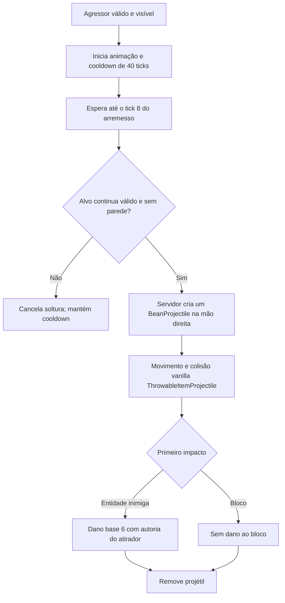
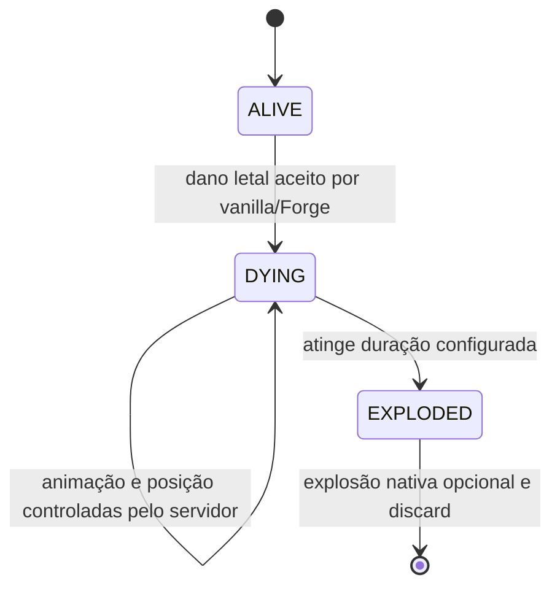

# Lula — sprint 0.009.0

Implementação local solicitada pelo autor: Lula neutro com skin original, barriga saliente, arremesso de feijão, quatro gravações e morte cinematográfica explosiva. Não publica o repositório automaticamente.

## Personagem e acesso

- Minecraft Java 1.20.1, Forge 47.4.28, Java 17 e GeckoLib 4.8.4. Nenhuma dependência nova.
- Entidade `guerra_ezuberante:lula`; ovo `guerra_ezuberante:lula_spawn_egg`, na aba Guerra Ezuberante. Painel **K → Personagens → Lula** inclui prévia e biblioteca de gravações.
- Vida padrão **30 HP**, velocidade base **0,23**, alcance de acompanhamento **20 blocos**, hitbox **0,6 × 1,8**, olhos a **1,62**. Vida configurável para novas entidades; NBT preserva entidades existentes.
- Não escolhe vítimas espontaneamente. Reage a um agressor válido seguindo a base de retaliação existente. Não foram inventadas alianças automáticas entre facções; alianças de scoreboard são respeitadas.
- Goal de distância tenta permanecer entre 5 e 16 blocos, olha para o alvo e usa navegação vanilla. Não usa o golpe corpo a corpo compartilhado em paralelo.

Em um mundo de teste com comandos:

```mcfunction
/give @s guerra_ezuberante:lula_spawn_egg
/summon guerra_ezuberante:lula ~ ~ ~5
```

Provoque com um golpe em Survival para observar a retaliação. Botão direito percorre as gravações. A morte causa uma explosão real e pode abrir crateras com a configuração padrão; use um mundo descartável para esse teste.

## Modelo e animação

`assets-entrada/skins/lula_skin_64x64.png` e `textures/entity/lula_skin_64x64.png` preservam exatamente o PNG fornecido. Não existe textura redesenhada ou reescalada. Modelo próprio `geo/lula.geo.json`, 15 ossos: corpo, cabeça, membros articulados, mãos e barriga com três volumes em degraus. A barriga projeta-se até Z = −5 pixels, diante do torso em Z = −2, usando a região vermelha da camisa no atlas original.

| Clipe GeckoLib | Duração | Comportamento |
| --- | --- | --- |
| `animation.guerra.lula_idle` | 2,4 s, loop | Postura inclinada, respiração discreta, braços relaxados e barriga |
| `animation.guerra.lula_walk` | 1 s, loop | Passos pesados, joelhos articulados e balanço |
| `animation.guerra.lula_attack_bean` | 0,9 s | Preparação, soltura no tick 8 e recuperação |
| `animation.guerra.lula_hurt` | 0,5 s | Reação breve, sem reiniciar o cooldown |
| `animation.guerra.lula_death` | 3 s, pose final mantida | Curvatura progressiva, cabeça baixa, cotovelos e joelhos dobrados, compressão e tremor |

`tools/generate_lula.ps1` compila o gerador determinístico Java, que reutiliza os helpers de UV existentes e escreve somente os assets novos. Os assets dos demais personagens não são regenerados. `validateLulaAssets` verifica hash da skin, dimensões, barriga, limites dos UVs e os cinco clipes.

## Feijão físico

Entidade e item: `guerra_ezuberante:semente_feijao`. Sprite original marrom, transparente, 16×16, desenhado pelo gerador. O item é a representação visual do projétil; segurá-lo não cria uma arma de jogador adicional.



- **6 pontos de dano base**, antes de armadura e reduções vanilla. Nenhum dano antes da colisão.
- Um início de arremesso a cada **40 ticks de servidor**; soltura no **tick 8**, recuperação até o 18. Ataques bloqueados por alvo/parede não devolvem o cooldown e não geram rajadas acumuladas.
- Velocidade inicial 1,2 bloco/tick, gravidade 0,015; elevação balística pequena. Sem homing ou hitscan. Não prevê automaticamente a movimentação futura de um alvo veloz.
- Dono e aliados de ambos os lados de `isAlliedTo` são ignorados. Parede impede a soltura; colisão nativa também impede atravessar uma parede que entre no caminho depois.
- Um impacto processado pelo servidor; descarte após impacto ou 100 ticks carregados. Tempo de vida salvo em NBT. Spawn usa pacote Forge, renderer vanilla de item arremessado.

## Gravações reais

A pasta encontrada foi **`audios/lula_audio/`**, não `audios_lula/`. Originais preservados e ignorados pelo Git conforme a política existente. Conversão FFmpeg para OGG Vorbis mono, 44.100 Hz, qualidade 5, sem corte.

| Original local | OGG no JAR | Duração OGG | Timer |
| --- | --- | --- | --- |
| `feijao puro.MP3` | `sounds/lula/feijao_puro.ogg` | 9,247347 s | 185 ticks |
| `lula homofobia.MP3` | `sounds/lula/homofobia.ogg` | 5,433469 s | 109 ticks |
| `lula machiso.MP3` | `sounds/lula/machismo.ogg` | 7,288163 s | 146 ticks |
| `luluaracismo.MP3` | `sounds/lula/racismo.ogg` | 7,784490 s | 156 ticks |

Timers = teto da duração × 20, medidos com FFprobe. Os nomes identificam os arquivos recebidos; não são transcrições ou afirmações editoriais. Todas as quatro gravações participam da mesma playlist de interação/combate, conforme a preferência anterior do autor. Nenhum arquivo foi classificado como reação temática de dano/morte sem evidência; esses eventos não recebem uma fala aleatória.

Arquitetura compartilhada `CharacterAudio → EntityMusicSession → SynchedEntityData → CharacterAudioClient`: uma instância espacial por UUID, shuffle bag sem repetição imediata, debounce do botão direito, sessão compartilhada com combate, categoria RECORDS, atenuação 32 blocos, streaming e limpeza ao morrer/remover/desrastrear. A explosão usa som e partículas nativos. Sem áudio de morte inventado.

## Morte e explosão



| Tempo padrão | Fase |
| --- | --- |
| 0–10 ticks | Para ataque, IA, navegação e playlist; começa tint vermelho do modelo inteiro |
| 10–30 ticks | Smoothstep até elevar a entidade 2 blocos; inicia contração |
| 30–50 ticks | Tronco e cabeça abaixam, braços e joelhos se dobram |
| 50–60 ticks | Compressão, tremor mais intenso, tint e partículas vermelhas |
| 60 ticks | Marca EXPLODED, executa explosão uma vez e remove a entidade |

`LivingEntity.die`/Forge processa o evento letal e atribuição de morte uma vez. O override de `tickDeath` impede descarte vanilla após 20 ticks, e o renderer remove a rotação vanilla de queda. O controlador busca a fase pelo relógio sincronizado, incluindo clientes que começam a rastrear depois. A duração configurada redimensiona os três segundos de keyframes.

O estado, tempo decorrido, origem da subida e snapshot das configurações são persistidos. Carregar DYING retoma o tempo carregado restante, sem reiniciar nem avançar pelo tempo offline. Carregar EXPLODED descarta sem nova explosão. Dano adicional em DYING é rejeitado; nenhum novo feijão é criado. EXPLODED é marcado **antes** de chamar o motor, evitando reentrada durante explosões em cadeia. Cada Lula atingido letalmente inicia sua própria sequência atrasada.

### Referência vanilla verificada

Inspeção do `WitherBoss` **mapeado official 1.20.1**, no JAR exato Forge 47.4.28 usado pelo projeto: ao terminar a invulnerabilidade de surgimento, chama `Level.explode(..., 7.0F, false, Level.ExplosionInteraction.MOB)`. Não se trata da caveira do Wither. Bytecode inspecionado com `javap -c -p`, evidência local `.tools/wither-bytecode.txt`.

Lula usa a mesma potência **7** e ausência de fogo. A origem fica no centro abdominal após a subida, Y + 0,9, em vez dos olhos do Wither. Dano, exposição, knockback, som e partículas são os do motor de explosão. Dano a blocos usa `MOB` e respeita `mobGriefing`/hooks Forge; desativá-lo usa `NONE`, preservando dano a entidades e efeitos. Cancelamento por `ExplosionEvent.Start` foi testado; compatibilidade com cada mod externo de proteção não foi presumida.

### Configuração SERVER por mundo

Arquivo `<mundo>/serverconfig/guerra_ezuberante-server.toml`:

```toml
[lula]
max_health = 30.0
death_explosion_enabled = true
death_explosion_power = 7.0
death_animation_ticks = 60
death_rise_blocks = 2.0
death_explosion_block_damage = true
```

Faixas: vida 1–1024, potência 0–16, duração 20–200 ticks, subida 0–8 blocos. As configurações da morte são capturadas no início para evitar mudança de fase no meio da sequência. Desativar a explosão mantém a animação e o descarte final. `mobGriefing=false` também protege blocos quando a opção está ligada.

## Validação

**60 GameTests passaram** em `.tools/lula-final-build-tests.log`: 55 anteriores e cinco novos. Novos casos cobrem ovo/neutralidade/biblioteca, dano real/cadência/windup, parede/tempo de vida, dono/aliados e sequência de morte. O último testa subida, rejeição de dano repetido, persistência DYING/EXPLODED, potência 7 observada no motor, dano e knockback, flags de blocos, `mobGriefing`, explosão desativada, cadeia limitada e cancelamento Forge.

`build` executa também os validadores de assets antigos, GeckoLib, TaCZ, menu e Lula. JAR próprio: `build/libs/guerra_ezuberante-0.009.0.jar`. Fixtures ficam fora do JAR, em `src/gameTest`. Testes visuais usam `.tools/run-lula-client` e `.tools/run-lula-observer`, sempre com master 0. Preferência de áudio do perfil normal preservada.

### Dois clientes reais — resultado final

O host integrado e o observador TCP passaram no cenário final. Relatórios: [host](validacao/lula-0.009/host.json) e [observador](validacao/lula-0.009/observer.json). Ambos receberam os mesmos **cinco IDs de feijões**, as **quatro gravações**, no máximo **uma instância de áudio por entidade**, estados da morte e **um som nativo de explosão**. Os ossos foram medidos no modelo realmente renderizado, não apenas lidos do JSON: no tick50, torso aproximadamente −0,98 rad e antebraço +1,75 rad. O canal verde do tint caiu de204 para20 enquanto a altura do servidor/cliente foi de101 para103.

| Evidência gráfica | Captura |
| --- | --- |
| Skin, barriga, cabeça e membros | [Lula neutro](preview/lula-0.009/idle-belly.png) |
| Combate e feijão visível | [Arremesso](preview/lula-0.009/combat.png) |
| Levitação e início da contração | [Tick30](preview/lula-0.009/death-30.png) |
| Tint, compressão e braços dobrados | [Tick50](preview/lula-0.009/death-50.png) |
| Explosão e remoção | [Depois da explosão](preview/lula-0.009/after-explosion.png) |

Capturas foram inspecionadas; o primeiro desenho do feijão e a pose dos braços foram ajustados e revalidados. Uma tentativa anterior de conexão deu timeout antes do gameplay; a execução final passou com dois clientes, distância de renderização5 e listener somente127.0.0.1:25583. Isso não valida internet pública, reconexão sob latência, todos os mods externos de proteção ou sincronismo de amostras OGG. Late tracking usa o comportamento compartilhado existente, que inicia a gravação do começo e acompanha as próximas transições do servidor. Inspeção auditiva humana continua a cargo do autor: os testes automatizados são silenciosos.

JAR final SHA256: `19715ce2b027f272f4d28d1340fcb087200dd05e206b0b30bc756fa1ef5218ff`. Inspeção confirmou os quatro OGGs, Lula e sprite, sem classes de fixture nem classes TaCZ copiadas. O build final passou em `.tools/lula-final-package.log`.
