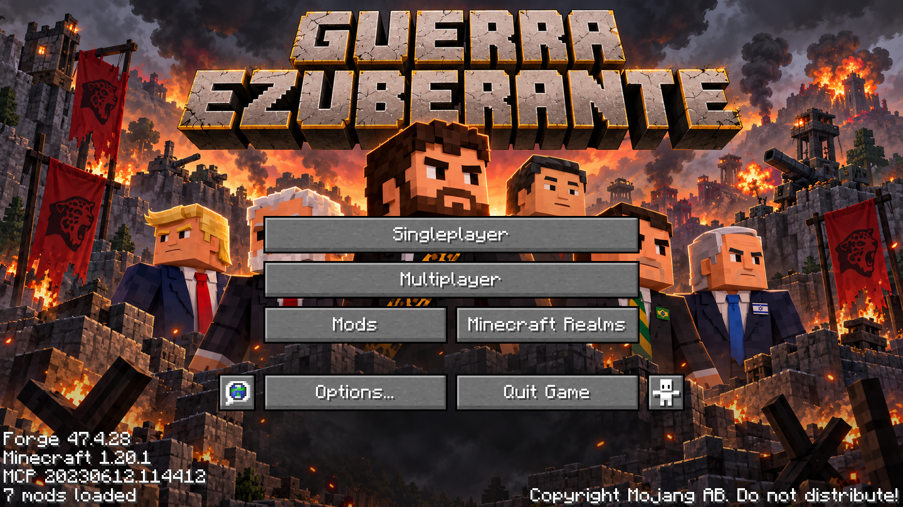
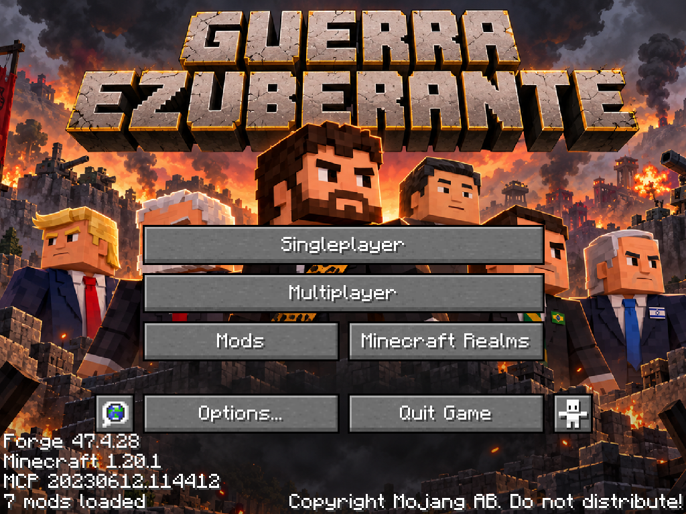
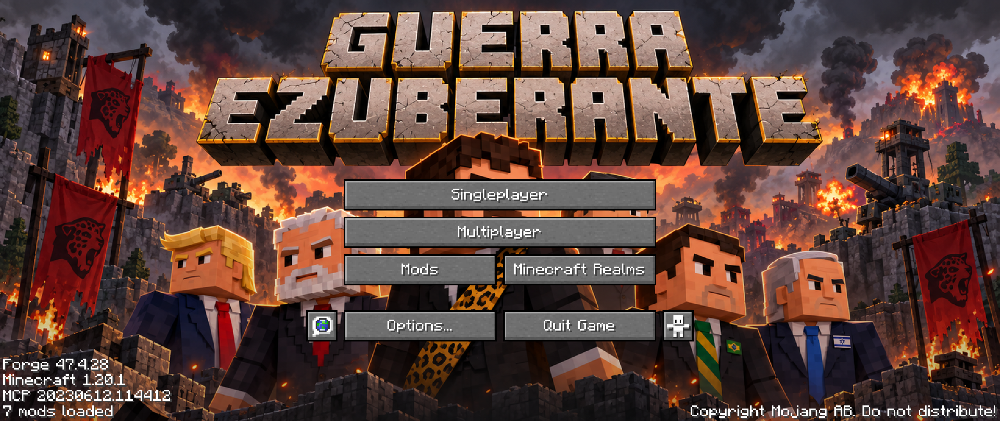

# Menu inicial ilustrado — 0.008.0

Uma arte original em estilo Minecraft/voxel substitui o panorama da tela inicial. A implementação mantém os controles e ações da `TitleScreen` vanilla, inclusive os complementos do Forge.

## Arte e arquivo entregue

O gerador integrado **imagegen** criou a ilustração a partir do [prompt completo utilizado](arte/menu-inicial-prompt.txt). Ela mostra Renan em destaque, com terno e faixa de onça, acompanhado de Lula, Flávio Bolsonaro, Donald Trump, Benjamin Netanyahu e Xi Jinping. O título usa a grafia **GUERRA EZUBERANTE**. Os personagens adicionais aparecem somente na arte; isso não registra novos mobs ou habilidades no jogo.

O resultado original de 1672×941 foi normalizado mecanicamente para um **PNG RGB opaco de 1920×1080** com Lanczos e recorte proporcional mínimo. Não foram redesenhados elementos nessa preparação. O original do gerador foi preservado na pasta gerenciada pelo Codex; a imagem consumida pelo projeto está dentro do workspace:

```text
src/main/resources/assets/guerra_ezuberante/textures/gui/title/guerra_ezuberante_menu_bg.png
```

Recurso em runtime:

```text
guerra_ezuberante:textures/gui/title/guerra_ezuberante_menu_bg.png
```



## Como a integração funciona

| Arquivo | Responsabilidade |
| --- | --- |
| `client/screen/GuerraEzuberanteTitleScreen.java` | Estende `TitleScreen`, conserva `super.init()` e `super.render()`, substitui o renderizador do panorama |
| `client/ClientScreenHooks.java` | Trata `ScreenEvent.Opening` somente no cliente e substitui apenas a classe vanilla exata |
| `META-INF/accesstransformer.cfg` | Torna dois campos de apresentação acessíveis à subclasse, removendo `final` apenas do panorama |
| PNG em `textures/gui/title/` | Arte carregada pelo gerenciador normal de recursos do Minecraft |
| `tools/prepare_menu_art.ps1` | Normaliza uma arte fornecida para o formato e dimensão esperados |
| `tools/validate_menu_art.ps1` | Confere assinatura PNG, tamanho e RGB opaco; executado por `check`/`build` |
| `tools/title_visual_test.ps1` e `TitleScreenChecks` | Teste gráfico isolado, silencioso e excluído do JAR |

Não foram recriados botões, ações de click, telas seguintes ou lógica de autenticação. Singleplayer, Multiplayer, Minecraft Realms, Mods, Options, Quit, Language, Accessibility e o aviso de copyright continuam nos widgets originais. As notificações e os rodapés do Forge continuam renderizados pelo código original.

O hook usa `getClass() == TitleScreen.class`, portanto não substitui a própria subclasse novamente. Também respeita uma tela inicial personalizada que outro mod já tenha fornecido. Isso evita loops e disputa desnecessária entre menus; se outro mod assumir o menu, nossa arte pode não aparecer nessa outra tela.

O acesso aos campos `panorama` (`f_96729_`) e `splash` (`f_96721_`) usa o mecanismo oficial de [Access Transformers do Forge 1.20.x](https://docs.minecraftforge.net/en/1.20.x/advanced/accesstransformers/). O arquivo é configurado no Gradle para desenvolvimento e empacotado em `META-INF/accesstransformer.cfg` para instalações normais. Não há mixin novo, reflexão ou dependência extra de interface.

A arte já contém o título do mod. Por isso o logo Minecraft/Java Edition e a frase amarela decorativa são ocultados nessa tela para não cobrirem o título. Os botões, rodapés, notificações e ações permanecem. Se o recurso da arte estiver ausente, o renderizador de panorama e o logo vanilla são usados como fallback.

## Escala e legibilidade

O desenho usa **scale-to-cover**: a maior escala necessária para preencher a tela, mantendo a proporção 16:9. O excesso horizontal é recortado de maneira simétrica. Em telas ultrawide, o recorte vertical remove a parte inferior em vez do topo, preservando o título incluído na imagem.

Uma camada de escurecimento gradual e discreta atua na metade inferior. O panorama não gira e a arte não é esticada independentemente em cada eixo. A posição e o tamanho dos botões continuam sendo calculados pelo vanilla conforme a resolução e a configuração de escala da interface do jogador.

Em proporções diferentes, parte da paisagem será recortada. Em escalas grandes da interface, os botões podem cobrir partes dos personagens, como esperado para um fundo atrás dos controles originais. A ilustração completa permanece disponível no PNG.

## Testes realmente executados

Data: **26/10/2026**, Windows, Minecraft 1.20.1, Forge 47.4.28, Java 17, GeckoLib 4.8.4 e TaCZ opcional já existente.

O cenário abriu um cliente real em `.tools/run-title-client`, com **master volume 0.0 antes do launch**. Esperou o término da sobreposição de carregamento antes de capturar a tela e acionou os próprios botões vanilla. [Relatório JSON](validacao/menu-0.008/cliente.json).

| Verificação | Resultado |
| --- | --- |
| Arte carregada | PNG real de 1920×1080, encontrada pelo ResourceManager e renderizada |
| Controles originais | Nove widgets encontrados, incluindo os botões extras do Forge e copyright |
| Options | Abriu a tela vanilla e voltou ao menu |
| Multiplayer | Passou pelo aviso vanilla e abriu a lista de servidores; não conectou a um servidor externo |
| Mods | Abriu a lista do Forge e voltou ao menu |
| Singleplayer | Abriu a lista de mundos e entrou em uma cópia isolada de mundo |
| Retorno do mundo | Botão vanilla de salvar/sair voltou à tela inicial ilustrada, sem crash |
| Repetição | Cinco aberturas adicionais; dez eventos totais de substituição no cenário, sem loop |
| Renderização | Capturas em 1280×720, 1920×1080, 1024×768 e 2560×1080 |
| Regressão | **55 GameTests obrigatórios passaram**, incluindo personagens, invocação, armas e playlists |
| Build | `build`/`reobfJar` e validadores de assets concluídos |

O monitor físico restringiu uma janela solicitada em 1920×1080 a 1444×881. Portanto, as resoluções alternativas foram verificadas **no framebuffer real do Minecraft**, redimensionando o viewport de teste; não se declara que o monitor físico exibiu 2560×1080. A captura inicial de 1280×720 foi vista numa janela normal. Essa adaptação existe somente no código de teste, fora do JAR.





O teste de multiplayer confirma navegação até a lista, não login em um servidor da internet. O botão Realms foi preservado; a sessão de desenvolvimento sem conta autenticada não permite validar o serviço Realms. Nenhuma lógica desse serviço foi alterada.

## Como trocar a imagem futuramente

É possível fornecer outro PNG no próximo pedido, sem editar Java. O caminho do recurso permanece fixo. O agente pode preparar a arte assim:

```powershell
powershell -NoProfile -ExecutionPolicy Bypass -File tools/prepare_menu_art.ps1 -SourcePath 'C:\caminho\nova-arte.png'
powershell -NoProfile -ExecutionPolicy Bypass -File tools/gradle.ps1 build
```

A preparação gera sempre 1920×1080 proporcional, correspondente aos valores do renderizador. Um resource pack também pode substituir esse mesmo recurso usando a dimensão padrão. Para trocar título/logo, basta que eles estejam incorporados na nova imagem; não existe outro arquivo de logo obrigatório.

## Execução e entrega

Teste isolado e silencioso:

```powershell
powershell -NoProfile -ExecutionPolicy Bypass -File tools/title_visual_test.ps1
```

Cliente normal para o autor, iniciando no menu, sem quick play e sem flags que encerrem automaticamente:

```powershell
powershell -NoProfile -ExecutionPolicy Bypass -File tools/gradle.ps1 runClient
```

Artefato: `build/libs/guerra_ezuberante-0.008.0.jar`. Os pacotes locais com dependências separadas continuam em `build/distributions/guerra-ezuberante-0.008.0/mods/` e `build/distributions/guerra-ezuberante-0.008.0-sem-tacz/mods/`.

Em 26/10/2026, após a entrega, o autor autorizou commit e push das alterações acumuladas até a 0.008.0 na main. Nenhum merge foi solicitado. Nenhum mundo do autor foi usado pelo cenário automatizado nem removido. As preferências de volume do perfil normal foram preservadas.
