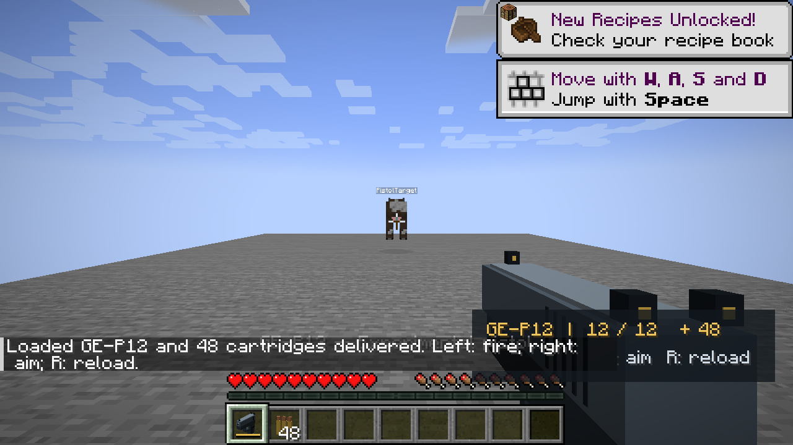
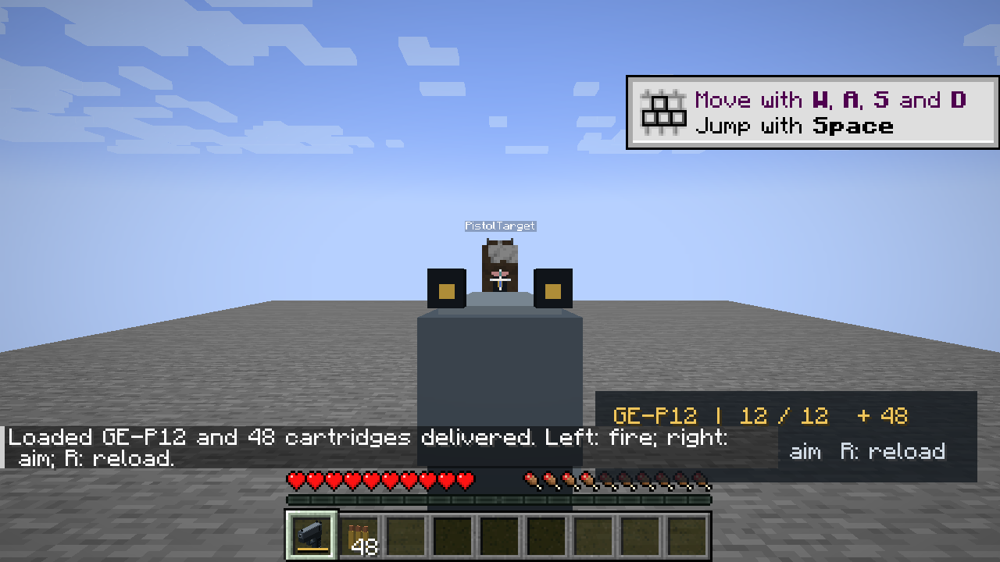
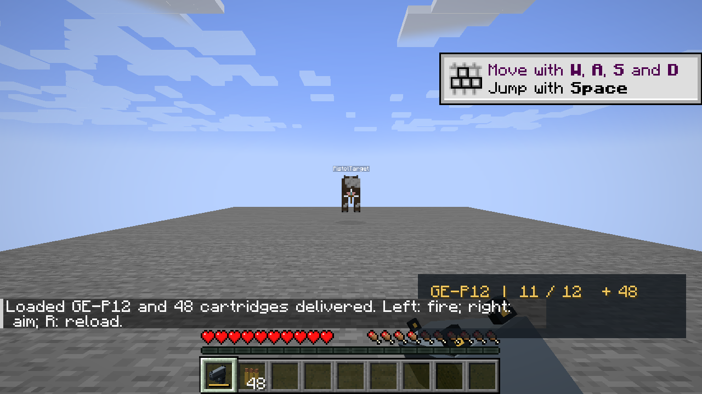

# GE-P12 — experiência de pistola própria, 0.006.0

O autor pediu uma pistola feita do zero para avaliar uma alternativa ao TaCZ. A GE-P12 é esse protótipo: implementação e recursos próprios, inspirados apenas nos controles familiares de uma arma FPS. As cinco armas externas anteriores permanecem disponíveis quando TaCZ está instalado.

## Como testar

No Minecraft aberto, usar **`/ge pistola`** com cheats/OP 2. O comando entrega a GE-P12 carregada com 12 tiros e 48 cartuchos. Também existem dois itens novos na aba Guerra Ezuberante; a pistola criada pela aba nasce vazia.

| Controle | Resultado |
| --- | --- |
| Botão esquerdo | Um tiro por pressionamento; segurar não produz rajada |
| Segurar botão direito | Mira ao centro, FOV reduzido em 22% |
| Soltar botão direito | Retorna da mira |
| R | Recarga de 1,6 segundo; exige reserva em Survival |
| Trocar de slot | Cancela a recarga sem consumir cartuchos |

HUD: quantidade no carregador, capacidade, reserva e indicação de recarga. As teclas podem ser remapeadas nos controles; o comando da pistola é separado de `/ge armamento`, que continua pertencendo à integração TaCZ opcional.

## Implementação

| Parte | Código ou recurso |
| --- | --- |
| Item, uso para ADS, tooltip e barra | `pistol/PistolItem.java` |
| Cadência, hitscan, dano e recarga | `pistol/PistolLogic.java` |
| Canal SimpleChannel, direção cliente → servidor | `pistol/PistolNetwork.java` |
| Kit OP, cancelamento de melee/mineração, limpeza ao largar/sair | `pistol/PistolEvents.java` |
| Input, FOV, recuo, transformações do item em primeira pessoa e HUD | `client/PistolClient.java` |
| Isolamento da integração opcional | `arsenal/TaczIntegration.java` |
| Geometria, paleta e fontes sintetizadas dos sons | `tools/GeneratePistolAssets.java` |

O cliente pede apenas **tiro** ou **recarga**, usando um booleano e direção de pacote restrita. O servidor valida jogador vivo, modo, item na mão principal, estado de recarga, cadência e munição. Coordenadas, dano e alvo não vêm do pacote do cliente. As ações são processadas na thread principal conforme o [modelo de rede oficial do Forge](https://docs.minecraftforge.net/en/1.20.x/networking/simpleimpl/).

Cada tiro válido em Survival retira um cartucho, incrementa um número de tiro no NBT, calcula o raio pela posição dos olhos/direção do jogador e limita o alcance pelo primeiro bloco sólido. Seleciona a entidade atingida mais próxima antes da parede e aplica 6 HP de dano antes das reduções vanilla. Não há penetração, projétil viajando ou cálculo de queda: é **hitscan**, até 48 blocos.

O tipo `guerra_ezuberante:pistol` é marcado como projétil e ignora somente a janela padrão entre danos. A cadência de seis ticks é validada no servidor, permitindo o segundo tiro legítimo sem ser descartado pela janela de dano corpo a corpo. Armadura, PvP, times e proteção Creative continuam pelo pipeline vanilla. O servidor transmite som e partículas; o cliente observa o número confirmado para animar o recuo. Não há previsão local de dano.

Munição usa NBT persistido, limitado a 0–12. Itens novos são vazios. O comando administrativo concede uma arma carregada explicitamente. Em Survival, a recarga só consome cartuchos próprios ao concluir os 32 ticks, inclusive quando há menos que um carregador completo; pedidos repetidos e término repetido não consomem duas vezes. Trocar de slot, largar ou sair cancela a ação. Creative permite recarga sem reserva e não gasta tiros.

## Independência e preservação do projeto

TaCZ passou de obrigatório para **opcional**. A compilação conhece sua API, mas o runtime pode excluí-lo com `-PwithoutTacz`. O adaptador antigo e seu registro de comandos só são carregados se `ModList` informa que ele existe. A pistola não importa classes `com.tacz`, não usa seus itens de munição e não depende dos gunpacks.

Nenhum código de combate, habilidade, invocação ou renderer dos personagens foi refeito; nenhuma entidade recebeu arma automaticamente. GeckoLib permanece para os personagens. Portanto, o conjunto sem TaCZ tem **duas entradas de mods**: Guerra Ezuberante e GeckoLib; não é um único mod total.

O perfil normal mantém TaCZ para preservar os itens que já existem no mundo do autor. A prova de independência usa outra instância e um mundo copiado, sem o TaCZ no classpath de execução. Não remover o mod de um mundo com itens dele para fazer esse teste.

## Recursos próprios

- Modelo de cubos: ferrolho de aço, armação, empunhadura, guarda-mato, gatilho, cano, janela lateral e alças de mira abertas.
- Paleta PNG 16×16 de seis tons; JSON contém geometria real, não um sprite 2D fingindo ser arma.
- Sons mono sintetizados deterministicamente para tiro, recarga e clique vazio. Java gera WAVs locais e FFmpeg converte para Vorbis; os OGGs são recursos próprios versionados.
- Mira/recuo/recarga usam transformações do item, sem novas dependências de animação.

Regeneração:

```powershell
powershell -NoProfile -ExecutionPolicy Bypass -File tools/generate_pistol.ps1
```

Não foram baixados ou copiados modelos, sons ou código de armas de terceiros. Não houve necessidade de escolher outra licença de biblioteca de armas para esta experiência.

## Validação executada

Dez GameTests novos verificam: tiro/acerto e rejeição de duplicata imediata; segundo tiro legítimo durante a janela vanilla; parede; arma vazia/item errado; duração e conservação da recarga; cancelamento; reserva parcial e item incorreto; espectador; persistência NBT e limites; permissões/quantidades do kit. A regressão completa com TaCZ passou em **47 testes**: 37 existentes + 10 novos.

Os **dez testes próprios também passaram sem TaCZ**, em `.tools/pistol-final-no-tacz-tests.log`. Os cenários gráficos com e sem TaCZ passaram no Minecraft real em Survival, usando input e pacotes de produção:

| Observação | Resultado |
| --- | --- |
| TaCZ carregado | **false**, verificado via ModList |
| Modelo real 3D | `isGui3d=true` e capturas inspecionadas |
| FOV fora / dentro da mira | 70 / 54,6 |
| Tiro | Um número de tiro, um som principal e 6 HP de dano |
| Recarga após o tiro | 12 no carregador, 47 na reserva: 60 iniciais → 59 |
| Sem munição | Tiro e recarga rejeitados; nenhum som novo de tiro ou dano |
| Saída da mira | Retorno ao estado normal aprovado |
| Gatilho segurado por 12 ticks | Um tiro; sem rajada automática, mesmo após o intervalo de cadência |
| Aba criativa real | 6 itens sem TaCZ; 15 com TaCZ, preservando todos os anteriores |

[Relatório gráfico sem TaCZ](validacao/pistola-0.006/cliente-sem-tacz.json), [com TaCZ](validacao/pistola-0.006/cliente-com-tacz.json), [hashes dos artefatos](validacao/pistola-0.006/artefatos.json).







Os testes usam `.tools/run-pistol-client`; o encerramento automático só existe nesse perfil. As tentativas iniciais encontraram e corrigiram a supressão do ataque vanilla enquanto usando ADS. A instrumentação foi ajustada para esperar frames reais após teleportar, antes de medir FOV/capturar imagens. Um exit code zero sem relatório aprovado não é considerado sucesso.

## Build e pacotes

```powershell
# Regressão completa, com integração antiga instalada
powershell -NoProfile -ExecutionPolicy Bypass -File tools/gradle.ps1 runGameTestServer build

# Somente testes próprios, sem TaCZ no runtime
powershell -NoProfile -ExecutionPolicy Bypass -File tools/gradle.ps1 runGameTestServer -PwithoutTacz

# Cenário gráfico próprio sem TaCZ
powershell -NoProfile -ExecutionPolicy Bypass -File tools/pistol_visual_test.ps1

# Mesmo cenário com TaCZ presente
powershell -NoProfile -ExecutionPolicy Bypass -File tools/pistol_visual_test.ps1 -WithTacz
```

JAR próprio: `build/libs/guerra_ezuberante-0.006.0.jar`. Pacote normal: `build/distributions/guerra-ezuberante-0.006.0/mods/`. Pacote sem TaCZ: `build/distributions/guerra-ezuberante-0.006.0-sem-tacz/mods/`. Este último mantém GeckoLib e exclui apenas TaCZ. Fixtures `src/pistolTest` e `src/gameTest` não entram no JAR.

## Limites desta experiência

A GE-P12 é um protótipo funcional, visualmente mais simples que as armas TaCZ. Não há mãos articuladas em primeira pessoa, slide/carregador animado separado, acessórios, headshots, balística ou receitas Survival. Há transformações do conjunto para ADS, recoil e recarga. Sem crafting, a forma prevista de teste é Creative ou kit administrativo.

O pipeline de dano/rede é de servidor, mas esta entrega não declara multiplayer gráfico com dois clientes da pistola aprovado sem ter executado essa sessão. Os resultados de duas pessoas da sprint 0.005 pertencem às armas TaCZ. Validação humana de sensação de tiro, estética e som continua sendo feedback do autor. A audição humana não é substituída pela contagem de eventos de som.

As mudanças ficam locais nesta etapa; não houve novo pedido de commit, push ou merge.
