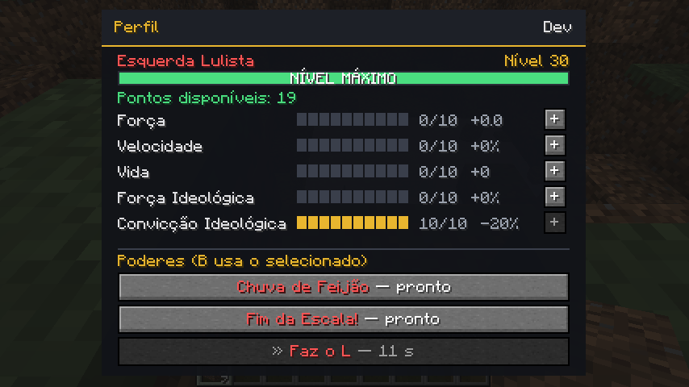
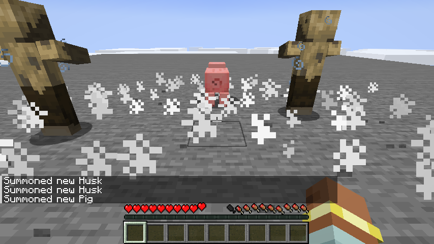
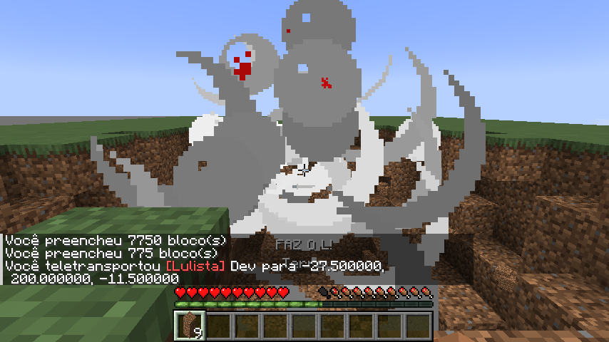
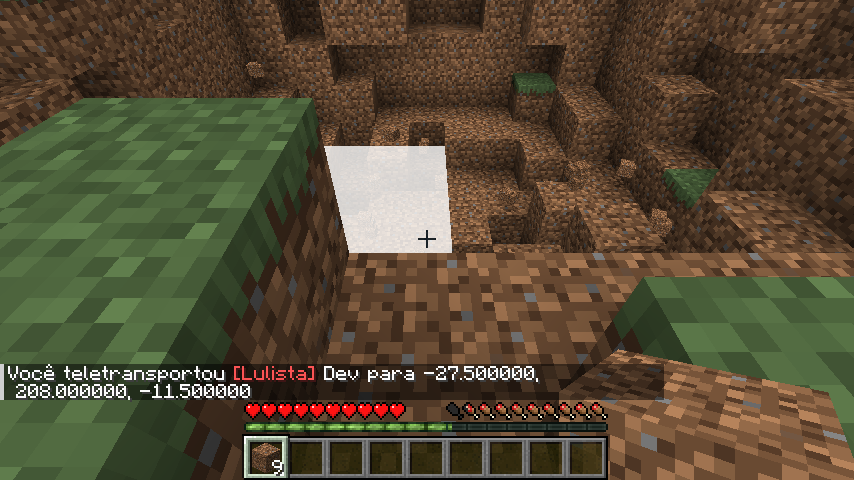
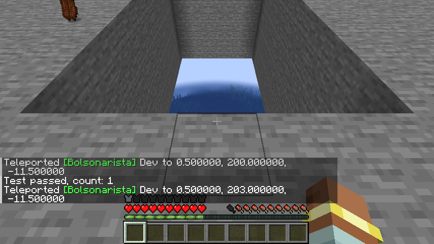
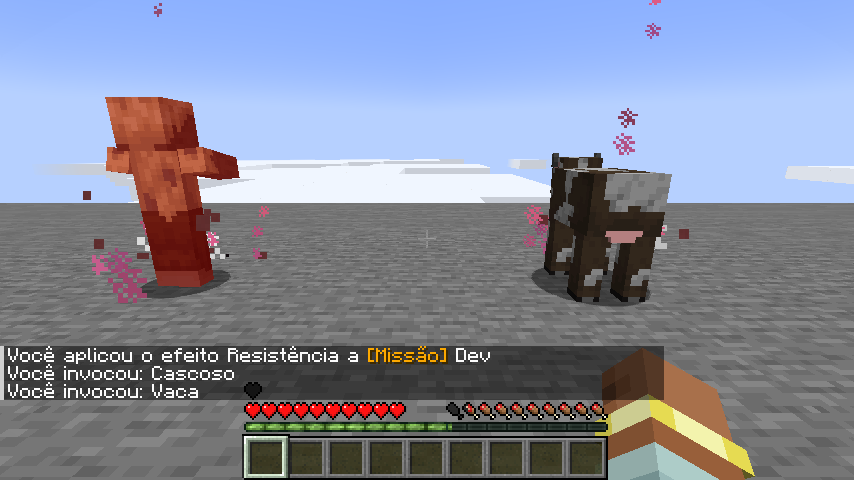
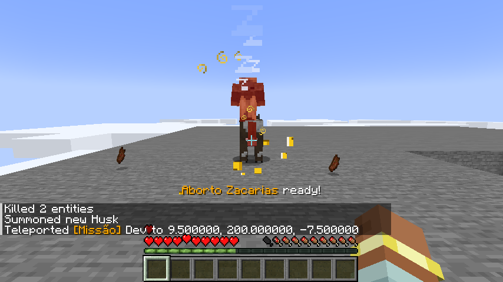
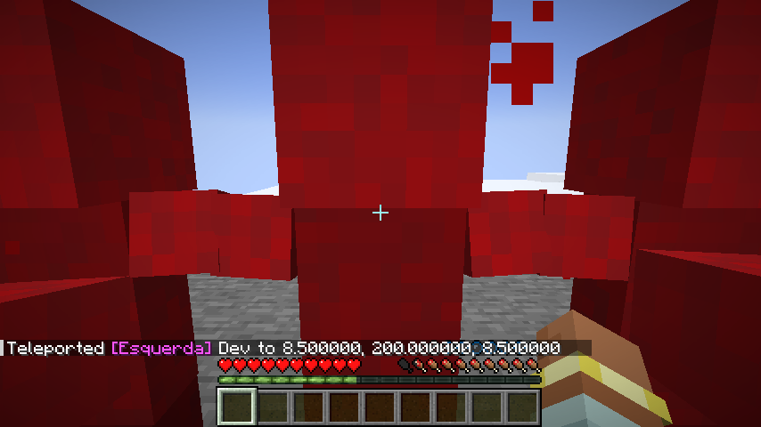

# Guerra Ezuberante 0.013.0 — nível, status e poderes de Convicção

> Contribuição original de GabrielKraemer2805. A [integração0.014.1](INTEGRACAO_0.014.1.md) preserva os recursos e corrige permissões, cancelamentos, PvP e confirmação de XP. O canal atual é a versão3, introduzida com as vilas0.014; os trechos sobre a versão2 abaixo são históricos.

Cada jogador com facção agora **sobe de nível derrotando inimigos**, ganha **pontos** e os distribui em cinco status. A **Convicção Ideológica** libera o **2º e o 3º poder** da facção. Tudo aparece num perfil pequeno aberto com a tecla **J**.

## Perfil (tecla J)

| Parte | O que mostra |
| --- | --- |
| Topo | Nome, facção e nível |
| Barra | XP atual / XP do próximo nível (verde e "NÍVEL MÁXIMO" no 30) |
| Pontos | Pontos livres; em verde quando há o que gastar |
| Status | Barrinha de 0 a 10, valor, bônus atual e botão **+**. Passar o mouse mostra a descrição |
| Poderes | Os três poderes da facção. Clicar num liberado faz dele o poder da tecla **B** (marcado com »). Bloqueados mostram a Convicção que falta. Cada um mostra a própria recarga |

A tecla J está livre no Minecraft e no TaCZ 1.1.8 (o TaCZ usa T, C, G, H, O, V, Z e R). Dá para trocar em Opções → Controles → Guerra Ezuberante. O painel K → Facções também mostra o poder selecionado.

## XP e níveis

| Abate | XP |
| --- | --- |
| Mob hostil (zumbi, esqueleto, aranha...) ou tropa invocada por outro | 10 |
| Personagem do mod (Renan, Arthur, Flávio...) | 40 |
| Boss (Lula, Jair, Wither, Dragão, Warden, Guardião Ancião) | 200 |
| Jogador de outra facção ou sem facção | 60 |
| Animal, jogador da mesma facção, suas próprias tropas | 0 |

- Contam também os abates feitos **com poderes** (feijão, Rachadinha, Faz o L...) e pelas **suas tropas** (Ucranianas e Manifestantes).
- Do nível *n* para o *n+1* custa `40 + 20·n` XP. Do 1 ao 30 são 9.860 XP, cerca de 1.000 mobs hostis.
- **1 ponto por nível**, 29 no nível 30. Maximizar os cinco status exigiria 50: é preciso escolher uma build.
- Sem facção não se ganha XP. Nível e pontos ficam com o jogador ao morrer, relogar e se um operador trocar a facção (os poderes passam a ser os da facção nova).
- Ficam nos dados persistentes do jogador (`PlayerPersisted/GuerraEzuberanteProgress`).

## Status (até 10 pontos cada)

| Status | Por ponto | No 10 |
| --- | --- | --- |
| Força | +0,5 de dano corpo a corpo (não afeta armas do TaCZ) | +5 |
| Velocidade | +2% de velocidade | +20% |
| Vida | +1 de vida máxima | +10 (5 corações) |
| Força Ideológica | +5% no dano dos poderes; nos poderes sem dano, +5% de duração | +50% |
| Convicção Ideológica | −2% na recarga de todos os poderes. **5 libera o 2º poder, 10 libera o 3º** | −20% e 3 poderes |

## Poderes novos

O fogo amigo continua ativo nos poderes marcados como **todos**. Os marcados como **inimigos** poupam a sua facção (e as tropas dela) e animais passivos, e atingem jogadores de outra facção ou sem facção, mobs hostis e os personagens do mod. Todos respeitam o PvP do servidor e nunca atingem jogadores no criativo/espectador.

| Facção | 2º poder (Convicção 5) | 3º poder (Convicção 10) |
| --- | --- | --- |
| Esquerda Lulista | **Fim da Escala!** Pequeno salto e pisão com onda de choque: 6 de dano, empurrão, Lentidão II e Fraqueza por 5 s nos **inimigos** a até 6 blocos. Recarga 20 s | **Faz o L** Um L vermelho gigante que explode no primeiro bloco ou criatura com **a mesma explosão da morte do Lula** (tamanho, visual e destruição de blocos, `[lula] death_explosion_power`): 10 de dano em área (7 blocos) em **todos**. Jogador de outra facção que sobreviver **deixa cair 2 itens** do inventário (nunca armadura nem mão secundária). Recarga 45 s |
| Direita Bolsonarista | **Histórico de Atleta** Força I, Velocidade II, Pressa II, Salto II e Vida Extra I por 15 s. Recarga 45 s | **Não Sou Coveiro** Cova de 10 × 5 blocos e 5 de profundidade à frente, aberta fileira por fileira. Quebra tudo menos bedrock e blocos inquebráveis, sem drop (baús soltam o conteúdo). 10 de dano em **todos** na área. Recarga 60 s |
| Direita Missão | **Aborto Zacarias** 20 pedras rosas caem do céu em 5 s a até 7 blocos de você; 2 de dano por pedra nos **inimigos**. Sem fogo e sem quebrar blocos. Recarga 30 s | **O Livro Amarelo** Por 10 s, 2 livros amarelos por segundo para onde você mira: 1 de dano e **Entediado** por 2 s (não anda nem pula, "Zzz" na cabeça) nos **inimigos**. Recarga 45 s |
| Esquerda Independente | **Manifestando** 10 zumbis vermelhos por 15 s que agem como lobos: seguem você, atacam quem te bateu e quem você atacou, nunca atacam a sua facção, não queimam no sol e não dropam nada. Recarga 45 s | **Greve Geral** Lentidão II e Fraqueza por 6 s nos **inimigos** a até 8 blocos. Recarga 30 s |
| Direita Independente | **Salto Liberal** Salto alto sem dano de queda; ao aterrissar, 6 de dano nos **inimigos** a até 4 blocos. Recarga 15 s | **Mão Invisível** Empurra para longe e causa 6 de dano nos **inimigos** a até 6 blocos. Recarga 20 s |
| Centro | **Isenção** Resistência IV por 3 s. Recarga 30 s | **Toma Lá, Dá Cá** Tira 4 de vida de cada **inimigo** a até 6 blocos e cura você com o total. Sem inimigos perto, é recusado sem gastar a recarga. Recarga 30 s |

- Cada poder tem **sua própria recarga**. A recarga é do *slot*, não da facção: trocar de facção pelo operador não zera recargas.
- **Recusas não gastam a recarga**: poder ainda bloqueado, exército/manifestação completos, sem espaço seguro, sem inimigos para o Toma Lá, Dá Cá.
- Poderes que duram (pedras rosas, livros, pisão, salto, cova) param se quem usou morrer, sair do servidor ou mudar de facção.
- As recargas da tabela são as de base; a Convicção diminui todas.

## Comandos

| Comando | Quem | O que faz |
| --- | --- | --- |
| `/ge nivel` | todos | Mostra nível, XP e pontos livres |
| `/ge nivel xp <jogadores> <quantidade>` | operador | Dá XP (só a jogadores com facção). Útil para testar a Convicção 10 |
| `/ge nivel resetar <jogadores>` | operador | Volta ao nível 1, devolve os pontos e seleciona o 1º poder |

## Configuração

Arquivo do servidor `guerra_ezuberante-server.toml`:

- `[progression]`: nível máximo, pontos por nível, limite por status, curva de XP, XP por tipo de abate, bônus por ponto de cada status e a Convicção que libera cada poder.
- `[conviction_powers]`: recarga, dano, raio e duração dos 12 poderes novos, mais `faz_o_l_break_blocks` e `nao_sou_coveiro_break_blocks` (desligar preserva o terreno). O tamanho da explosão do Faz o L segue `[lula] death_explosion_power`; o dano é `lulista_faz_o_l_damage`.

## Rede e compatibilidade

- Canal `guerra_ezuberante:faction` agora na **versão 2**: cliente e servidor precisam estar na 0.013. Pacotes novos: `Profile` (S2C, substitui o antigo `Cooldown`), `SpendPoint` e `SelectPower` (C2S, só índices; o servidor valida tudo).
- A recarga do 1º poder continua na chave `PowerReadyAt` da 0.012.

## Testes

- GameTests novos em `src/pistolTest/.../ProgressionGameTests.java` (rodam com e sem TaCZ): curva de XP e nível máximo, gasto e limite de pontos com os bônus aplicados, desbloqueio por Convicção e recarga −20%, XP por tipo de abate, e cada poder novo (alvos, dano, efeitos, recusas sem recarga, cova 249/250 blocos com bedrock preservada).
- Os testes de poder em área rodam em lotes próprios (`ge_*`) e se limpam mesmo quando falham, para não atingir os testes vizinhos.
