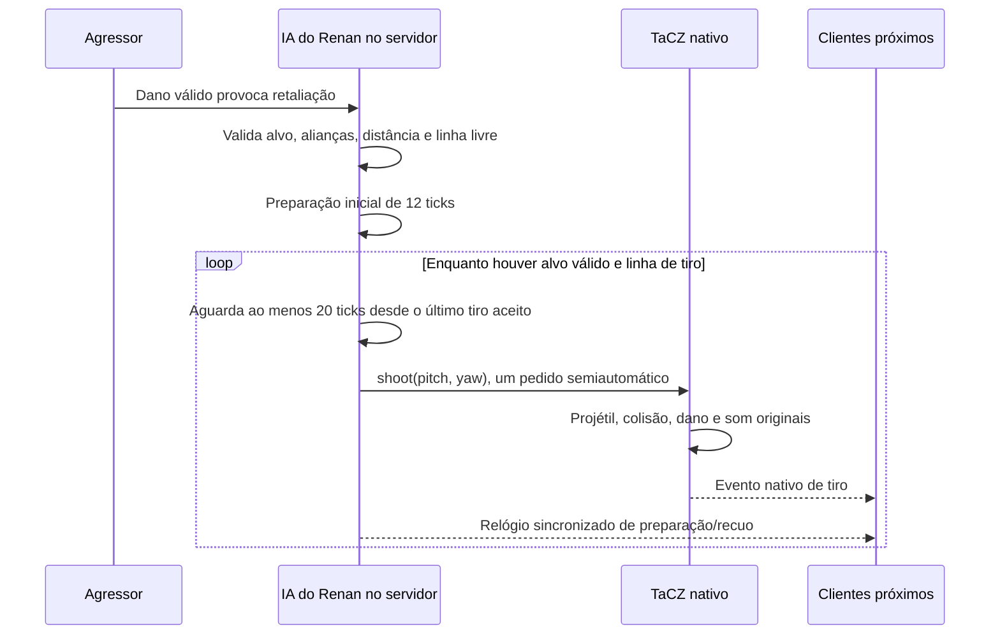
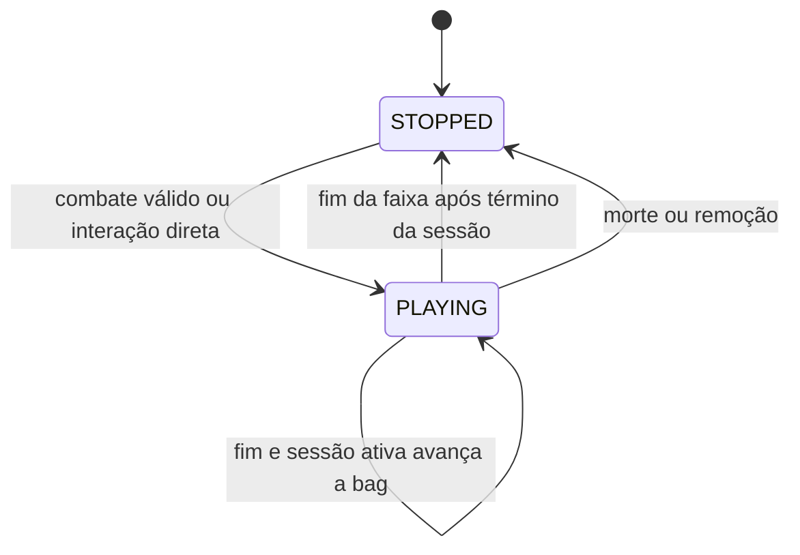
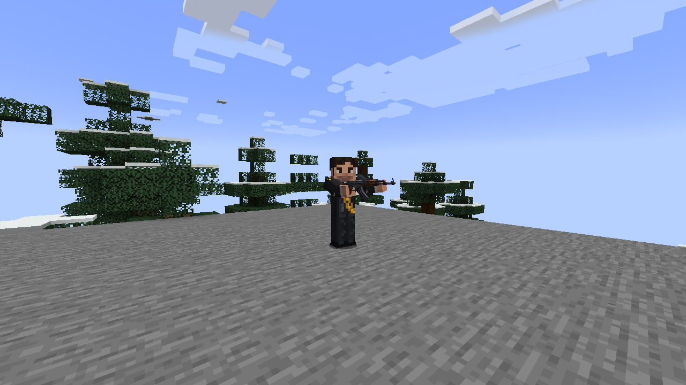

# Renan armado e playlists por personagem — 0.007.0

Esta sprint mantém **TaCZ 1.1.8-hotfix2**, namespace `tacz`, arquivo oficial 9037989, Forge 1.20.1, GeckoLib 4.8.4 e Java 17. A AK usada é a nativa `tacz:ak47`, já disponível no projeto. A GE-P12 experimental e as outras quatro armas continuam registradas. Nenhum asset de arma foi copiado.

O autor ampliou o pedido durante a execução: **usar falas e músicas das pastas de cada personagem na mesma biblioteca**. Assim, a playlist do Renan tem os três áudios; as duas variantes e o ID legado de Arthur compartilham os sete áudios únicos de Arthur. As combatentes não têm pasta de falas/músicas própria: seu efeito de spawn continua ligado à invocação, sem transformá-lo em música em loop.

## Equipamento, tiro e munição

Renan nasce com um ItemStack real da AK-47, construído pela API existente após validar o índice do gunpack. O item usa modo SEMI apenas nessa instância. Não se modifica o JSON da AK, o catálogo global, o dano, os sons, a munição ou o comportamento da arma dos jogadores.

O adaptador chama `IGunOperator.draw`, `aim` e `shoot` do TaCZ. A API cria os projéteis nativos, aplica colisão/dano e envia os eventos de tiro aos clientes. Não há outro projétil, raycast de dano, som de tiro ou chamada manual de dano nesta integração. O raycast anterior ao tiro serve apenas para evitar paredes/aliados.

`needCheckAmmo()` e `consumesAmmoOrNot()` são resolvidos por despacho virtual somente na entidade Renan. TaCZ injeta o contrato `IGunOperator` em LivingEntity; as implementações do Renan retornam falso. O item permanece normal, sem dummy ammo ou propriedade portátil de munição infinita. O carregador começa cheio e não é consumido; não há itens de reserva criados ou recarga automática. A chance de drop da mão principal é zero. O teste também confirmou que um jogador Survival continua com verificação e consumo de munição ativos.

Cadência do Renan: **um disparo a cada 20 ticks de servidor**, após preparação e respeitando os estados nativos. O relógio usa `level.getGameTime()`, sem timers externos, catch-up de tiros ou loops concorrentes. Se a arma nativa rejeitar um pedido ou a linha estiver bloqueada, o Renan não compensa com rajada. No Minecraft a 20 TPS, são 1 s entre tiros; TPS menor alonga o tempo real.

## Retaliação e posicionamento

Renan continua pacífico até dano de um agressor válido. Não há busca de jogadores por proximidade. O goal à distância controla MOVE/LOOK, prepara a postura, aproxima quando está além de 18 blocos ou procura linha de visão, para quando já está em distância útil e tenta se afastar quando o alvo entra em menos de cinco blocos. A navegação vanilla resolve o terreno.

São preservadas a validação de Creative/Spectator, as alianças em ambos os sentidos e a desistência de alvos inválidos/distantes. Enquanto mantém uma posição válida para atirar, isso conta como progresso: ele não precisa correr para continuar retaliando. Paredes e um aliado no corredor de tiro bloqueiam o pedido; o evento nativo `EntityHurtByGunEvent.Pre` também cancela dano do Renan a aliados que entrarem no projétil em trânsito.

Se estiver sem a AK, o goal corpo a corpo anterior permanece como fallback. O teste de impacto no tick 5 agora esvazia explicitamente a mão para exercitar esse caminho. Sem TaCZ instalado, Renan permanece desarmado e usa esse fallback; a integração opcional não carrega classes externas ausentes. Armas retiradas durante a sessão não são recriadas a cada 20 ticks. Entidades antigas podem receber o equipamento inicial ao carregar se estavam sem arma.

## Animações e renderização

O modelo humanoide articulado, a skin 64×64 e suas UVs foram preservados. Foram acrescentados seis clipes ao mesmo controlador GeckoLib: `rifle_idle`, `rifle_prepare`, `rifle_aim`, `rifle_walk`, `rifle_fire`, `rifle_hurt`. Os oito anteriores permanecem para Arthur, tropas e fallback.

- Idle com arma abaixada; transição de preparação de 12 ticks.
- Postura de mira com braços e antebraços flexionados; ajuste de pitch acompanha o alvo.
- Recuo de nove ticks, associado ao instante do tiro aceito no servidor.
- Caminhada mantém os braços na posição de arma e anima pernas/apoio do tronco.
- Reação ao dano mantém a postura armada.

O item 3D nativo é renderizado na mão direita pelo layer Gecko já existente, com ajuste específico só para Renan armado. Não foi adicionado outro controlador TaCZ/Gecko concorrente. O token de tiro evita reiniciar o mesmo recuo a cada tick; a idade sincronizada também atende um cliente que começa a acompanhar a entidade depois.

## Biblioteca completa de áudio

Arquivos foram auditados com FFprobe. Duração do controlador = `ceil(segundos × 20)`, baseada no OGG efetivamente distribuído. Nenhum áudio foi substituído, cortado ou sintetizado nesta sprint.

| Personagem / ID registrado | Segundos do OGG | Ticks |
| --- | --- | --- |
| Renan — `renan.me_respeita` | 13,479184 | 270 |
| Renan — `renan.phonk` | 12,591020 | 252 |
| Renan — `renan.risadinha` | 2,377143 | 48 |
| Arthur — `arthur.e_vagabundo_sim` | 9,978776 | 200 |
| Arthur — `arthur.ficou_ofendidinho` | 16,587755 | 332 |
| Arthur — `arthur.limpa_o_cu_com_a_linuga` | 14,027755 | 281 |
| Arthur — `arthur.parar_de_mamat` | 13,191837 | 264 |
| Arthur — `arthur.privatizar_tudo` | 16,692245 | 334 |
| Arthur — `arthur.sao_faceis_pq_sao_pobres` | 7,888980 | 158 |
| Arthur — `arthur.so_deusa` | 9,430204 | 189 |

`privatizar_tudo(1).MP3` e `(2).MP3` são idênticos por SHA-256 a `parar_de_mamat.MP3`; não viraram faixas duplicadas. O efeito `arthur.invocacao` permanece em 5,903673 s, associado à conjuração. Áudios fonte ficam nas pastas locais ignoradas; os OGGs anteriores foram preservados.

### Causa anterior e novo controlador

A versão anterior escolhia interação apenas de `RENAN_VOICES` e combate apenas de uma lista com o phonk. A seleção de combate era executada na entrada da retaliação, tinha cooldown e não tinha condição de avanço ao fim do áudio. Portanto, o phonk era o único candidato de combate e não existia playlist contínua. Cooldown de voz e cooldown de combate também bloqueavam um ao outro na interação. Não foi encontrado um callback de fim controlando essa seleção.

O novo `EntityMusicSession` é único por entidade, com estados STOPPED/PLAYING. O servidor mantém biblioteca, shuffle bag, término previsto, sessão manual e cooldown de clique. Não depende de callback do motor de som para avançar.

Cada rodada embaralha a biblioteca e toca todas as faixas uma vez. A primeira não é fixada. Ao reembaralhar, a primeira não pode ser a última da rodada anterior; uma biblioteca de uma faixa pode repetir. Os testes cobriram cem rodadas de uma biblioteca de quatro faixas, além de bibliotecas vazia e unitária.

Interação direta com a entidade, botão direito: inicia se parado e avança se já tocando, com **10 ticks / 0,5 s de cooldown**. Não foi alterada nenhuma tecla de ADS ou handler de input de arma. Combate e interação usam a mesma sessão; receber outro dano, trocar agressor ou atirar não reinicia a faixa ativa.

Uma sessão manual dura 1200 ticks / 60 s após o último clique aceito. Combate mantém a sessão ativa; ao terminar há 40 ticks de tolerância. Ao expirar, **a gravação atual termina naturalmente**, então a sessão para. Morte/remoção interrompem imediatamente. Essas durações e o volume ficam no SERVER config `character_audio` do mundo.

### Som espacial e sincronização

Índice, início, número de transição e volume são SynchedEntityData. Cada cliente acompanha esses dados e mantém no máximo uma instância por UUID. Ao avançar, cancela a anterior antes de iniciar a próxima. `AttachedRecording` acompanha a posição do emissor, usa atenuação linear de 32 blocos, streaming e categoria Jukebox/Note Blocks. Não é trilha global. Sair de alcance/tracking, trocar de dimensão, desconectar, remover ou matar a entidade limpa a reprodução.

Um cliente que começa a acompanhar uma gravação já ativa começa o arquivo pelo início e respeita a próxima transição do servidor; não há seek/offset de OGG implementado. Os estados são compartilhados, mas não se declara alinhamento de amostra entre ouvintes. O fim lógico acompanha ticks de servidor; sob TPS baixo, o arquivo pode acabar antes do próximo avanço previsto.

## Extensão para próximos personagens

`musicTracks()` fornece biblioteca; o gerenciador e o som espacial são compartilhados. `allowsMeleeCombat()` permite um goal especializado sem competir com o corpo a corpo. Registros, atributos, renderer, alianças, equipamento e poderes continuam nos pontos existentes, sem mover todas as classes ou criar um framework novo.

[Próximos personagens — Lula](PROXIMOS_PERSONAGENS.md) lista somente decisões técnicas pendentes. Lula não foi implementado e nenhuma habilidade foi inventada.

## Validação

**54 GameTests passaram**: os 47 anteriores adaptados às novas regras de áudio/fallback e sete novos. O teste acelerado percorreu 6500 ticks e registrou 108 tiros nativos / 108 acertos, carregador permanecendo em 30. GameTest executa ticks rapidamente; isso não representa vários minutos de relógio real.

O cliente gráfico separado executou mais de dois minutos de combate em tempo real: **124 pedidos/tiros, 124 projéteis e 124 acertos**, 124 eventos remotos no cliente, 14 gravações iniciadas cobrindo os três áudios, máximo de uma instância por Renan, munição em 30 e parada na morte. [Relatório](validacao/renan-0.007/singleplayer.json).

A repetição com **dois Minecrafts reais**, servidor integrado e TCP somente em 127.0.0.1:25582, também completou: host: 124 tiros/projéteis/acertos; Observer: 124 eventos remotos e poses de mira/recuo vistas. Os dois receberam os três áudios, com uma instância por UUID; host confirmou que a ativação de combate manteve a gravação de interação e limpou na morte. [Host](validacao/renan-0.007/multiplayer-host.json), [Observer](validacao/renan-0.007/multiplayer-observer.json). Essa repetição rodou com **master 0.0 nos dois perfis**, conforme pedido do autor; estados, recursos e eventos foram auditados sem emitir áudio. Uma tentativa anterior foi fechada antes de produzir relatórios e não contou como sucesso.

Os timestamps dos dois relatórios prolongados foram conferidos: todos os123 intervalos em cada sessão foram **exatamente 20 ticks**, mínimo e máximo20. O limite de servidor permanece seguro se outra condição impedir um tiro: não há compensação posterior por rajada.

Os **11 GameTests sem TaCZ passaram**, incluindo criação do Renan e início da mesma playlist com o adaptador opcional ausente. O novo teste de compatibilidade foi acrescentado depois da execução dos 54; não se declara um resultado de 55 no conjunto completo sem executá-lo.

A regressão gráfica do arsenal dos jogadores foi repetida na 0.007, silenciosa: **as cinco armas passaram**, incluindo AKM, com ADS/FOV, recoil, um som/evento por tiro, dano nativo, consumo de munição, recarga/conservação e rejeição de tiro/recarga vazios. [Cliente](validacao/renan-0.007/arsenal-jogador-cliente.json), [Servidor integrado](validacao/renan-0.007/arsenal-jogador-servidor.json). As regras especiais de Renan não se propagaram aos jogadores.

Os testes cobrem arma nativa equipada, regras de munição exclusivas do NPC e Survival preservado, distância, parede/aliado, shuffle, cooldown/avanço, combate sem reiniciar interação e término por duração/morte. Os validadores conferem os 14 clipes e a preservação das skins. Capturas são de clientes reais, não mockups; aprovação estética e auditiva pelo autor permanece feedback humano.

Ferramentas: `tools/renan_visual_test.ps1`; modo `-Multiplayer` abre listener só em 127.0.0.1:25582; `tools/renan_observer_test.ps1` conecta o observador. Flags e encerramento automático são exclusivos dos perfis `.tools`, nunca do mundo normal do autor. Relatórios do arsenal antigo não são usados como prova de multiplayer desta nova IA.

Preferência permanente: todo `runClient` cujo diretório fica dentro de `.tools/` grava master 0.0 antes de iniciar, inclusive quando as tarefas de preparação já estão atualizadas. Não é silenciado o Windows ou qualquer aplicativo da série. O perfil normal mantém suas opções próprias.

## Artefato e referências

`build/libs/guerra_ezuberante-0.007.0.jar`. Pacote normal: `build/distributions/guerra-ezuberante-0.007.0/mods/`. Alternativa sem TaCZ: `build/distributions/guerra-ezuberante-0.007.0-sem-tacz/mods/`; nela não existe a AK nativa e o Renan usa o fallback. GeckoLib permanece obrigatório. Não houve commit/push/merge autorizado nesta sprint.

- [IGunOperator, fonte oficial](https://github.com/MCModderAnchor/TACZ/blob/1.20.1/src/main/java/com/tacz/guns/api/entity/IGunOperator.java).
- [Operador nativo de tiro](https://github.com/MCModderAnchor/TACZ/blob/1.20.1/src/main/java/com/tacz/guns/entity/shooter/LivingEntityShoot.java).
- [Política nativa de munição](https://github.com/MCModderAnchor/TACZ/blob/1.20.1/src/main/java/com/tacz/guns/entity/shooter/LivingEntityAmmoCheck.java).
- [API de script e consumo](https://github.com/MCModderAnchor/TACZ/blob/1.20.1/src/main/java/com/tacz/guns/item/ModernKineticGunScriptAPI.java).
- [Créditos e dependências externas](DEPENDENCIAS_TERCEROS.md).
