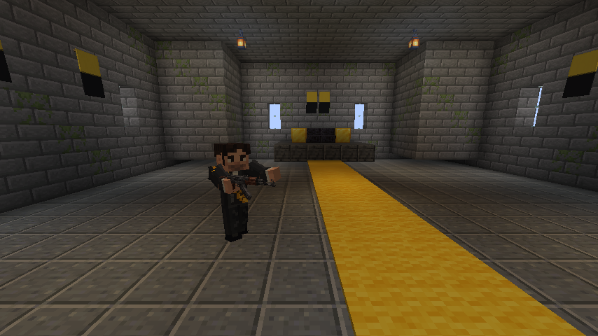
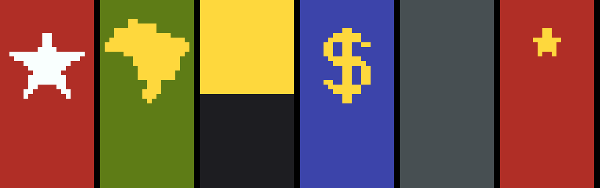
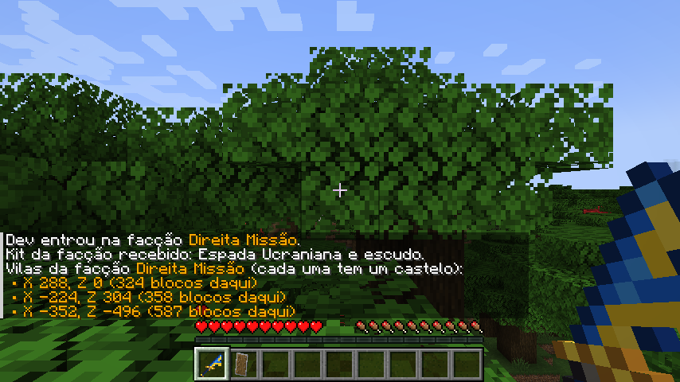

# Guerra Ezuberante 0.014.0 — vilas de facção

O sistema planeja **18 vilas de facção**, **3 de cada facção**, em anéis com raio alvo entre **350 e1.000 blocos** de0,0. A busca de bioma/terra pode deslocar pontos além dessa faixa. Cada vila usa casas do Minecraft no estilo do bioma, cores e estandartes da facção e **um castelo** para o líder. As vilas são o **único spawn natural** dos personagens, e quem morre **não volta**. A [integração0.014.1](INTEGRACAO_0.014.1.md) registra correções e validação.

## Quem mora em cada vila

| Facção | No castelo (líder) | Na praça da vila | Estandarte |
| --- | --- | --- | --- |
| Lulista | Lula | — | Vermelho com estrela branca |
| Bolsonarista | Jair | Flávio | Verde com o mapa do Brasil em amarelo |
| Missão | Renan | Arthur do Val | Metade amarela em cima, metade preta embaixo |
| Direita | trono vazio | — | Azul com cifrão amarelo |
| Centro | trono vazio | — | Cinza |
| Esquerda | trono vazio | — | Vermelho com estrela amarela pequena |

- Cada vila tem **um** de cada personagem da sua facção. Com 3 vilas por facção, o mundo começa com 3 Lulas, 3 Jairs, 3 Flávios, 3 Renans e 3 Arthurs.
- Direita, Centro e Esquerda ainda não têm personagens; as vilas e os castelos existem, com o trono à espera de um líder.
- Os personagens nascem persistentes (não somem quando o jogador se afasta). **Morreu, não volta**: não há renascimento.
- Os ovos de spawn e os comandos continuam funcionando como antes.

## A vila

- As vilas são geradas depois das árvores, então casas e castelo limpam a vegetação do terreno.
- A vila usa as casas do bioma em que caiu: planície, deserto, savana, taiga ou neve. Em biomas sem vila própria (floresta, selva, pântano, montanha...) usa as casas da planície. Nunca sai a variante abandonada (vila zumbi): toda vila de facção tem aldeões.
- Toda **lã e tapete** da vila trocam para a cor da facção.
- Casas ganham um **estandarte** num canto do terreno, e a praça ganha um **mastro** com a bandeira.
- Aldeões, golem e comércio funcionam como numa vila comum.

## O castelo

- Castelo de tijolos de pedra de 22 × 22 blocos, com quatro torres nos cantos, ameias, telhado de pedra, janelas e **porta dupla de ferro voltada para a praça**, com botões de pedra dos dois lados.
- O chão é de meia-laje de andesito polido, onde não nascem monstros nem cogumelos. O terreno em volta sobe até o piso, e há um degrau de pedra na porta.
- Dentro: tapete da cor da facção até o **trono** (degraus de pedra-negra polida com braços de ouro), lanternas penduradas e estandartes nas paredes, atrás do trono e no alto de cada torre.
- O líder nasce na frente do trono. Aldeões e personagens não abrem portas de ferro, então ele fica dentro até um jogador apertar o botão.
- O castelo fica no lote livre mais próximo da praça (sem encostar em casa nem rua) que esteja em terra seca e plana; sem lote plano, aceita terra seca com desnível, e o alicerce de pedra preenche o resto. Se a vila estiver cheia, ele fica logo na borda dela.

## Coordenadas

- Ao **escolher a facção**, o chat lista as 3 vilas dela, da mais próxima para a mais distante. Desde a0.014.2, clicar numa linha prepara o comando completo `/ge vilas tp <faccao> <1–3>`; confirme com Enter. Requer comandos ativados ou operador. O servidor procura chão com espaço para o jogador e leva ao mundo principal, sem adivinhar a altura.
- O **painel K → Facções** mostra as mesmas coordenadas e a distância atual até cada uma.
- `/ge vilas` repete a lista a qualquer momento. Operadores consultam qualquer facção com `/ge vilas <faccao>`, inclusive pelo console do servidor.
- Para visitar diretamente, por exemplo: `/ge vilas tp missao 1`. Os números1–3 são estáveis, mesmo que a ordem por distância no chat mude. O teleporte não cria vilas retroativamente em chunks antigos.
- No comando vanilla, use três coordenadas: `/tp 176 200 480` significa X176, Y200, Z480. Digitar só `/tp 176 480` faz o jogo tentar interpretar números como entidades. Prefira o comando de vila acima para aterrissar no chão.
- O `/locate structure` do Minecraft 1.20.1 não encontra essas vilas: ele só procura estruturas com os posicionamentos vanilla. Use `/ge vilas`.
- A disponibilidade depende dos conjuntos de estruturas oferecidos pelo gerador/datapacks do mundo. Quando as vilas de facção não estiverem disponíveis, o chat avisa; a mera existência de coordenadas não comprova uma vila completa em chunks antigos.

## Mundos já existentes

As vilas nascem quando o terreno é gerado. Num mundo criado antes da 0.014, as áreas a até 1.000 blocos do centro que já foram exploradas **não ganham vila**; só os pedaços ainda não gerados recebem a parte da vila que cair neles. Para ver tudo, crie um mundo novo.

## Técnica

| Parte | Onde |
| --- | --- |
| Posições (semente → 18 pontos em dois anéis, alternando facções; cada vila procura bioma de vila perto do ponto sorteado, depois terra firme, depois desliza pela própria fatia do anel; nunca a menos de 176 blocos de outra) | `village/FactionVillages` |
| Placement que só aceita esses 3 chunks por facção | `village/FactionVillagePlacement`, `worldgen/structure_set/vilas_<faccao>.json` |
| Estrutura: vila vanilla do bioma + castelo + tingimento, estandartes e personagens | `village/FactionVillageStructure`, `worldgen/structure/vila_<faccao>.json` |
| Castelo | `village/FactionCastlePiece` |
| Estandartes e padrões novos (estrela, estrela pequena, cifrão, Brasil) | `village/FactionBanners`, `registry/ModWorldgen`, texturas de `tools/GenerateVillageAssets.java` |
| Biomas aceitos | `tags/worldgen/biome/has_structure/vila_faccao.json` (mesma lista de `FactionVillages.LAND`) |

- As posições dependem só da semente e do gerador de biomas, então o mundo, o chat, o painel K e o `/ge vilas` sempre concordam.
- O canal de rede `faction` passou para a versão **3** (pacote `Villages`); cliente e servidor precisam da 0.014.
- Um access transformer abre `ChunkGeneratorStructureState.biomeSource`, como as fortalezas vanilla fazem para achar bioma.
