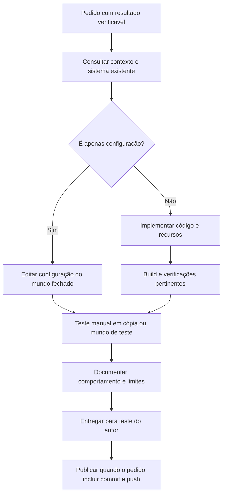

# Como modificar o Guerra Ezuberante

[Voltar ao guia](README.md) · [Prompts prontos](MODELOS.md) · [Preparar o ambiente](REQUISITOS.md#para-desenvolver)

## Começar pela mudança desejada

Leia a seção mais recente de [CONTEXTO.md](../CONTEXTO.md), as [preferências do autor](../AGENTS.md) e `git status`. Há registros históricos com atributos antigos; o código atual, `gradle.properties` e a seção mais recente do contexto determinam o estado vigente.

Antes de alterar código, descreva uma situação de jogo que demonstre o resultado. Exemplo: “Flávio precisa usar a habilidade pelo menos três vezes na mesma luta, com alvo vivo e respeitando a recarga”. Isso orienta tanto a implementação quanto a validação.

## Mapa dos arquivos

Os caminhos Java abaixo partem de `src/main/java/io/github/omarflk/guerraezuberante/`.

| Onde | Responsabilidade |
| --- | --- |
| `entity/` | Personagens, projéteis, estados e persistência por entidade |
| `combat/` | Objetivos de IA, seleção de ataque, terreno e regras de combate |
| `summon/` | Invocação, vínculo e contagem de unidades por dono |
| `config/ModConfig.java` | Parâmetros SERVER, padrões e faixas permitidas |
| `config/ConfigMigrations.java` | Migração dos padrões antigos sem substituir outros valores personalizados |
| `registry/` | Registros de entidades, itens, sons e aba criativa |
| `animation/` | Controladores e seleção dos clipes GeckoLib |
| `client/model/` e `client/renderer/` | Modelos, texturas, transformações e renderização |
| `client/gui/` e `client/screen/` | Painel e interface do cliente |
| `arsenal/` | Integração opcional com TaCZ e armas nativas dos NPCs |
| `pistol/` | Pistola própria GE-P12 |

| Outro caminho | Conteúdo |
| --- | --- |
| `src/main/resources/assets/guerra_ezuberante/` | Texturas, modelos, animações, sons e traduções finais |
| `assets-entrada/` | Fontes de arte que precisam ser preservadas e referências usadas por validadores |
| `src/gameTest/` | Regressões e cenários gráficos com a integração completa |
| `src/pistolTest/` | Verificações da pistola e compatibilidade, inclusive sem TaCZ |
| `tools/` | Wrappers, geradores, validadores e cenários |
| `docs/` | Design, entregas por versão, procedência e evidências |
| `guia-de-prompts/` | Instruções para pedir mudanças, instalar e desenvolver |



## Configurar ou recompilar?

Para mudar atributos e opções já expostos, primeiro confira `serverconfig/guerra_ezuberante-server.toml` **do mundo correto**. Valores como HP, recarga, poder da explosão e destruição podem estar configuráveis. A [0.011.0](../docs/BOSSES_0.011.md) lista os parâmetros de Lula/Jair/Rachadinha.

Editar o arquivo não substitui automaticamente todos os atributos gravados em NBT de personagens existentes. Veja como a entidade lê a configuração, o que é capturado ao nascer/ativar e qual migração está implementada. Para editar com previsibilidade, salve e feche o mundo; use uma cópia para conferir.

Uma mecânica nova, novo registro, regra de IA, tela ou mudança de estado exige código e novo build. Não altere o ID de uma entidade/item existente para mudar apenas o nome exibido: nomes ficam nas traduções, IDs afetam mundos salvos.

## Implementar um personagem ou poder

1. Use o personagem/sistema mais parecido como referência. Reutilize `SpecialDeathEntity`, infraestrutura de invocação, áudio e integração de armas quando forem adequados.
2. Defina atributos, condições, fases, recarga, alvos válidos e cancelamento. Evite ampliar o escopo para personagens que não foram pedidos.
3. Mantenha dano, IA, criação/remoção de entidades e alteração de terreno no servidor. O cliente desenha o estado sincronizado e os efeitos.
4. Defina o que precisa de NBT, `SynchedEntityData` ou `SavedData`; evite duplicar invocações, dano ou efeitos ao carregar/reconectar.
5. Integre registros, ovo, aba criativa, painel K e traduções quando fizer parte da entrega. Preserve a possibilidade de iniciar sem TaCZ se tocar na integração opcional.
6. Atualize documentação, padrões de configuração e migração quando a mudança afetar mundos existentes.

Para dano de área, confira aliados, dono, espectadores, Creative/Spectator, linha de visão e quantidade de acertos por ativação. Para invocações, confira cap por dono, UUIDs descarregados e limpeza na morte/remoção. Para terreno, reutilize as opções e hooks do sistema existente.

## Alterar recursos visuais e áudio

- **Skin:** use o atlas final no tamanho esperado; prévia ampliada não substitui o PNG. Preserve a fonte e confira UV no modelo real, inclusive lados, costas e overlays.
- **Modelo/animação:** mantenha nomes de ossos/clipes compatíveis com o controlador. Confira se há gerador que poderia sobrescrever a alteração manual e mantenha o fluxo coerente.
- **Sprite:** confirme dimensão, transparência, caminho, modelo JSON e onde será exibido.
- **Áudio:** fontes pessoais ficam em `audios/` e não são versionadas; os OGGs finais entram em `resources/assets/guerra_ezuberante/sounds/`. Atualize `sounds.json`, legendas/traduções e seleção das gravações.
- **Procedência:** registre referências/licenças e o que foi adaptado. As dependências externas continuam em JARs próprios, com os avisos existentes.

Geradores como os de Lula/Jair/Flávio podem depender do JDK portátil e caminhos locais em `.tools/`. A conversão de áudio pode precisar de FFmpeg e gravações que não acompanham o clone. Isso é preparo para regenerar recursos, não uma exigência para compilar os recursos finais já versionados. Confira cada script antes de executar uma regeneração ampla.

## Validar conforme a mudança

| Alteração | Verificação útil |
| --- | --- |
| Só Markdown | Links locais, exemplos, consistência com o código e versões |
| PNG, UV, animação ou som | Validador relevante, build e conferência real no cliente; audição fica para teste manual autorizado |
| Dano, IA, recarga ou invocação | Casos funcionais relevantes e regressões; teste a IA normal e ativações repetidas |
| NBT ou migração | Dados antigos, save/load, idempotência, personagens mortos e personalização |
| Integração opcional | Cliente/servidor apropriados com e sem dependência |
| Sincronização multiplayer | Clientes reais quando a mudança exigir; GameTest sozinho não comprova recepção remota |

Os [comandos de build e teste](REQUISITOS.md#testes-e-servidor-de-desenvolvimento) estão no guia de requisitos. Os resultados já existentes e suas limitações ficam em [docs/VALIDACAO.md](../docs/VALIDACAO.md). Não repetir cenários caros sem necessidade se apenas a documentação mudou e o código já foi validado. Também não escrever teste que apenas repita uma constante sem verificar comportamento relevante.

Para automação, prepare **perfil isolado e master 0 antes de iniciar o Minecraft**. Os cenários copiam mundos de teste fechados e guardam resultados fora do perfil normal. Nunca use o mundo do autor como fixture nem mate o processo à força para ganhar tempo.

## Versionar e entregar

Ao gerar uma nova versão de código, atualize `mod_version` em `gradle.properties`, confirme o JAR gerado e descreva o que mudou, como foi validado e o que continua pendente. Em entrega ao autor, abra o cliente normal atualizado e deixe-o aberto, sem flags que o encerrem automaticamente. Documentação sozinha não exige fechar ou reiniciar um jogo que já está aberto.

Para publicar uma mudança já revisada no checkout:

```powershell
git status --short
git diff --check
git diff --stat
git add -A
git diff --cached --stat
git commit -m "docs: adiciona guia de prompts e requisitos"
git push origin main
```

Adapte a mensagem ao conteúdo real e confira a branch antes de publicar. Use `git fetch origin` e compare com o remoto se houver outras contribuições; não use force push para ignorar divergências. Depois, confirme o hash remoto e a árvore de trabalho.

O `.gitignore` preserva mundos, caches, ferramentas baixadas, fontes locais de áudio e diretórios de build fora dos commits. Código, recursos finais, fontes de arte necessárias aos validadores, scripts, guias e evidências documentadas fazem parte da entrega. Um release com JAR para download é uma etapa separada do push do código.
